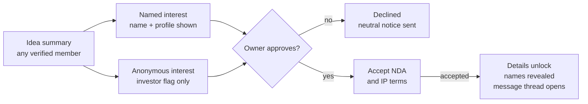

# Kingdom Connect: Product Requirements Document

| Item | Detail |
|---|---|
| Product | Kingdom Connect (People • Opportunities • Growth) |
| PRD version | 0.2 (draft), 15 October 2026 |
| Supersedes | PRD v0.1, 14 October 2026 ([sources/Kingdom-Connect-PRD-v0.1.pdf](../sources/Kingdom-Connect-PRD-v0.1.pdf)) |
| Based on | Project Plan v1.1, 14 October 2026 (FR-01 to FR-49, UC-01 to UC-43), frozen as the approved church document |
| Audience | Champion and the collaborator (product and build), Technical Committee |
| Status | Draft. Being driven to v1.0 by the [wayfinder map](https://github.com/clainkavit/kingdom-connect/issues/1) |

## 1. Document info and purpose

This PRD turns the Kingdom Connect Project Plan v1.1 into buildable requirements: what each screen does, who can use it, and how we know it works.

**How to read it.** Each feature section has user stories ("As a … I want … so that …") and acceptance criteria (AC). Each story cites the Plan's FR or UC numbers so the two documents stay traceable.

**Markers.**
- **Proposed**: a default the PRD sets that the Plan does not. Under review in [Confirm or change the PRD's Proposed defaults](https://github.com/clainkavit/kingdom-connect/issues/4).
- **Changed 15 Oct**: a decision made after v0.1. Where it overrides the Plan, the Plan is not edited; this PRD wins. See Appendix A.
- **Open**: a question with a ticket on the map. The ticket is linked where it applies.

Terms follow the glossary in [context/CONTEXT.md](../context/CONTEXT.md).

## 2. Product overview and goals

Kingdom Connect is a verified, members-only platform where the Mkuyuni Community finds people, opportunities and ideas to grow together, on web and mobile.

**Problem.** Members meet at church but have no way to find each other's skills, businesses, ideas or opportunities during the week. Opportunities get missed, and unverified channels expose members to job and investment scams.

**Product goals**
1. Every member can find verified professionals and businesses by skill, sector and location.
2. Members can find and apply for safe, verified opportunities, with scam posts removed fast.
3. Innovators can share ideas and meet investors or partners without losing control of their IP.
4. Investors can find ideas discreetly, without being publicly listed or pitched.
5. Members can grow through training, events, tenders and community news.

**Non-goals (Phase 1)**
- Moving money: no payments, course fees, escrow or investment transactions.
- Mentorship matching.
- Members resident outside Tanzania.
- Public, non-member access to any content beyond the landing and sign-up pages.

## 3. Users, roles and permissions

Roles stack: a member gains rights by passing further verification, and the investor flag is a private permission added on top of a member account.

| Role | How someone gets it | Visible to other members as |
|---|---|---|
| Applicant | Submits registration | Not visible |
| Verified Member (Level 1) | NIDA + manual review approved. **Open:** what the review checks, see [What does an admin check to approve a member?](https://github.com/clainkavit/kingdom-connect/issues/3) | Member, with profession |
| Verified Business (Level 2) | BRELA, TRA TIN, business licence approved | Member + business listing |
| Opportunity Poster (Level 3) | Director/authorisation proof + physical address approved | Member + business listing |
| Investor (private flag) | Invitation by an Administrator or Super Administrator, or approved application from a Level 2 member | Same as their base role; never labelled investor |
| Administrator | Assigned by Super Administrator | Staff badge |
| Super Administrator | Assigned at setup | Staff badge |

**Permission matrix** (✓ allowed, ✗ not allowed)

| Action | Member L1 | Business L2 | Poster L3 | Investor flag | Admin |
|---|---|---|---|---|---|
| Browse directories, profiles, opportunities, ideas | ✓ | ✓ | ✓ | ✓ | ✓ |
| Connect and message | ✓ | ✓ | ✓ | ✓ | ✗ |
| Apply for opportunities, register for training and events | ✓ | ✓ | ✓ | ✓ | ✗ |
| Submit ideas, express named interest | ✓ | ✓ | ✓ | ✓ | ✗ |
| List a business in the directory | ✗ | ✓ | ✓ | ✗ | ✗ |
| Post opportunities, including tenders | ✗ | ✗ | ✓ | ✗ | ✓ (changed 15 Oct) |
| Post training and courses | ✓ (admin approval) | ✓ | ✓ | ✗ | ✓ |
| Apply for investor flag | ✗ | ✓ | ✓ | ✗ | ✗ |
| Anonymous interest, silent browsing, investor filters, saved list | ✗ | ✗ | ✗ | ✓ | ✗ |
| Approve members, businesses, investors; moderate; take down | ✗ | ✗ | ✗ | ✗ | ✓ |
| See investor list and audit logs | ✗ | ✗ | ✗ | ✗ | ✓ |
| Manage admin accounts and settings | ✗ | ✗ | ✗ | ✗ | Super Admin only |

A professional who is also a student is one Level 1 member with study information on their profile (FR-09).

**Changed 15 Oct: Administrators post opportunities and tenders.** This restores use case UC16 from the original use case diagram and overrides Plan FR-15 (Level 3 posters only). Admin posts publish directly with no probation review and do not carry the no-fee declaration.

## 4. Scope and release plan

Phase 1 ships in two releases inside the 12-month plan: Release 1 builds trust and connection, and Release 2 adds everything that depends on that trust. Months count from the start of the plan; no calendar dates are fixed.

| Area | Release 1 (Core, months 5–7) | Release 2 (Extended, months 7–9) |
|---|---|---|
| Accounts | Registration, NIDA verification, MFA login, approval workflow | Annual business re-verification |
| Dashboards | Member and Admin dashboards (core widgets) | Widgets for opportunities, ideas, featured items, news |
| Profiles and directories | Professional and business profiles, study info, search, privacy masking | Business levels 2 and 3 |
| Connections | Requests, accept/decline, secure messaging | ✗ |
| Safety | Report a scam/bad user, admin review, suspension | Fast takedown of opportunities, probation queue |
| Opportunities | ✗ | Posting (including tenders), applications, featured, Scan for Opportunities |
| Ideas and investors | ✗ | Ideas pool, profile Ideas tab, NDA flow, investor flag and tools |
| Learning and community | ✗ | Training and courses, events, news |
| Agreed to proceed | ✗ | A two-sided record that two members agreed to continue off the platform (Ideas and Opportunities). Replaces agreement forms, e-signing and legal support (decided 20 Oct, [#6](https://github.com/clainkavit/kingdom-connect/issues/6)) |

**Platforms:** responsive web portal plus Android and iOS apps with the same features.

**Geography:** Tanzania only. Registration requires a valid NIDA number.

**Out of scope:** payments of any kind, investment transaction processing, e-commerce, social media integrations, mentorship, members outside Tanzania.

## 5. Information architecture and navigation

Members and administrators get different sidebars; a member never sees admin items, and an investor's sidebar looks the same as any member's.

**Member sidebar:** Dashboard · Professionals · Businesses · Opportunities (Jobs, Partnerships, Investment, Tenders) · Ideas · Training & Courses · Events · Messages · Connections · Reports & Safety · Settings. Persistent "Report a Scam / Bad User" card at the foot.

**Investor additions (inside Ideas only):** investor filters, Saved ideas, anonymous "Express interest" option. No separate menu item.

**Admin sidebar:** Admin Dashboard · Verification Queue (members, businesses, investors) · Moderation Queue (opportunities, ideas, training, events, tenders) · Reports · Re-verification · Members · Investors · News · Featured · Audit Log · Settings.

**On phones** the sidebar becomes a bottom tab bar (Proposed): Home, People, Opportunities, Messages, More for members; Home, Verify, Moderate, Reports, More for admins.

**Visual direction.** The team's mockup ([context/design/dashboard-mockup.jpg](../context/design/dashboard-mockup.jpg)) sets the look. The clickable prototype ([context/design/dashboard-prototype.html](../context/design/dashboard-prototype.html)) applies this PRD to it. Where the mockup conflicts with this PRD, the PRD wins.

**Key screens**

| # | Screen | Used by |
|---|---|---|
| 1 | Landing, sign-up, login, OTP | Everyone |
| 2 | Registration wizard (personal, category, category details, credentials, review) | Applicant |
| 3 | Registration status | Applicant |
| 4 | Member dashboard | Members |
| 5 | Directory list + filters (Professionals, Businesses) | Members |
| 6 | Member profile (About, Skills, Business, Ideas tab) | Members |
| 7 | Connections and requests | Members |
| 8 | Messages (inbox, thread) | Connected members |
| 9 | Opportunities list, detail, apply, post form | Members, posters, admins |
| 10 | Ideas pool, idea summary, idea detail, submit form, access manager | Members, owners, investors |
| 11 | Training list, detail, post form, learning materials | Members |
| 12 | Events list, detail, registration | Members |
| 13 | Business verification and upgrade (Level 2, Level 3, investor application) | Members |
| 14 | Report form, my reports | Members |
| 15 | Admin dashboard and each queue | Admins |
| 16 | Settings (profile privacy, notifications, password, MFA) | All |

The full screen list with states is being built in [Screen list with states](https://github.com/clainkavit/kingdom-connect/issues/13).

## 6. Registration, login and verification

No one reaches member content until an administrator has verified their NIDA identity, and business rights unlock one level at a time.

**Stories**
- **REG-1** As a church member in Tanzania, I want to register on web or mobile so that I can join the platform. (FR-01, UC-01–06)
- **REG-2** As an applicant, I want to see my registration status so that I know when I can log in. (FR-04, FR-05)
- **REG-3** As an admin, I want to review pending profiles and approve or reject them so that only real members get in. (FR-03, UC-07–08)
- **REG-4** As a member, I want to log in with password and OTP so that my account is protected. (FR-02, UC-09–10)
- **REG-5** As a business owner, I want to upgrade to Verified Business, then Opportunity Poster, so that I can list my business and post opportunities. (FR-32, UC-28–29)

**Acceptance criteria**
1. The wizard collects full name, username, address, NIDA number, email, phone, occupation category (Professional, Businessperson, Entrepreneur, Other) and optional study info.
2. Category-specific fields appear based on the category (for example, CPA number for auditors; CISSP, CISM, CEH for cybersecurity).
3. NIDA number must be 20 digits and unique across accounts; a duplicate blocks submission and alerts admins (duplicate-profile detection). In Phase 1 an admin checks NIDA details manually; integration with NIDA's verification service may follow if problems arise.
4. On submit, status = Pending and the applicant receives an email and SMS confirmation.
5. Admin sees each pending applicant with documents side by side and must give a reason when rejecting; the reason is sent to the applicant.
6. Status values: Pending → Approved or Rejected. A rejected applicant can correct and resubmit once (Proposed).
7. Login requires username/password, then a 6-digit OTP sent by email during the pilot (SMS OTP considered later, depending on cost), valid 5 minutes, 3 attempts (Proposed values). **Open:** whether the chosen auth service supports this natively, see [Can Supabase Auth do username login plus an email OTP second step?](https://github.com/clainkavit/kingdom-connect/issues/8)
8. Five failed password attempts lock the account for 15 minutes (Proposed).

**Open:** what the admin's manual review actually checks, and whether it confirms church membership as well as identity. See [What does an admin check to approve a member?](https://github.com/clainkavit/kingdom-connect/issues/3)

**Business verification levels**

| Level | Unlocks | Documents the member uploads | Admin checks |
|---|---|---|---|
| 2. Verified Business | Business directory listing; may apply for investor flag | BRELA certificate, TRA TIN certificate, valid business licence | Documents match the business name; licence not expired |
| 3. Opportunity Poster | Post opportunities, including tenders | Proof of directorship (BRELA records) or authorisation letter; physical address | Person is director or authorised; address confirmed |

9. A member can only request Level 3 after Level 2 is approved.
10. Each level shows its own status (Not started, Pending, Approved, Rejected, Expired) on the member's verification screen.
11. Licence expiry date is captured at Level 2 approval and drives annual re-verification (section 13).

## 7. Dashboards

The member dashboard shows community activity and the member's own to-dos; every approval, rejection and moderation figure lives only on the admin dashboard. (FR-30, FR-31)

| Widget | Member dashboard | Admin dashboard |
|---|---|---|
| Welcome, date, location | ✓ | ✓ |
| Community stats: verified members, registered businesses, open opportunities, ideas in pool | ✓ | ✓ |
| People you may know: members whose skills or location match yours, with a Connect button (changed 15 Oct) | ✓ | ✗ |
| My connection requests (accept/decline inline) | ✓ | ✗ |
| My activity: applications, idea requests, registrations | ✓ | ✗ |
| Featured opportunities | ✓ | ✓ (with slot count and remove, Proposed) |
| Latest opportunities & more (tabs: All, Jobs, Training, Tenders, Investments, Ideas) | ✓ | ✗ |
| Member quick actions: Post opportunity (Level 3 only), Share an idea, Scan for opportunities, Post training | ✓ | ✗ |
| Admin quick actions: Post opportunity, Post tender, Post news, Feature an opportunity (Proposed) | ✗ | ✓ |
| Latest news & updates | ✓ | ✓ |
| Pending verifications (members, Level 2, Level 3, investors) | ✗ | ✓ |
| Rejected/denied members | ✗ | ✓ |
| Open reports and items hidden pending review | ✗ | ✓ |
| Moderation queue counts (opportunities, ideas, training, events, tenders) | ✗ | ✓ |
| Re-verifications due in 30 days | ✗ | ✓ |
| Investor count and activity | ✗ | ✓ |

**Acceptance criteria**
1. The member dashboard API never returns pending, rejected or investor counts, so they cannot appear even through a client bug.
2. Quick actions a member is not entitled to are hidden, with a short path to upgrade (for example, "Verify your business to post opportunities").
3. Each admin count links straight to its filtered queue.
4. Stats refresh at least every 15 minutes (Proposed).
5. People you may know excludes members already connected, with a pending request, blocked, or hidden from the directory, and is rule-based like Scan for Opportunities (Proposed). The matching rules are open: see [Matching rules for Scan for Opportunities and People you may know](https://github.com/clainkavit/kingdom-connect/issues/7).

## 8. Profiles and directories

Profiles show what people do and offer, never how to reach them; contact happens only through a connection. (FR-06–12, FR-25, UC-11–13)

**Stories**
- **PRO-1** As a member, I want to build a profile with my profession, skills and experience so that others can find me.
- **PRO-2** As a member who is studying, I want to add my institution, course and year so that I can be found as a student without a separate account.
- **PRO-3** As a member, I want to search and filter Professionals and Businesses so that I can find the right person or company.
- **PRO-4** As a member, I want to see someone's ideas on their profile so that I know what they are working on.

**Profile fields**

| Section | Fields | Shown to members |
|---|---|---|
| Basics | Photo, name, headline, city/region, bio | ✓ |
| Professional | Profession, skills (tags), experience, certifications, credentials | ✓ |
| Study (optional) | Institution, course, year | ✓ |
| Business (Level 2+) | Business name, sector, size, description, logo, verified badge | ✓ |
| Ideas tab | Published idea summaries | ✓ (per idea settings) |
| Contact | Phone, email, physical address | ✗ (masked; member may choose to share with connections) |
| Identity | NIDA number, documents | ✗ (admins only) |
| Investor flag | n/a | ✗ (admins only) |

**Acceptance criteria**
1. Directory cards show photo, name, headline, location, top 3 skills, verified badge and a Connect button; no contact details.
2. Filters: profession, skills, sector, region/city, currently studying (yes/no), verification level for businesses.
3. Search matches name, profession, skills and business name, and returns results in under 2 seconds for 10,000 members.
4. Location is chosen from Tanzanian regions and districts only.
5. Contact fields are never sent to another member's device; they are revealed only inside an accepted connection, and only if the owner chooses to share them. Sharing is optional and set by each member in privacy settings.
6. A member can hide their profile from the directory without leaving the platform (Proposed).

## 9. Connections and messaging

Two members can message only after one accepts the other's connection request. (FR-13–14, UC-14–16)

**Stories**
- **CON-1** As a member, I want to send a connection request with a short note so that the other person knows why I'm reaching out.
- **CON-2** As a member, I want to accept or decline requests so that I control who can message me.
- **CON-3** As a connected member, I want to message securely so that I don't need to share my phone number.

**Acceptance criteria**
1. Request states: Sent → Accepted, Declined or Withdrawn. Declining does not notify the sender (Proposed: the request simply stays pending for them for 30 days, then expires).
2. The request note is optional, up to 300 characters.
3. A member can send at most 30 requests a day to slow spam (Proposed).
4. Messages support text and attachments (PDF, images, up to 10 MB). Messages are encrypted in transit and at rest.
5. Either side can remove a connection or block a member; blocking stops messages and hides each from the other's searches.
6. Every message thread has a "Report" action that sends the thread to admins (section 13).
7. Idea-related conversations (section 11) open as message threads too, labelled with the idea title.

## 10. Opportunity marketplace

Level 3 businesses and Administrators post opportunities, including tenders. Every Level 3 post carries a no-fee declaration, and new Level 3 posters go through admin review first. (FR-15, FR-33–39, FR-47, UC-30–31, UC-40, UC-42–43)

**Stories**
- **OPP-1** As an Opportunity Poster, I want to post a job, partnership, collaboration, investment opportunity or tender so that I can reach verified members.
- **OPP-2** As a member, I want to browse, filter and apply through the platform so that my details stay private until I choose to apply.
- **OPP-3** As a poster, I want to see and respond to applications in one place.
- **OPP-4** As a member, I want to "Scan for Opportunities" so that I see ones that match my skills and location.
- **OPP-5** As an admin, I want to feature selected opportunities on the dashboard.
- **OPP-6** As an admin, I want to post opportunities and tenders on behalf of the community so that members see them without waiting for a business to post (changed 15 Oct).

**Posting form: required fields**

| Field | Rule |
|---|---|
| Type | Job, Training/Internship, Partnership, Collaboration, Investment, Tender (Tender added 15 Oct) |
| Title and role | Required |
| Employment type | Full-time, Part-time, Contract, Internship (jobs only) |
| Location | Tanzanian region/district, or Remote |
| Description and requirements | Required, minimum 100 characters |
| Contact channel | Always via the platform; phone numbers, emails and links in the description are blocked or flagged (Proposed) |
| Closing date | Required, maximum 90 days ahead |
| No-fee declaration | Required tick for Level 3 posters: "No fee will be charged to applicants at any stage". Not shown for admin posts (changed 15 Oct) |

**Tender type (changed 15 Oct).** A tender is an Opportunity type, not a separate module. Draft tender fields carried from v0.1: issuing business, scope, closing date, eligibility. Members express interest in a tender rather than apply. **Open:** the exact fields and actions per type, and whether Training/Internship belongs here or in Training & Courses. See [Tenders as an Opportunity type: how do they differ?](https://github.com/clainkavit/kingdom-connect/issues/5)

**Acceptance criteria**
1. A new Level 3 poster's first 3 opportunities go to the moderation queue (status Pending review); after 3 approvals with no upheld reports, later posts publish directly. Admin posts always publish directly (changed 15 Oct).
2. Opportunity states: Draft → Pending review → Published → Closed or Expired; also Hidden (reported) and Removed (admin).
3. Apply sends the member's profile and an optional CV (PDF, max 5 MB) and cover note. The poster sees applications as New, Shortlisted, Declined; the applicant sees the same status.
4. A member can apply to an opportunity once.
5. Featured opportunities: an admin picks up to 5 published posts; they show with a Featured badge until the admin removes them or the post closes.
6. Scan for Opportunities ranks open posts by matching skills, profession, location and study info. Phase 1 uses rules, not AI. **Open:** the rules, see [Matching rules for Scan for Opportunities and People you may know](https://github.com/clainkavit/kingdom-connect/issues/7).
7. Filters: type, location, sector, employment type, posted date.

## 11. Ideas pool and investor access

Every verified member sees idea summaries; full details unlock only when the owner approves and the requester accepts the NDA, and investors stay anonymous until that moment. (FR-16–24, FR-40–44, UC-17–23, UC-35–36)

Both routes meet at the owner's decision; an anonymous investor's name is revealed only once the NDA is accepted.

**Stories**
- **IDEA-1** As a member, I want to submit an idea with a summary and choose its visibility so that I can find investors or partners.
- **IDEA-2** As a member, I want to browse ideas in the Ideas section and on profiles so that I can find ones to back or join.
- **IDEA-3** As any member, including a business owner, I want to say "I'm interested" as investor, partner or both so that I can invest without needing the investor flag.
- **IDEA-4** As a flagged investor, I want to filter, save and express interest anonymously so that I am not publicly pitched.
- **IDEA-5** As an idea owner, I want to approve, decline and revoke access so that I control who sees my details.
- **IDEA-6** As a Verified Business, I want to apply for the investor flag.

**Idea fields**

| Layer | Fields |
|---|---|
| Summary (all members) | Title, problem being solved, industry, stage (Idea, Prototype, Early revenue, Growing), seeking (Investor, Partner, Both), optional investment range in TZS, owner name and profile link unless hidden, interest count |
| Details (approved only) | Full description, business model, market, financials, team, attachments (PDF, images; max 20 MB total) |

**Acceptance criteria**
1. Idea states: Draft → Pending moderation → Published (named or without name) → Archived; also Hidden (reported) and Removed.
2. A published idea appears in the pool and on the owner's profile Ideas tab. An idea posted without name appears in the pool only, as "A verified member".
3. Named interest shows the requester's name, profile and chosen role (Investor, Partner, Both) to the owner.
4. Anonymous interest (investor flag only) shows the owner: "A verified investor", sector focus and ticket size band: under TZS 10M, TZS 10–50M, or over TZS 50M. Name and profile stay hidden.
5. The owner approves or declines within the request card; declining sends a neutral notice.
6. After approval, the requester must accept the NDA and IP terms before details open. Acceptance timestamp, IP and version of the terms are stored. **Open:** who drafts the terms, see [Who writes the NDA, IP terms and data-consent text?](https://github.com/clainkavit/kingdom-connect/issues/11)
7. On NDA acceptance, both identities are shown to each other and a message thread opens, labelled with the idea title.
8. Detail pages and documents are watermarked with the viewer's name and date. Every view and download is logged.
9. The owner's access manager lists everyone with access and a Revoke button; revoking removes access at once and logs it.
10. Investor silent browsing: the owner sees "Viewed by N investors", never names.
11. Investor filters: sector, stage, investment range, region; a private Saved list.
12. The investor flag is granted only by Administrator or Super Administrator invitation or by approving a Level 2 member's application. There is no investor directory, badge or member-facing count.
13. After an approved connection, the two members can record that they agreed to proceed. See "Agreed to proceed" below. The agreement form, e-signing and legal support (UC-24–26) are not in Phase 1.

**Agreed to proceed** (changed 20 Oct; replaces UC-24 to UC-27, ticket [#6](https://github.com/clainkavit/kingdom-connect/issues/6)). It applies to an accepted Idea connection and to a connection that comes from an Opportunity (Partnership, Collaboration or Investment). It ships in Release 2.

1. Either member marks "We agreed to proceed" and may add a short note. The other member must confirm.
2. Each side must accept a hand-off disclaimer: from here the parties continue outside Kingdom Connect, and the platform is not responsible for what follows. The record is valid only when both sides have accepted. The accepted version and timestamp are stored for each side, as with the NDA. The wording is written in [Who writes the NDA, IP terms and data-consent text?](https://github.com/clainkavit/kingdom-connect/issues/11).
3. While Pending, the member who started it may withdraw. It stays Pending for 14 days, with one reminder on day 7, then lapses. Either member can restart it. A lapsed request counts as "not recorded" in analytics. Messaging stays open throughout.
4. Once both have accepted, either member may withdraw within 1 hour and the other is notified. After that hour the record is final.
5. The record shows on both members' profiles and to Administrators. Administrators see names, the idea or opportunity, date, note and status only, never contact details or the investor flag. An Administrator can annotate a record but not delete it. A withdrawn record stays visible as Withdrawn.
6. The record also gives the platform the count of people it has linked, for analytics.
7. Not in Phase 1: an agreement form, e-signing, uploaded contracts and a legal-professional directory. A lawyer directory is a possible Phase 2 idea now that the platform is open to anyone in Tanzania.

## 12. Training, events and news

These modules are free to join in Phase 1, and anything members post passes moderation before it goes live. (FR-45–46, FR-48, UC-37–39, UC-41) Tenders moved to section 10 on 15 Oct.

| Module | Who posts | What members do | Key rules |
|---|---|---|---|
| Training & Courses | Any verified member, and admins; every member post needs admin approval | Browse, register, open learning materials (PDF, video links, slides) | Title, provider, format (in person, online), date or self-paced, seats; free only; materials visible after registration |
| Events | Admins and Level 2+ businesses | Browse, register, add to calendar, get reminders | Title, date, time, venue or link, capacity; reminders 1 day and 1 hour before |
| News & Updates | Admins only | Read on the dashboard and News page | Title, image, body, publish date; optional pin to top |

**Acceptance criteria**
1. Training and events follow the same states as opportunities: Draft → Pending review → Published → Closed; plus Hidden and Removed.
2. Registration stops at capacity and offers a waitlist (Proposed).
3. A registered member sees their trainings and events under "My activity" on the dashboard.
4. The poster sees a registrant list (names and profiles only, no contact details).
5. Learning materials open inside the platform; downloads are allowed only if the poster enables them.

## 13. Reports, safety and administration

A reported opportunity disappears from members' view the moment it is reported; admins then restore it or act on it, and every admin action is logged. (FR-26–29, FR-35–36, FR-49, UC-32–34)

**Stories**
- **SAFE-1** As a member, I want to report a scam or bad user from any profile, opportunity, idea or message thread.
- **SAFE-2** As an admin, I want one queue of reports, pending posts and re-verifications so that nothing is missed.
- **SAFE-3** As an admin, I want to suspend repeat offenders.
- **SAFE-4** As a Super Admin, I want an audit log of every admin and sensitive action.

**Acceptance criteria**
1. The report form asks for a reason (Asked for money, Fake job or business, Harassment, Impersonation, Spam, Other) and an optional note and screenshot.
2. Reporting an opportunity (any type, including tenders) sets it to Hidden immediately. Profiles and ideas stay visible until an admin reviews them.
3. The reporter gets a reference number and the final outcome (Action taken / No action), not the details.
4. Admin actions: Restore, Edit request to poster, Remove, Warn, Suspend posting rights, Suspend account. Each requires a note.
5. Two upheld reports against a business within 12 months suspend its posting rights; three suspend the account pending review.
6. Re-verification: 30 and 7 days before a business licence expires, the member is reminded. On expiry, Level 2 and 3 rights pause until new documents are approved.
7. Audit log records who, what, when, and before/after values for approvals, rejections, moderation, role changes, investor flag changes, admin-posted opportunities, and every view of idea details. Logs are read-only and kept at least 5 years (Proposed).
8. Admins cannot see message contents unless a thread has been reported.

## 14. Notifications

Every event below shows in the in-app bell; during the pilot, OTPs and account messages go by email, SMS is added later if the budget allows, and members can turn off email for non-critical ones. (FR-05)

| Event | Who is told | In-app | Email | SMS |
|---|---|---|---|---|
| Registration received, approved or rejected | Applicant | ✓ | ✓ | Later |
| Login OTP | Member | ✗ | ✓ | Later |
| Business level approved, rejected or expiring | Business member | ✓ | ✓ | Later |
| Connection request received or accepted | Member | ✓ | ✓ | ✗ |
| New message | Member | ✓ | Digest | ✗ |
| Application received / status changed | Poster / applicant | ✓ | ✓ | ✗ |
| Post approved, rejected, hidden or removed | Poster | ✓ | ✓ | ✗ |
| Interest in my idea (named or anonymous) | Idea owner | ✓ | ✓ | ✗ |
| Access approved, NDA accepted, access revoked | Owner and requester | ✓ | ✓ | ✗ |
| Agreed to proceed: requested, reminder, confirmed, lapsed or withdrawn | The other member (both, on withdrawal) | ✓ | ✓ | ✗ |
| Matches from Scan for Opportunities | Member | ✓ | Weekly digest | ✗ |
| Training or event reminder | Registrant | ✓ | ✓ | ✗ |
| Report outcome | Reporter | ✓ | ✗ | ✗ |
| Investor flag granted | Investor | ✓ | ✓ | ✗ |

Notification text never names an anonymous investor and never includes contact details. The wording is written in [Notification copy in English and Kiswahili](https://github.com/clainkavit/kingdom-connect/issues/14).

## 15. Non-functional requirements

The figures below are proposed starting targets for the Technical Committee to confirm.

| Area | Requirement |
|---|---|
| Security | MFA on every login; passwords hashed (bcrypt/Argon2), minimum 8 characters with a number; TLS 1.2+ in transit; AES-256 at rest for documents and messages; role-based access enforced on the server, not just hidden in the UI |
| Privacy and law | Comply with Tanzania's Personal Data Protection Act 2022: consent captured at registration, members can download or delete their data, hosted with a cloud provider in a region that meets the Act's rules on storing personal data |
| Hosting (changed 15 Oct) | Development runs on managed Supabase with test data only; no real member data goes in until the hosting decision. The production provider and region (managed Supabase outside Africa, or self-hosted in Tanzania) are decided before the pilot, with a legal check against the Act |
| Document storage | Identity and business documents in a separate encrypted store, visible to admins only, never in public URLs |
| Performance | Pages and searches load in under 2 seconds on 3G for 95% of requests; app usable on Android 9+ and iOS 15+ |
| Scale | Built for 2,000 members in year 1 and 20,000 without redesign |
| Availability | 99.5% monthly uptime; daily backups kept 30 days; restore tested quarterly |
| Languages | English and Kiswahili for all member-facing screens |
| Accessibility | WCAG 2.1 AA contrast and text sizes; works with screen readers on mobile |
| Data usage | Images compressed; a low-data mode that hides images on mobile |
| Monitoring | Security logging, alerts on repeated failed logins, unusual message volume, or duplicate NIDA attempts |

The stack itself is decided in [Lock the tech stack](https://github.com/clainkavit/kingdom-connect/issues/10).

## 16. Key data entities and statuses

These are the main records the system stores and the states each can be in. The physical schema is designed in [Database schema and access rules](https://github.com/clainkavit/kingdom-connect/issues/12).

**Access rules (decided 17 Oct).** The server decides what each request may read or write; the UI only hides what a user doesn't need to see, and is never relied on for privacy. Restricted data never leaves the server for a user who isn't allowed it:

| Data | Who the server returns it to |
|---|---|
| Investor flag | Admins only. No member-facing query returns it, directly or as a count |
| Contact details (phone, email, address) | The owner; a connected member only if the connection is accepted and the owner shares contact details |
| NIDA number and identity or business documents | The owner and admins. Documents sit in a separate admin-only store, never at public URLs |
| Message contents | The two members in the thread. Admins only once the thread is reported |

If the stack stays on Supabase/Postgres, these rules are enforced in the database with Row-Level Security policies and restricted views, so a faulty API endpoint can't leak them. The stack is decided in [Lock the tech stack](https://github.com/clainkavit/kingdom-connect/issues/10).

| Entity | Key fields | Statuses |
|---|---|---|
| Member | Name, username, NIDA (encrypted), phone, email, region, category, verification level, investor flag (private) | Pending, Approved, Rejected, Suspended, Deactivated |
| Profile | Headline, bio, skills, experience, certifications, study info, privacy settings | n/a |
| Business | Name, sector, BRELA no., TIN, licence no. and expiry, address, level | Pending, Approved, Rejected, Expired |
| Verification request | Member, level requested, documents, reviewer, reason | Pending, Approved, Rejected |
| Connection | Requester, receiver, note | Sent, Accepted, Declined, Withdrawn, Expired |
| Message thread / message | Members, idea link (optional), body, attachments | Active, Reported, Closed |
| Opportunity | Poster (Level 3 member or admin), type (including Tender), title, location, closing date, no-fee flag, featured flag | Draft, Pending review, Published, Closed, Expired, Hidden, Removed |
| Application | Opportunity, applicant, CV, note | New, Shortlisted, Declined, Withdrawn |
| Idea | Owner, summary fields, details, attachments, visibility | Draft, Pending moderation, Published, Archived, Hidden, Removed |
| Idea access request | Idea, requester, role, anonymous flag, NDA version, accepted at | Pending, Approved, Declined, NDA accepted, Revoked |
| Agreement record | The two members, idea or opportunity, note, disclaimer version, accepted at (each side), admin annotations | Pending, Agreed, Lapsed, Withdrawn |
| Training / Event | Poster, title, dates, capacity, materials | Draft, Pending review, Published, Closed, Hidden, Removed |
| Registration | Member, training or event | Registered, Waitlisted, Cancelled, Attended |
| News item | Title, body, image, pinned | Draft, Published |
| Report | Reporter, target, reason, note | Open, Under review, Action taken, No action |
| Audit log entry | Actor, action, target, before/after, time, IP | Append only |

Changed 15 Oct: Tender moved from the Training / Event / Tender record into Opportunity. How a member's interest in a tender is stored (as an Application or its own record) is open in ticket [Tenders as an Opportunity type](https://github.com/clainkavit/kingdom-connect/issues/5).

## 17. Success metrics

Year 1 targets come from the Project Plan v1.1; the product measures below show whether the features are working day to day.

| Metric | Target | Source |
|---|---|---|
| Registered members | 2,000+ | Plan |
| Verified professionals | 1,000+ | Plan |
| Registered businesses | 300+ | Plan |
| Investors (internal only) | 50+ | Plan |
| Jobs published | 200+ | Plan |
| Partnerships formed | 100+ | Plan |
| Platform adoption rate | 70%+ | Plan |
| Median time from registration to approval | Under 3 working days | Proposed |
| Reported opportunities reviewed | Within 24 hours | Proposed |
| Upheld scam reports per 100 opportunities | Under 1 | Proposed |
| Ideas with at least one approved access request | To be agreed | n/a |
| Monthly active members | To be agreed | n/a |

## 18. Decisions and open questions

**Decided on 14 October 2026**
- NIDA: manual admin review in Phase 1; integrate with NIDA's verification service later if problems arise.
- Training: any verified member can post; every post needs admin approval.
- Contact sharing: optional; each member chooses whether connections can see their phone or email.
- OTP: by email during the pilot; SMS considered later, depending on cost.
- Investor invitations: Administrators and Super Administrators.
- Probation: a new poster's first 3 posts are reviewed; 2 upheld reports in 12 months suspend posting, 3 suspend the account.
- Investor ticket bands: under TZS 10M, TZS 10–50M, over TZS 50M.
- Hosting: cloud hosting.

**Decided on 15 October 2026**
- Administrators can post opportunities and tenders. Admin posts publish directly (no probation) and do not carry the no-fee declaration. Overrides Plan FR-15.
- A tender is a kind of Opportunity, not a separate module.
- The member dashboard gets a "People you may know" widget.
- No "No fee" label on opportunity cards; the no-fee declaration stays at posting time only.
- Development uses managed Supabase with test data only; the production hosting decision, with a legal check, comes before the pilot.
- This markdown file is the living PRD; the Plan v1.1 stays frozen as the approved church document.

**Decided on 17 October 2026**
- Access rules are enforced on the server, not in the UI: the investor flag, contact details, identity documents and message contents never reach a user who isn't allowed them (section 16). On Supabase/Postgres this means Row-Level Security in the database. The schema itself is still open in [Database schema and access rules](https://github.com/clainkavit/kingdom-connect/issues/12).

**Decided on 20 October 2026**
- Agreements and e-signing (UC-24 to UC-27) are replaced in Phase 1 by an "Agreed to proceed" record that both members accept, with a hand-off disclaimer. It applies to Ideas and Opportunities and ships in Release 2 (section 11).
- Legal support (UC-26) is out of Phase 1. A lawyer directory is a possible Phase 2 idea.

**Open.** Every open question is a ticket on the [wayfinder map](https://github.com/clainkavit/kingdom-connect/issues/1) and is linked where it applies above.

**Outside this spec**
- Cloud provider and region: before the pilot (see Hosting in section 15).
- Admin team size: decided from pilot volumes.

## Appendix A: Changes since v0.1

| Date | Change | Sections |
|---|---|---|
| 15 Oct 2026 | Administrators post opportunities and tenders; no probation and no no-fee tick for admin posts | 3, 7, 10, 13, 16, 18 |
| 15 Oct 2026 | Tender becomes an Opportunity type; removed from section 12 and from the Training / Event / Tender record | 10, 12, 16 |
| 15 Oct 2026 | People you may know widget added to the member dashboard; admin quick actions and featured slot count proposed | 7 |
| 15 Oct 2026 | Development hosting path recorded | 15, 18 |
| 15 Oct 2026 | Phone bottom tab bar proposed; mockup and prototype linked as visual direction | 5 |
| 15 Oct 2026 | Open items linked to wayfinder tickets; Proposed values flagged for review | Throughout |
| 17 Oct 2026 | Server-side access rules for the investor flag, contact details, identity documents and messages | 16, 18 |
| 20 Oct 2026 | UC-24 to UC-27 replaced by a two-sided "Agreed to proceed" record; overrides the Plan's "both routes end with an agreement" (section 13 of the Plan) | 4, 11, 14, 16, 18 |

## Appendix B: Source documents

| File | Status |
|---|---|
| [Project Plan v1.1](../sources/Kingdom_Connect_Project_Plan_v1.1.docx) ([markdown extract](../context/project-plan-v1.1.md)) | Frozen, approved church document. Where it and this PRD disagree, this PRD wins, and the difference is listed in Appendix A |
| [PRD v0.1](../sources/Kingdom-Connect-PRD-v0.1.pdf) ([text extract](../context/prd-v0.1.txt)) | Superseded by this file |
| [Use case diagram](../sources/Church-Connect-Platform-Use-Case-Diagram.pdf) | Outdated, pre-v1.1 (UC01 to UC21, titled "Church Connect") |

**How the diagram's 21 use cases map to the Plan's 43.** Fourteen match a Plan use case directly. The separate Professional and Business dashboards (UC11, UC12) became one Member dashboard; members and admins still have separate dashboards. Admin posting opportunities (UC16) was dropped in the Plan and restored on 15 Oct. Checking registration status (UC02), notifications (UC04), and viewing news and opportunities (UC13, UC14) exist in the Plan as functional requirements (FR-04, FR-05, FR-31, FR-15), not as use cases.
