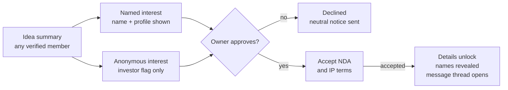

# Kingdom Connect: Product Requirements Document

| Item | Detail |
|---|---|
| Product | Kingdom Connect (People • Opportunities • Growth) |
| PRD version | 0.2 (draft), 15 October 2026 |
| Supersedes | PRD v0.1, 14 October 2026 ([sources/Kingdom-Connect-PRD-v0.1.pdf](../sources/Kingdom-Connect-PRD-v0.1.pdf)) |
| Based on | Project Plan v1.1, 14 October 2026 (FR-01 to FR-49, UC-01 to UC-43), frozen as the approved church document |
| Audience | Champion and the collaborator (product and build), Technical Committee |
| Status | Draft. Being driven to v1.0 by the [wayfinder map](https://github.com/clainkavit/kingdom-connect/issues/1) |

## 1. Document info and purpose

This PRD turns the Kingdom Connect Project Plan v1.1 into buildable requirements: what each screen does, who can use it, and how we know it works.

**How to read it.** Each feature section has user stories ("As a … I want … so that …") and acceptance criteria (AC). Each story cites the Plan's FR or UC numbers so the two documents stay traceable.

**Markers.**
- **Proposed**: a default the PRD sets that the Plan does not. Every Proposed value that existed on 19 Oct was confirmed or changed in [Confirm or change the PRD's Proposed defaults](https://github.com/clainkavit/kingdom-connect/issues/4). The four added on 20 to 22 Oct (ID expiry check, 10 milestones, 10 MB signed document, staff access to the signed document) were confirmed on 22 Oct, so none remain. Section 15 targets are separate and still need the Technical Committee.
- **Changed 15 Oct**: a decision made after v0.1. Where it overrides the Plan, the Plan is not edited; this PRD wins. See Appendix A.
- **Open**: a question with a ticket on the map. The ticket is linked where it applies.

Terms follow the glossary in [context/CONTEXT.md](../context/CONTEXT.md).

## 2. Product overview and goals

Kingdom Connect is a verified, members-only platform where people in Tanzania find people, opportunities and ideas to grow together, on web and mobile. It is open to anyone in Tanzania with a verified identity. The pilot starts with the Mkuyuni Community.

**Problem.** People have no trusted place to find each other's skills, businesses, ideas or opportunities. Opportunities get missed, and unverified channels expose people to job and investment scams.

**Product goals**
1. Every member can find verified professionals and businesses by skill, sector and location.
2. Members can find and apply for safe, verified opportunities, with scam posts removed fast.
3. Innovators can share ideas and meet investors or partners without losing control of their IP.
4. Investors can find ideas discreetly, without being publicly listed or pitched.
5. Members can grow through training, events, tenders and community news.

**Non-goals (Phase 1)**
- Moving money: no payments, course fees, escrow or investment transactions.
- Mentorship matching.
- Members resident outside Tanzania.
- Public, non-member access to any content beyond the landing and sign-up pages.

## 3. Users, roles and permissions

Roles stack: a member gains rights by passing further verification, and the investor flag is a private permission added on top of a member account.

| Role | How someone gets it | Visible to other members as |
|---|---|---|
| Applicant | Submits registration | Not visible |
| Verified Member (Level 1) | Identity checked by an admin with one accepted ID (section 6, Member verification) | Member, with profession |
| Verified Business (Level 2) | BRELA, TRA TIN, business licence approved | Member + business listing |
| Opportunity Poster (Level 3) | Director/authorisation proof + physical address approved | Member + business listing |
| Investor (private flag) | Invitation by an Administrator or Super Administrator, or approved application from a Level 2 member | Same as their base role; never labelled investor |
| Administrator | Assigned by Super Administrator | Staff badge |
| Super Administrator | Assigned at setup | Staff badge |

**Permission matrix** (✓ allowed, ✗ not allowed)

| Action | Member L1 | Business L2 | Poster L3 | Investor flag | Admin |
|---|---|---|---|---|---|
| Browse directories, profiles, opportunities, ideas | ✓ | ✓ | ✓ | ✓ | ✓ |
| Connect and message | ✓ | ✓ | ✓ | ✓ | ✗ |
| Apply for opportunities, register for training and events | ✓ | ✓ | ✓ | ✓ | ✗ |
| Submit ideas, express named interest | ✓ | ✓ | ✓ | ✓ | ✗ |
| List a business in the directory | ✗ | ✓ | ✓ | ✗ | ✗ |
| Post opportunities, including tenders | ✗ | ✗ | ✓ | ✗ | ✓ (changed 15 Oct) |
| Post training and courses | ✓ (admin approval) | ✓ | ✓ | ✗ | ✓ |
| Apply for investor flag | ✗ | ✓ | ✓ | ✗ | ✗ |
| Anonymous interest, silent browsing, investor filters, saved list | ✗ | ✗ | ✗ | ✓ | ✗ |
| Approve members, businesses, investors; moderate; take down | ✗ | ✗ | ✗ | ✗ | ✓ |
| See investor list and audit logs | ✗ | ✗ | ✗ | ✗ | ✓ |
| Manage admin accounts and settings | ✗ | ✗ | ✗ | ✗ | Super Admin only |

A professional who is also a student is one Level 1 member with study information on their profile (FR-09).

**Changed 15 Oct: Administrators post opportunities and tenders.** This restores use case UC16 from the original use case diagram and overrides Plan FR-15 (Level 3 posters only). Admin posts publish directly with no probation review and do not carry the no-fee declaration.

## 4. Scope and release plan

Phase 1 ships in two releases inside the 12-month plan: Release 1 builds trust and connection, and Release 2 adds everything that depends on that trust. Months count from the start of the plan; no calendar dates are fixed.

| Area | Release 1 (Core, months 5–7) | Release 2 (Extended, months 7–9) |
|---|---|---|
| Accounts | Registration, NIDA verification, MFA login, approval workflow | Annual business re-verification |
| Dashboards | Member and Admin dashboards (core widgets) | Widgets for opportunities, ideas, featured items, news |
| Profiles and directories | Professional and business profiles, study info, search, privacy masking | Business levels 2 and 3 |
| Connections | Requests, accept/decline, secure messaging | ✗ |
| Safety | Report a scam/bad user, admin review, suspension | Fast takedown of opportunities, probation queue |
| Opportunities | ✗ | Posting (including tenders), applications and expressions of interest, featured, Scan for Opportunities |
| Ideas and investors | ✗ | Ideas pool, profile Ideas tab, NDA flow, investor flag and tools |
| Learning and community | ✗ | Training and courses, events, news |
| Milestone plans | ✗ | A step-by-step plan two connected members agree on and track on the platform, ending with an upload of their signed agreement. Replaces agreement forms and e-signing (decided 20 Oct, reworked 22 Oct, [#6](https://github.com/clainkavit/kingdom-connect/issues/6)) |

**Platforms (changed 20 Oct):** the pilot launches as a responsive web portal that can be added to a phone's home screen. Android and iOS apps with the same features follow once the web version is stable, built from the same codebase (section 15).

**Geography:** Tanzania only, enforced by a Tanzanian (+255) phone number and a Tanzanian address on registration. There is no nationality rule, so a foreign resident can join (changed 22 Oct).

**Out of scope:** payments of any kind, investment transaction processing, e-commerce, social media integrations, mentorship, members outside Tanzania.

## 5. Information architecture and navigation

Members and administrators get different sidebars; a member never sees admin items, and an investor's sidebar looks the same as any member's.

**Member sidebar:** Dashboard · Professionals · Businesses · Opportunities (Jobs, Partnerships, Investment, Tenders) · Ideas · Training & Courses · Events · Messages · Connections · Reports & Safety · Settings. Persistent "Report a Scam / Bad User" card at the foot.

**Investor additions (inside Ideas only):** investor filters, Saved ideas, anonymous "Express interest" option. No separate menu item.

**Admin sidebar:** Admin Dashboard · Verification Queue (members, businesses, investors) · Moderation Queue (opportunities, ideas, training, events, tenders) · Reports · Re-verification · Members · Investors · News · Featured · Audit Log · Settings.

**On phones** the sidebar becomes a bottom tab bar: Home, People, Opportunities, Messages, More for members; Home, Verify, Moderate, Reports, More for admins.

**Visual direction.** The team's mockup ([context/design/dashboard-mockup.jpg](../context/design/dashboard-mockup.jpg)) sets the look. The clickable prototype ([context/design/dashboard-prototype.html](../context/design/dashboard-prototype.html)) applies this PRD to it. Where the mockup conflicts with this PRD, the PRD wins.

**Key screens**

| # | Screen | Used by |
|---|---|---|
| 1 | Landing, sign-up, login, OTP | Everyone |
| 2 | Registration wizard (personal, category, category details, photos, credentials, review) | Applicant |
| 3 | Registration status | Applicant |
| 4 | Member dashboard | Members |
| 5 | Directory list + filters (Professionals, Businesses) | Members |
| 6 | Member profile (About, Skills, Business, Ideas tab) | Members |
| 7 | Connections and requests | Members |
| 8 | Messages (inbox, thread) | Connected members |
| 9 | Opportunities list, detail, apply, post form | Members, posters, admins |
| 10 | Ideas pool, idea summary, idea detail, submit form, access manager | Members, owners, investors |
| 11 | Training list, detail, post form, learning materials | Members |
| 12 | Events list, detail, registration | Members |
| 13 | Business verification and upgrade (Level 2, Level 3, investor application) | Members |
| 14 | Report form, my reports | Members |
| 15 | Admin dashboard and each queue | Admins |
| 16 | Settings (profile privacy, notifications, password, MFA) | All |

The full screen list with states is being built in [Screen list with states](https://github.com/clainkavit/kingdom-connect/issues/13).

## 6. Registration, login and verification

No one reaches member content until an administrator has verified their identity, and business rights unlock one level at a time.

**Stories**
- **REG-1** As a person in Tanzania, I want to register on web or mobile so that I can join the platform. (FR-01, UC-01–06)
- **REG-2** As an applicant, I want to see my registration status so that I know when I can log in. (FR-04, FR-05)
- **REG-3** As an admin, I want to review pending profiles and approve or reject them so that only real members get in. (FR-03, UC-07–08)
- **REG-4** As a member, I want to log in with password and OTP so that my account is protected. (FR-02, UC-09–10)
- **REG-5** As a business owner, I want to upgrade to Verified Business, then Opportunity Poster, so that I can list my business and post opportunities. (FR-32, UC-28–29)

**Acceptance criteria**
1. The wizard collects full name, username, a Tanzanian address chosen from the region and district lists, email, a Tanzanian phone number (+255), one accepted ID (NIDA, passport, driving licence or voter's ID) with its type and number, occupation category (Professional, Businessperson, Entrepreneur, Other), optional study info, a face photo (required), and a photo of the ID (see Member verification below).
2. Category-specific fields appear based on the category (for example, CPA number for auditors; CISSP, CISM, CEH for cybersecurity).
3. An ID number must be unique for its ID type, and a NIDA number must be 20 digits. A duplicate blocks submission and alerts admins (duplicate-profile detection). Because one person could register twice with two different IDs, admins also compare face photos. In Phase 1 an admin checks the ID manually; a connection to NIDA's verification service for NIDA holders may follow (ticket [#30](https://github.com/clainkavit/kingdom-connect/issues/30)).
4. On submit, status = Pending and the applicant receives an email and SMS confirmation.
5. Admin sees each pending applicant with documents side by side and must give a reason when rejecting; the reason is sent to the applicant.
6. Status values: Pending → Approved or Rejected. A rejected applicant can correct and resubmit once; a second rejection is final unless an admin reopens the application.
7. Login requires username/password, then a 6-digit OTP sent by email during the pilot (SMS OTP considered later, depending on cost), valid 10 minutes, 3 attempts, with a resend allowed after 60 seconds (changed 19 Oct: email can arrive slowly on mobile networks). **Open:** whether the chosen auth service supports this natively, see [Can Supabase Auth do username login plus an email OTP second step?](https://github.com/clainkavit/kingdom-connect/issues/8)
8. Five failed password attempts lock the account for 15 minutes.

**Business verification levels**

| Level | Unlocks | Documents the member uploads | Admin checks |
|---|---|---|---|
| 2. Verified Business | Business directory listing; may apply for investor flag | BRELA certificate, TRA TIN certificate, valid business licence | Documents match the business name; licence not expired |
| 3. Opportunity Poster | Post opportunities, including tenders | Proof of directorship (BRELA records) or authorisation letter; physical address | Person is director or authorised; address confirmed |

9. A member can only request Level 3 after Level 2 is approved.
10. Each level shows its own status (Not started, Pending, Approved, Rejected, Expired) on the member's verification screen.
11. Licence expiry date is captured at Level 2 approval and drives annual re-verification (section 13).

**Member verification (Level 1), decided 19 Oct and changed 22 Oct for the nationwide scope.** An admin approves an applicant only after checking that they are who they say they are. Church membership is no longer checked. Decided in [What does an admin check to approve a member?](https://github.com/clainkavit/kingdom-connect/issues/3)

| Check | Evidence | What the admin confirms |
|---|---|---|
| Identity | Completed profile, a face photo, and a photo of one accepted ID: NIDA, passport, driving licence or voter's ID | Name and ID number on the ID match the form; the face photo matches the ID photo; the ID has not expired |
| Location | A +255 phone number and a Tanzanian address chosen from the region and district lists | Both are present. There is no nationality rule |

12. Each ID number is unique for its ID type. Admins compare face photos to catch one person registering with two different IDs; a suspected duplicate is flagged and the admin decides.
13. The ID photo is stored in the admin-only document store (section 15) and is never shown to members. **Open:** how long the photo is kept after the decision, for the lawyer (see Legal texts in section 13).
14. NIDA's verification service may be connected after the pilot, for NIDA holders, once the company exists and the production hosting is decided (NIDA asks where the server is; ticket [#30](https://github.com/clainkavit/kingdom-connect/issues/30)). Passports, driving licences and voter's IDs stay manual, and Persona is deferred until the company exists.
15. **Sign-up is open from day one (decided 22 Oct, ticket [#30](https://github.com/clainkavit/kingdom-connect/issues/30)),** so review volume is managed in four ways:
    - The sign-up form checks what it can before an admin sees the application: a NIDA number must be 20 digits, the phone must start with +255, the address must come from the region and district lists, a duplicate ID is flagged automatically, and the face photo and ID photo are required.
    - Applications are reviewed oldest first. The admin dashboard shows queue size and the age of the oldest application, with an alert when an application has waited 2 working days. Applicants see "Your application is being reviewed" with the expected time.
    - A daily cap on new applications is a Super Administrator setting, off by default. When it is on, people over the cap see "We're reviewing a high number of applications, please try again tomorrow".
    - The pilot starts with at least 3 staff accounts, including trusted volunteers, not one admin.

## 7. Dashboards

The member dashboard shows community activity and the member's own to-dos; every approval, rejection and moderation figure lives only on the admin dashboard. (FR-30, FR-31)

| Widget | Member dashboard | Admin dashboard |
|---|---|---|
| Welcome, date, location | ✓ | ✓ |
| Community stats: verified members, registered businesses, open opportunities, ideas in pool | ✓ | ✓ |
| People you may know: members who share skills, location, profession, study or connections with you, with a Connect button (changed 15 Oct) | ✓ | ✗ |
| My connection requests (accept/decline inline) | ✓ | ✗ |
| My activity: applications and expressions of interest, idea requests, registrations | ✓ | ✗ |
| Featured opportunities | ✓ | ✓ (with slot count and remove) |
| Latest opportunities & more (tabs: All, Jobs, Training, Tenders, Investments, Ideas) | ✓ | ✗ |
| Member quick actions: Post opportunity (Level 3 only), Share an idea, Scan for opportunities, Post training | ✓ | ✗ |
| Admin quick actions: Post opportunity, Post tender, Post news, Feature an opportunity | ✗ | ✓ |
| Latest news & updates | ✓ | ✓ |
| Pending verifications (members, Level 2, Level 3, investors), with queue size and the age of the oldest application | ✗ | ✓ |
| Rejected/denied members | ✗ | ✓ |
| Open reports and items hidden pending review | ✗ | ✓ |
| Moderation queue counts (opportunities, ideas, training, events, tenders) | ✗ | ✓ |
| Re-verifications due in 30 days | ✗ | ✓ |
| Investor count and activity | ✗ | ✓ |

**Acceptance criteria**
1. The member dashboard API never returns pending, rejected or investor counts, so they cannot appear even through a client bug.
2. Quick actions a member is not entitled to are hidden, with a short path to upgrade (for example, "Verify your business to post opportunities").
3. Each admin count links straight to its filtered queue.
4. Stats refresh at least every 15 minutes.
5. People you may know excludes members already connected, with a pending request, blocked, or hidden from the directory, and is rule-based like Scan for Opportunities. The rules are in "Matching rules" in section 10 (decided 20 Oct).

## 8. Profiles and directories

Profiles show what people do and offer, never how to reach them; contact happens only through a connection. (FR-06–12, FR-25, UC-11–13)

**Stories**
- **PRO-1** As a member, I want to build a profile with my profession, skills and experience so that others can find me.
- **PRO-2** As a member who is studying, I want to add my institution, course and year so that I can be found as a student without a separate account.
- **PRO-3** As a member, I want to search and filter Professionals and Businesses so that I can find the right person or company.
- **PRO-4** As a member, I want to see someone's ideas on their profile so that I know what they are working on.

**Profile fields**

| Section | Fields | Shown to members |
|---|---|---|
| Basics | Photo, name, headline, city/region, bio | ✓ |
| Professional | Profession, skills (tags), experience, certifications, credentials | ✓ |
| Study (optional) | Institution, course, year | ✓ |
| Business (Level 2+) | Business name, sector, size, description, logo, verified badge | ✓ |
| Ideas tab | Published idea summaries | ✓ (per idea settings) |
| Contact | Phone, email, physical address | ✗ (masked; member may choose to share with connections) |
| Identity | NIDA number, documents | ✗ (admins only) |
| Investor flag | n/a | ✗ (admins only) |

**Acceptance criteria**
1. Directory cards show photo, name, headline, location, top 3 skills, verified badge and a Connect button; no contact details.
2. Filters: profession, skills, sector, region/city, currently studying (yes/no), verification level for businesses.
3. Search matches name, profession, skills and business name, and returns results in under 2 seconds for 10,000 members.
4. Location is chosen from Tanzanian regions and districts only.
5. Contact fields are never sent to another member's device; they are revealed only inside an accepted connection, and only if the owner chooses to share them. Sharing is optional and set by each member in privacy settings.
6. A member can hide their profile from the directory without leaving the platform. Existing connections can still see the profile.

## 9. Connections and messaging

Two members can message only after one accepts the other's connection request. (FR-13–14, UC-14–16)

**Stories**
- **CON-1** As a member, I want to send a connection request with a short note so that the other person knows why I'm reaching out.
- **CON-2** As a member, I want to accept or decline requests so that I control who can message me.
- **CON-3** As a connected member, I want to message securely so that I don't need to share my phone number.

**Acceptance criteria**
1. Request states: Sent → Accepted, Declined or Withdrawn. Declining does not notify the sender: the request simply stays pending for them for 30 days, then expires.
2. The request note is optional, up to 300 characters.
3. A member can send at most 30 requests a day to slow spam.
4. Messages support text and attachments (PDF, images, up to 10 MB). Messages are encrypted in transit and at rest.
5. Either side can remove a connection or block a member; blocking stops messages and hides each from the other's searches.
6. Every message thread has a "Report" action that sends the thread to admins (section 13).
7. Idea-related conversations (section 11) open as message threads too, labelled with the idea title.

## 10. Opportunity marketplace

Level 3 businesses and Administrators post opportunities, including tenders. Every Level 3 post carries a no-fee declaration, and new Level 3 posters go through admin review first. (FR-15, FR-33–39, FR-47, UC-30–31, UC-40, UC-42–43)

**Stories**
- **OPP-1** As an Opportunity Poster, I want to post a job, partnership, collaboration, investment opportunity or tender so that I can reach verified members.
- **OPP-2** As a member, I want to browse, filter and apply through the platform so that my details stay private until I choose to apply.
- **OPP-3** As a poster, I want to see and respond to applications and expressions of interest in one place.
- **OPP-4** As a member, I want to "Scan for Opportunities" so that I see ones that match my skills and location.
- **OPP-5** As an admin, I want to feature selected opportunities on the dashboard.
- **OPP-6** As an admin, I want to post opportunities and tenders on behalf of the community so that members see them without waiting for a business to post (changed 15 Oct).

**Posting form: required fields**

| Field | Rule |
|---|---|
| Type | Job, Partnership, Collaboration, Investment, Tender (Tender added 15 Oct). An internship is a Job with employment type Internship; training goes in Training & Courses (section 12). Training/Internship removed 19 Oct |
| Title and role | Required |
| Employment type | Full-time, Part-time, Contract, Internship (jobs only) |
| Location | Tanzanian region/district, or Remote |
| Description and requirements | Required, minimum 100 characters |
| Contact channel | Always via the platform. Phone numbers and emails in the description are blocked at posting, with a short explanation; a post that contains a link goes to admin review (decided 19 Oct) |
| Skills wanted | 1 to 5 tags. Required for Jobs and Collaboration; optional for other types (changed 20 Oct) |
| Sector | Chosen from a fixed list (changed 20 Oct) |
| Closing date | Required, maximum 90 days ahead |
| No-fee declaration | Required tick for Level 3 posters: "No fee will be charged to applicants at any stage". It covers tenders too, so a tender that charges a document fee or bid security cannot be posted in Phase 1 (decided 19 Oct). Not shown for admin posts (changed 15 Oct), but admin posts never ask members for a fee either |

**Types and responses (decided 19 Oct).** Members apply to Jobs and express interest in every other type. Both are stored as a Response. Decided in [Tenders as an Opportunity type: how do they differ?](https://github.com/clainkavit/kingdom-connect/issues/5)

| Type | Member action | What the member sends | Who can respond |
|---|---|---|---|
| Job (including internships) | Apply | Profile, optional CV (PDF, max 5 MB), cover note | Any member |
| Partnership, Collaboration | Express interest | Profile, short note, optional attachment (PDF, max 5 MB) | Any member |
| Investment | Express interest | Profile, short note, optional attachment (PDF, max 5 MB) | Any member |
| Tender | Express interest | Profile, short note, optional attachment such as a company profile (PDF, max 5 MB) | Verified Business (Level 2) and up |

Partnership and Collaboration keep both names from the Plan but share the same fields and action.

**Tender fields.** On top of the posting form above, a tender has: issuing organisation (the business, or "Kingdom Connect" for admin posts), tender reference number, scope of work, eligibility, required documents (a list), closing date and time, optional estimated value in TZS, and the tender document (PDF attachment). The formal bid follows the instructions in the tender document; the platform handles interest and conversation, not bid submission.

**Acceptance criteria**
1. A new Level 3 poster's first 3 opportunities go to the moderation queue (status Pending review); after 3 approvals with no upheld reports, later posts publish directly. Admin posts always publish directly (changed 15 Oct).
2. Opportunity states: Draft → Pending review → Published → Closed or Expired; also Hidden (reported) and Removed (admin).
3. Apply and Express interest send what the table above lists. The poster sees each Response as New, Shortlisted or Declined, the member sees the same status, and the conversation continues in a message thread.
4. A member can respond to an opportunity once.
5. Featured opportunities: an admin picks up to 5 published posts; they show with a Featured badge until the admin removes them or the post closes.
6. Scan for Opportunities ranks open posts by matching skills, profession, location and study info. Phase 1 uses rules, not AI. The rules are under "Matching rules" below (decided 20 Oct).
7. Filters: type, location, sector, employment type, posted date.
8. A member below Level 2 sees a tender but, instead of Express interest, sees "Verify your business to respond".

**Matching rules** (decided 20 Oct, ticket [#7](https://github.com/clainkavit/kingdom-connect/issues/7)). Both features are rule-based, with no AI. Matching reads only tags and profile fields, never a post's description text.

*Skill tags.* Typing suggests existing tags; tags are lowercased and trimmed on save. Administrators keep a synonym merge list (for example accounts to accounting) that applies everywhere.

*Location.* Same district counts fully, same region partly, and a Remote post counts fully for everyone. A different region earns no location points, but an item can still appear if skills match strongly.

*Scan for Opportunities.*

| Signal | Points |
|---|---|
| Each matching skill tag (max 3 counted) | 20 each |
| Post sector matches the member's profession or business sector | 15 |
| Location: same district 15, same region 8, Remote 15 | up to 15 |
| Study info, only for Jobs with employment type Internship and entry-level Jobs | 10 |

Eligible: published, open posts of every type. Excluded: the member's own posts, posts already applied to, and closed, expired, Hidden or Removed posts. Minimum 20 points to appear; sorted by score, ties to the post closing soonest.

*People you may know.*

| Signal | Points |
|---|---|
| Each mutual connection (max 5 counted) | 15 each |
| Each shared skill (max 3 counted) | 10 each |
| Same district 15, same region 8 | up to 15 |
| Same profession | 10 |
| Same institution or course (only if both filled it in) | 10 |

Excluded: members already connected, with a pending request, blocked, hidden from the directory, suspended or deactivated, and anyone whose connection request the member declined or who declined theirs, for 90 days. Minimum 20 points; sorted by score, ties to the most recently active member.

*Rules for both.*
- The investor flag is never used, so investor status cannot shape what anyone is shown.
- Each result shows its top two reasons, built from the member's own tags and location, for example "Matches your skills: accounting, auditing. In Mwanza." Mutual connections show as a count only ("3 mutual connections"), never names. A reason never includes anything the viewer cannot already see on that profile or post.
- The dashboard widget shows the top 5 of each feature and a "See all" page shows up to 20. Scores are worked out when the page opens and are not stored. If that is too slow at scale, a nightly job replaces it.
- The weekly Scan digest email sends the top 5 matches new since the last digest, only when there is at least one, and members can turn it off.
- A member with an empty profile sees "Complete your profile to see matches", listing the missing fields. People you may know falls back to the newest verified members in the same region until the profile has data.
- Weights and minimum scores live in a settings table. Only a Super Administrator can change them, and each change is written to the audit log with before and after values. Any Administrator can edit the synonym merge list.

## 11. Ideas pool and investor access

Every verified member sees idea summaries; full details unlock only when the owner approves and the requester accepts the NDA, and investors stay anonymous until that moment. (FR-16–24, FR-40–44, UC-17–23, UC-35–36)

Both routes meet at the owner's decision; an anonymous investor's name is revealed only once the NDA is accepted.

**Stories**
- **IDEA-1** As a member, I want to submit an idea with a summary and choose its visibility so that I can find investors or partners.
- **IDEA-2** As a member, I want to browse ideas in the Ideas section and on profiles so that I can find ones to back or join.
- **IDEA-3** As any member, including a business owner, I want to say "I'm interested" as investor, partner or both so that I can invest without needing the investor flag.
- **IDEA-4** As a flagged investor, I want to filter, save and express interest anonymously so that I am not publicly pitched.
- **IDEA-5** As an idea owner, I want to approve, decline and revoke access so that I control who sees my details.
- **IDEA-6** As a Verified Business, I want to apply for the investor flag.

**Idea fields**

| Layer | Fields |
|---|---|
| Summary (all members) | Title, problem being solved, industry, stage (Idea, Prototype, Early revenue, Growing), seeking (Investor, Partner, Both), optional investment range in TZS, owner name and profile link unless hidden, interest count |
| Details (approved only) | Full description, business model, market, financials, team, attachments (PDF, images; max 20 MB total) |

**Acceptance criteria**
1. Idea states: Draft → Pending moderation → Published (named or without name) → Archived; also Hidden (reported) and Removed.
2. A published idea appears in the pool and on the owner's profile Ideas tab. An idea posted without name appears in the pool only, as "A verified member".
3. Named interest shows the requester's name, profile and chosen role (Investor, Partner, Both) to the owner.
4. Anonymous interest (investor flag only) shows the owner: "A verified investor", sector focus and ticket size band: under TZS 10M, TZS 10–50M, or over TZS 50M. Name and profile stay hidden.
5. The owner approves or declines within the request card; declining sends a neutral notice.
6. After approval, the requester must accept the NDA and IP terms before details open. Acceptance timestamp, IP and version of the terms are stored. The terms are one of the legal texts described under "Legal texts" in section 13.
7. On NDA acceptance, both identities are shown to each other and a message thread opens, labelled with the idea title.
8. Detail pages and documents are watermarked with the viewer's name and date. Every view and download is logged.
9. The owner's access manager lists everyone with access and a Revoke button; revoking removes access at once and logs it.
10. Investor silent browsing: the owner sees "Viewed by N investors", never names.
11. Investor filters: sector, stage, investment range, region; a private Saved list.
12. The investor flag is granted only by Administrator or Super Administrator invitation or by approving a Level 2 member's application. There is no investor directory, badge or member-facing count.
13. After an accepted connection, the two members can set up a milestone plan. See "Milestone plans" below. In-platform agreement forms, e-signing and legal support (UC-24 to UC-26) are not in Phase 1.

**Milestone plans** (decided 20 Oct and reworked 22 Oct; replaces UC-24 to UC-27, ticket [#6](https://github.com/clainkavit/kingdom-connect/issues/6)). Two members who have decided to work together agree the stages up front, track them on the platform, and finish by uploading their signed agreement. The idea comes from a similar concept on Upwork. It ships in Release 2.

1. **Who.** Any two verified members connected through an Idea or an Opportunity (Partnership, Collaboration or Investment). There is no minimum level, so a Level 1 member with an idea can use it. Either member can start the plan; the other must accept it before it begins.
2. **Stages.** A plan has 1 to 10 milestones, each with a title, a description and a target date. Stage 1 is always "Agreed in principle". The last stage is the signed document.
3. **Doing a milestone.** The member responsible marks it done, and the other member confirms.
4. **Hand-off disclaimer.** Each side accepts, at the start, that the platform provides a record only, is not a party to the agreement, does not guarantee or mediate anything, and that dealings outside the platform are the members' own. The accepted version and timestamp are stored for each side, as with the NDA. The wording is written in [Who writes the NDA, IP terms and data-consent text?](https://github.com/clainkavit/kingdom-connect/issues/11).
5. **Waiting for the other member.** A proposed plan stays Pending for 14 days, with one reminder on day 7, then lapses. Either member can restart it. A lapsed plan counts as "not started" in analytics. Messaging stays open throughout.
6. **Withdrawing.** While Pending, the member who proposed it may withdraw. Once both have accepted stage 1, either may withdraw within 1 hour and the other is notified. After that hour, stage 1 is final and the plan can only be ended (see 11). Later stages keep an audit trail and cannot be removed.
7. **Signed document.** At the end, if both members agree, each is prompted to upload the signed agreement to the platform (PDF, up to 10 MB). The platform stores it. It does not draft, review or e-sign anything.
8. **Who sees what.** The plan shows on both members' profiles. Administrators see names, the idea or opportunity, stage statuses, dates and notes, never contact details or the investor flag. Administrators do not see the signed document unless a report is filed on the partnership. An Administrator can annotate a plan but not delete it. A withdrawn plan stays visible as Withdrawn.
9. **What protection means in Phase 1.** Evidence only: timestamped stages, the stored signed document and a record both members accepted. The platform does not mediate disputes or guarantee anything. The lawyer confirms the wording before launch (section 13, Legal texts).
10. **Analytics.** The platform counts people linked, plans started and plans completed.
11. **Ending a plan (decided 22 Oct).** After the first hour, either member can end the plan at any time and must give a reason. The other member is told, and the plan stays on record as Ended, showing who ended it, when, why, and every milestone so far. Nothing is deleted. A member who is being ignored can also report the partnership (section 13). **Open:** whether the platform may later charge for completed plans (billing is a Phase 2 ticket; Phase 1 has no payments).
12. **Not in Phase 1:** drafting agreements on the platform, e-signing and a legal-professional directory. A lawyer directory is a possible Phase 2 idea.

## 12. Training, events and news

These modules are free to join in Phase 1, and anything members post passes moderation before it goes live. (FR-45–46, FR-48, UC-37–39, UC-41) Tenders moved to section 10 on 15 Oct.

| Module | Who posts | What members do | Key rules |
|---|---|---|---|
| Training & Courses | Any verified member, and admins; every member post needs admin approval | Browse, register, open learning materials (PDF, video links, slides) | Title, provider, format (in person, online), date or self-paced, seats; free only; materials visible after registration |
| Events | Admins and Level 2+ businesses | Browse, register, add to calendar, get reminders | Title, date, time, venue or link, capacity; reminders 1 day and 1 hour before |
| News & Updates | Admins only | Read on the dashboard and News page | Title, image, body, publish date; optional pin to top |

**Acceptance criteria**
1. Training and events follow the same states as opportunities: Draft → Pending review → Published → Closed; plus Hidden and Removed.
2. Registration stops at capacity and offers a waitlist. When a place frees up, the first person waiting gets it automatically and is notified.
3. A registered member sees their trainings and events under "My activity" on the dashboard.
4. The poster sees a registrant list (names and profiles only, no contact details).
5. Learning materials open inside the platform; downloads are allowed only if the poster enables them.

## 13. Reports, safety and administration

A reported opportunity disappears from members' view the moment it is reported; admins then restore it or act on it, and every admin action is logged. (FR-26–29, FR-35–36, FR-49, UC-32–34)

**Stories**
- **SAFE-1** As a member, I want to report a scam or bad user from any profile, opportunity, idea or message thread.
- **SAFE-2** As an admin, I want one queue of reports, pending posts and re-verifications so that nothing is missed.
- **SAFE-3** As an admin, I want to suspend repeat offenders.
- **SAFE-4** As a Super Admin, I want an audit log of every admin and sensitive action.

**Acceptance criteria**
1. The report form asks for a reason (Asked for money, Fake job or business, Harassment, Impersonation, Spam, Other) and an optional note and screenshot.
2. Reporting an opportunity (any type, including tenders) sets it to Hidden immediately. Profiles and ideas stay visible until an admin reviews them.
3. The reporter gets a reference number and the final outcome (Action taken / No action), not the details.
4. Admin actions: Restore, Edit request to poster, Remove, Warn, Suspend posting rights, Suspend account. Each requires a note.
5. Two upheld reports against a business within 12 months suspend its posting rights; three suspend the account pending review.
6. Re-verification: 30 and 7 days before a business licence expires, the member is reminded. On expiry, Level 2 and 3 rights pause until new documents are approved.
7. Audit log records who, what, when, and before/after values for approvals, rejections, moderation, role changes, investor flag changes, admin-posted opportunities, and every view of idea details. Logs are read-only and kept at least 5 years, including after a member deletes their data, as a legal record.
8. Admins cannot see message contents unless a thread has been reported.

**Legal texts** (decided 20 Oct, ticket [#11](https://github.com/clainkavit/kingdom-connect/issues/11)). The platform needs five legal texts, each with a version number:

| Text | Accepted where |
|---|---|
| Terms of use for members | Registration; again when the text changes |
| Privacy notice and data consent (Personal Data Protection Act 2022) | Registration, as its own tick box separate from the terms of use; again when the text changes |
| NDA | Per idea access request, after the owner approves |
| IP terms | Per idea access request, together with the NDA |
| Hand-off disclaimer | Per milestone plan, at the start (see section 11) |

1. **Who writes and approves.** Champion and the collaborator draft the texts, with Claude's help. The texts are real drafts from the start, not placeholders, and the app shows them as they stand. Reviewers are the testers, the church leadership and a lawyer. A text that is not approved is edited and reviewed again. Where a lawyer's edit changes the legal meaning, the lawyer's wording is used. A text written with AI help is a draft, not legal advice, until a lawyer has approved it.
2. **Who they name.** The platform will be its own legal entity. The name is not final (Kingdom Connect for now), so every text takes the entity name from one setting, and the final name is filled in at the end.
3. **Launch gate.** No real member registers, and no real idea or NIDA data is stored, until all five texts are approved and loaded as version 1.0. Before that, the app runs test data only.
4. **Versions.** Each text is stored with its version number and date, and each acceptance records which version was accepted. When the terms of use or the privacy notice change, members accept again at their next login. An NDA or IP term a member has already accepted stays valid under the version they accepted; a new version applies only to new requests.
5. **Languages.** Every text is shown in English and Kiswahili. If the two differ, the English text governs, and the Kiswahili is a faithful translation, unless a lawyer advises otherwise.
6. **What the lawyer reviews.** Besides the wording of the five texts, the lawyer is asked to confirm:
   - The legal form and name of the entity that runs the platform.
   - Registration of that entity with the Personal Data Protection Commission as a data controller. The Act says no one may collect or process personal data without registering (checked against the Commission's website on 20 Oct; the lawyer confirms the process and timing).
   - Whether holding member data on a host outside Tanzania, such as managed Supabase, needs a cross-border transfer permit or the member's consent. This feeds the production hosting decision (section 15).
   - Whether NIDA numbers, identity documents and any record of church membership count as sensitive personal data that needs written consent.
   - Whether one consent tick box separate from the terms of use is enough, and how a member withdraws consent.
   - Whether the NDA and IP terms hold between members, and what the platform may and may not promise about them.
   - Whether the platform's role in milestone plans (a record and a stored signed document, with no mediation or guarantee) limits its liability, and whether storing members' signed agreements is allowed.
   - Whether sending ID images to a foreign verification service is allowed, and what a connection to NIDA's verification service requires.
   - What the platform must keep and what it must delete when a member asks to delete their data, including audit logs and milestone plans.

## 14. Notifications

Every event below shows in the in-app bell; during the pilot, OTPs and account messages go by email, SMS is added later if the budget allows, and members can turn off email for non-critical ones. (FR-05)

| Event | Who is told | In-app | Email | SMS |
|---|---|---|---|---|
| Registration received, approved or rejected | Applicant | ✓ | ✓ | Later |
| Login OTP | Member | ✗ | ✓ | Later |
| Business level approved, rejected or expiring | Business member | ✓ | ✓ | Later |
| Connection request received or accepted | Member | ✓ | ✓ | ✗ |
| New message | Member | ✓ | Digest | ✗ |
| Application or interest received / status changed | Poster / member who responded | ✓ | ✓ | ✗ |
| Post approved, rejected, hidden or removed | Poster | ✓ | ✓ | ✗ |
| Interest in my idea (named or anonymous) | Idea owner | ✓ | ✓ | ✗ |
| Access approved, NDA accepted, access revoked | Owner and requester | ✓ | ✓ | ✗ |
| Milestone plan: proposed, reminder, accepted, milestone done or confirmed, signed document uploaded, lapsed, withdrawn or ended | The other member (both, on withdrawal) | ✓ | ✓ | ✗ |
| Matches from Scan for Opportunities | Member | ✓ | Weekly digest | ✗ |
| Training or event reminder | Registrant | ✓ | ✓ | ✗ |
| Waitlist place confirmed | Member who was waiting | ✓ | ✓ | ✗ |
| Report outcome | Reporter | ✓ | ✗ | ✗ |
| Investor flag granted | Investor | ✓ | ✓ | ✗ |
| Login locked after 5 failed attempts | Member | ✗ | ✓ | ✗ |
| Account suspended | Member | ✗ | ✓ | ✗ |
| Posting rights paused | Poster | ✓ | ✓ | ✗ |
| Idea hidden or removed by an admin | Idea owner | ✓ | ✓ | ✗ |

**Push notifications** (decided 20 Oct) are sent to the Android and iOS apps once they ship; the web pilot has the in-app bell and email only.
- Push is sent for: connection request received or accepted, new message, application status change, idea access approved or NDA accepted, a milestone plan request, post approved or rejected, and registration approved or rejected. The weekly Scan digest is email only, and report outcomes are in-app only.
- The app asks for notification permission after the first login, not at install. Once permission is granted, push is on by default, with one master switch and a switch per category in Settings.
- A new-message push says "You have a new message", with no preview.

Notification text never names an anonymous investor and never includes contact details. The wording, in English and Kiswahili, is in [docs/notifications.md](notifications.md) (ticket [#14](https://github.com/clainkavit/kingdom-connect/issues/14)). The Kiswahili is a draft until a native speaker has reviewed it.

## 15. Non-functional requirements

The figures below are proposed starting targets for the Technical Committee to confirm.

| Area | Requirement |
|---|---|
| Security | MFA on every login; passwords hashed (bcrypt/Argon2), minimum 8 characters with a number; TLS 1.2+ in transit; AES-256 at rest for documents and messages; role-based access enforced on the server, not just hidden in the UI |
| Privacy and law | Comply with Tanzania's Personal Data Protection Act 2022: consent captured at registration, members can download or delete their data, hosted with a cloud provider in a region that meets the Act's rules on storing personal data |
| Hosting (changed 15 Oct) | Development runs on managed Supabase with test data only; no real member data goes in until the hosting decision. The production provider and region (managed Supabase outside Africa, or self-hosted in Tanzania) are decided before the pilot, with a legal check against the Act |
| Document storage | Identity and business documents in a separate encrypted store, visible to admins only, never in public URLs |
| Performance | Pages and searches load in under 2 seconds on 3G for 95% of requests; app usable on Android 9+ and iOS 15+ |
| Scale | Built for 2,000 members in year 1 and 20,000 without redesign |
| Availability | 99.5% monthly uptime; daily backups kept 30 days; restore tested quarterly |
| Languages | English and Kiswahili for all member-facing screens |
| Accessibility | WCAG 2.1 AA contrast and text sizes; works with screen readers on mobile |
| Data usage | Images compressed; a low-data mode that hides images on mobile |
| Monitoring | Security logging, alerts on repeated failed logins, unusual message volume, or duplicate NIDA attempts. Supabase logs for the server and Sentry (free plan) for app crashes (changed 20 Oct) |

**Technical stack** (decided 20 Oct, ticket [#10](https://github.com/clainkavit/kingdom-connect/issues/10)). The priorities are a low budget while developing, one codebase for every platform, and privacy rules enforced in the database.

| Layer | Choice |
|---|---|
| Member app | One Expo (React Native) universal app in TypeScript: web first, then Android and iOS from the same code. If the web build misses the 3G target in a prototype test, only the member website moves to Next.js |
| Admin console | Separate Next.js web app, sharing types and Supabase client code with the member app |
| Backend | Supabase: Postgres, Auth, Storage, Realtime. No separate server. Access rules are Row-Level Security; matching scores and agreement records are Postgres functions; Edge Functions handle login and OTP, email sending and signed links to private documents. Auth follows the custom design in [Supabase Auth login flow](../context/memory/supabase-auth-login-flow.md) |
| Interface | NativeWind in the Expo app, shadcn/ui in the admin console, on shared design tokens |
| Code and quality | pnpm workspace (no Turborepo at first), TypeScript with a typecheck script, Vitest, Husky with lint-staged and typecheck on pre-commit |
| Email | Brevo. Free plan (300 a day) for development and the start of the pilot, with an alert at 200 a day and a move to the paid plan when it fires. Test delivery to Gmail and Tanzanian mobile-provider addresses before the pilot |
| Push | Expo push service, for the Android and iOS apps once they ship. The web pilot uses the in-app bell and email only |
| Languages | English and Kiswahili from the start, with every screen string kept in translation files |
| Development hosting | Supabase Free plan and Vercel for development and preview builds, test data only |
| Production hosting | Not decided. Hostinger is a candidate, which would probably mean self-hosting Supabase on a VPS, so the team would run backups and security updates. Decided before the pilot with the legal check against the Act (see Hosting above) |

## 16. Key data entities and statuses

These are the main records the system stores and the states each can be in. Every table, its access rules and the functions that guard private data are in [docs/schema.md](schema.md) (decided 20 Oct, ticket [#12](https://github.com/clainkavit/kingdom-connect/issues/12)).

**Access rules (decided 17 Oct).** The server decides what each request may read or write; the UI only hides what a user doesn't need to see, and is never relied on for privacy. Restricted data never leaves the server for a user who isn't allowed it:

| Data | Who the server returns it to |
|---|---|
| Investor flag | Admins only. No member-facing query returns it, directly or as a count |
| Contact details (phone, email, address) | The owner; a connected member only if the connection is accepted and the owner shares contact details |
| NIDA number and identity or business documents | The owner and admins. Documents sit in a separate admin-only store, never at public URLs |
| Message contents | The two members in the thread. Admins only once the thread is reported |

On Supabase/Postgres (the stack, decided 20 Oct, see section 15), these rules are enforced in the database with Row-Level Security policies and restricted views, so a faulty API endpoint can't leak them.

| Entity | Key fields | Statuses |
|---|---|---|
| Member | Name, username, NIDA (encrypted), phone, email, region, category, verification level, investor flag (private) | Pending, Approved, Rejected, Suspended, Deactivated |
| Profile | Headline, bio, skills, experience, certifications, study info, privacy settings | n/a |
| Business | Name, sector, BRELA no., TIN, licence no. and expiry, address, level | Pending, Approved, Rejected, Expired |
| Verification request | Member, level requested, documents, reviewer, reason | Pending, Approved, Rejected |
| Connection | Requester, receiver, note | Sent, Accepted, Declined, Withdrawn, Expired |
| Message thread / message | Members, idea link (optional), body, attachments | Active, Reported, Closed |
| Opportunity | Poster (Level 3 member or admin), type (including Tender), title, location, sector, skills wanted (tags), closing date, no-fee flag, featured flag | Draft, Pending review, Published, Closed, Expired, Hidden, Removed |
| Response (replaces Application, 19 Oct) | Opportunity, member, kind (Application for Jobs, Interest for other types), CV or attachment, note | New, Shortlisted, Declined, Withdrawn |
| Idea | Owner, summary fields, details, attachments, visibility | Draft, Pending moderation, Published, Archived, Hidden, Removed |
| Idea access request | Idea, requester, role, anonymous flag, NDA version, accepted at | Pending, Approved, Declined, NDA accepted, Revoked |
| Milestone plan | The two members, idea or opportunity, milestones (title, description, target date, status), disclaimer version, accepted at (each side), signed document, admin annotations | Pending, Active, Completed, Lapsed, Withdrawn, Ended |
| Training / Event | Poster, title, dates, capacity, materials | Draft, Pending review, Published, Closed, Hidden, Removed |
| Registration | Member, training or event | Registered, Waitlisted, Cancelled, Attended |
| News item | Title, body, image, pinned | Draft, Published |
| Report | Reporter, target, reason, note | Open, Under review, Action taken, No action |
| Matching setting | Feature, signal, points, minimum score; skill synonym merge list. Weights changed by Super Administrator, synonyms by Administrator | n/a |
| Audit log entry | Actor, action, target, before/after, time, IP | Append only |

Changed 15 Oct: Tender moved from the Training / Event / Tender record into Opportunity. Decided 19 Oct: applications and expressions of interest share one Response record, and tenders carry their extra fields (section 10) on the Opportunity record.

## 17. Success metrics

Year 1 targets come from the Project Plan v1.1; the product measures below show whether the features are working day to day.

| Metric | Target | Source |
|---|---|---|
| Registered members | 2,000+ | Plan |
| Verified professionals | 1,000+ | Plan |
| Registered businesses | 300+ | Plan |
| Investors (internal only) | 50+ | Plan |
| Jobs published | 200+ | Plan |
| Partnerships formed | 100+ | Plan |
| Platform adoption rate | 70%+ of the pilot community (the church members told about it) registered and approved. The national target is set after the pilot | Plan, reworded 22 Oct |
| Median time from registration to approval | Under 3 working days | Agreed 19 Oct |
| Reported opportunities reviewed | Within 24 hours | Agreed 19 Oct |
| Upheld scam reports per 100 opportunities | Under 1 | Agreed 19 Oct |
| Ideas with at least one approved access request | 30% of published ideas in year 1 | Agreed 19 Oct |
| Monthly active members | 50% of verified members | Agreed 19 Oct |

**Testing and pilot readiness** (decided 20 Oct, ticket [#15](https://github.com/clainkavit/kingdom-connect/issues/15)).

| Layer | What it covers | Where it runs |
|---|---|---|
| Unit tests (Vitest) | Pure logic such as matching scores, status changes and validation | On every commit |
| Format and typecheck | Prettier on staged files, TypeScript typecheck | On every commit |
| Access-rule tests | One test per restricted item in section 16 (investor flag, contact details, identity documents, message contents): signed in as the wrong person, nothing comes back. Run against the real database rules | On every pull request (CI) |
| End-to-end tests (Playwright, web only) | Registration to approval; login with the email code and lockout; connection to message; idea access with NDA; a milestone plan with its 1-hour withdrawal after stage 1; reporting a post and it disappearing; the member dashboard never showing admin-only counts | On pull requests that change app code (CI) |
| Manual use by testers | Testers use the web version as ordinary members and report problems as feedback | Before the pilot |

1. **CI blocks merges.** A pull request with a failing check cannot merge. Pull requests that change only documents skip the end-to-end tests to save CI minutes on a private repository.
2. **Database tests run locally.** Tests use a local copy of Supabase in Docker on each machine and in CI, reset to a clean state each run. Both developers need Docker Desktop. Login-code emails are read from the local test mail catcher.
3. **Test data.** One seed script creates fake members in every role (applicant, member, Level 2, Level 3, investor-flagged, administrator, super administrator, suspended) with fake ideas, posts and connections. All tests and demos use it. No real person's data enters any test environment.
4. **Tests first for the costly parts.** Access rules and anything that moves through statuses (registration, idea access request, milestone plan, connection requests) get their tests written before the code. Ordinary screens get tests after.
5. **Phone apps.** End-to-end tests for the Android and iOS apps are added when the store apps ship (a tool such as Maestro).
6. **Ready for the pilot** only when all of these hold:
   - All CI checks pass on `main`.
   - Every access-rule test passes.
   - The testers have used the web version as ordinary members, and no serious issue they reported is still unresolved.
   - The five legal texts are approved as version 1.0 (section 13).
   - The email login code is confirmed arriving on Gmail and on Tanzanian mobile-provider addresses.

## 18. Decisions and open questions

**Decided on 14 October 2026**
- NIDA: manual admin review in Phase 1; integrate with NIDA's verification service later if problems arise.
- Training: any verified member can post; every post needs admin approval.
- Contact sharing: optional; each member chooses whether connections can see their phone or email.
- OTP: by email during the pilot; SMS considered later, depending on cost.
- Investor invitations: Administrators and Super Administrators.
- Probation: a new poster's first 3 posts are reviewed; 2 upheld reports in 12 months suspend posting, 3 suspend the account.
- Investor ticket bands: under TZS 10M, TZS 10–50M, over TZS 50M.
- Hosting: cloud hosting.

**Decided on 15 October 2026**
- Administrators can post opportunities and tenders. Admin posts publish directly (no probation) and do not carry the no-fee declaration. Overrides Plan FR-15.
- A tender is a kind of Opportunity, not a separate module.
- The member dashboard gets a "People you may know" widget.
- No "No fee" label on opportunity cards; the no-fee declaration stays at posting time only.
- Development uses managed Supabase with test data only; the production hosting decision, with a legal check, comes before the pilot.
- This markdown file is the living PRD; the Plan v1.1 stays frozen as the approved church document.

**Decided on 17 October 2026**
- Access rules are enforced on the server, not in the UI: the investor flag, contact details, identity documents and message contents never reach a user who isn't allowed them (section 16). On Supabase/Postgres this means Row-Level Security in the database. The schema is in [docs/schema.md](schema.md).

**Decided on 19 October 2026 (changed 22 October)**
- Level 1 verification checks identity only (section 6, Member verification): a completed profile, a face photo and a photo of one accepted ID (NIDA, passport, driving licence or voter's ID). Location is a +255 phone and a Tanzanian address, with no nationality rule. The 19 Oct version also checked church membership through references and a founding-members list; that was dropped on 22 Oct when the platform went nationwide. Resolves [What does an admin check to approve a member?](https://github.com/clainkavit/kingdom-connect/issues/3)
- The Proposed approval target (median under 3 working days, section 17) stays.

**Decided on 20 October 2026 (test strategy, ticket #15)**
- Unit tests and typecheck on commit; database access-rule tests and web end-to-end tests in CI on pull requests, blocking merges (section 17).
- Local Supabase in Docker for database tests; one seed script of fake members; tests first for access rules and status changes.
- Testers give feedback as ordinary members; there is no formal checklist.
- Pilot-readiness list as in section 17.

**Decided on 20 October 2026 (legal texts, ticket #11)**
- Five versioned legal texts: terms of use, privacy notice and consent, NDA, IP terms, hand-off disclaimer (section 13).
- Drafted by Champion and the collaborator as real text; reviewed by testers, church leadership and a lawyer; edited until approved.
- No real member data until all five are approved as version 1.0.
- The platform is its own legal entity; the name is not final.

**Decided on 20 October 2026 (matching, ticket #7)**
- Scan for Opportunities and People you may know are rule-based and point-scored from tags and profile fields; the rules are in section 10.
- Opportunity posts gain skills-wanted tags and a sector.
- The investor flag is never used in matching. Mutual connections show as a count only.

**Decided on 20 October 2026**
- Agreements and e-signing (UC-24 to UC-27) are replaced in Phase 1 by milestone plans: two connected verified members agree stages, track them on the platform and upload their signed agreement at the end (section 11). A first version on 20 Oct was a simple "Agreed to proceed" record; it was reworked on 22 Oct.
- Legal support (UC-26) is out of Phase 1. A lawyer directory is a possible Phase 2 idea.

**Decided on 19 October 2026 (opportunity types and tenders, ticket #5)**
- Opportunity types are Job, Partnership, Collaboration, Investment and Tender (section 10). Training/Internship is removed: internships are Jobs, training goes in Training & Courses. Members apply to Jobs and express interest in the rest, stored as one Response record. Only Level 2 and up can respond to a tender, tenders get 8 extra fields, and tenders that charge any fee cannot be posted. Resolves [Tenders as an Opportunity type: how do they differ?](https://github.com/clainkavit/kingdom-connect/issues/5)

**Decided on 19 October 2026 (Proposed defaults, ticket #4)**
- Every Proposed value is confirmed, with these changes: OTP valid 10 minutes with a resend after 60 seconds; phone numbers and emails blocked in posts and links sent to review; a second rejection is final unless an admin reopens it; waitlists move the first person up automatically; audit logs survive a member's data deletion; idea access target 30% and monthly active members 50%. Resolves [Confirm or change the PRD's Proposed defaults](https://github.com/clainkavit/kingdom-connect/issues/4)

**Decided on 20 October 2026 (database schema, ticket #12)**
- The schema and access rules are in [docs/schema.md](schema.md). Private data (contact details and ID numbers, investor flag, business registration numbers) sits in separate admin-only tables; other members reach contact details only through one checked function, with three share switches (phone, email, address) off by default.
- Admin accounts are separate from member accounts.
- ID numbers (NIDA, passport, driving licence or voter's ID) are encrypted in the database with a fingerprint for duplicate checks; messages and documents rely on the host's disk encryption.
- Milestone plans have their own tables (plans, milestones, signed documents); signed documents are visible to the two members, and to staff only while a report is open on the plan.
- A deleted member becomes a "Deleted member" placeholder; the lawyer review (#11) confirms what must be kept.
- Nothing hard-codes the community name, and church references and the founding list are not in the schema, so it fits the nationwide scope (ticket #30).

**Decided on 20 October 2026 (tech stack, ticket #10)**
- Stack as in section 15: Expo universal member app, Next.js admin console, Supabase, Brevo email, Sentry, pnpm workspace, TypeScript, Vitest, Husky.
- The pilot launches on the web first; Android and iOS follow from the same code. This supersedes the earlier plan to publish all three for the pilot.
- Push notifications are in scope for the mobile apps, with a master switch and per-category switches.
- English and Kiswahili from the start.
- Production hosting stays open until before the pilot.

**Decided on 22 October 2026 (nationwide scope, ticket #30)**
- The platform is open to anyone in Tanzania with a verified identity, with a Christian character kept in the name and tone. The church is the first community, not a requirement.
- Sign-up is open from day one; review volume is managed by form checks, a visible queue with an alert, a daily-cap switch and at least 3 staff accounts (section 6).
- The NIDA verification service is a post-pilot step, after the company exists and hosting is decided.
- The adoption target is reworded for the pilot community; the national target comes after the pilot.
- The name Kingdom Connect stays for now; the final name is decided late, and every text takes it from one setting (section 13).

**Decided on 22 October 2026 (confirmed Proposed items)**
- Confirmed: an admin checks that the ID has not expired; a milestone plan has 1 to 10 milestones; a signed document is a PDF up to 10 MB; staff see a signed document only while a report is open on that plan.

**Decided on 22 October 2026 (ending a milestone plan)**
- After the first hour, either member can end a plan at any time with a reason. The other is told, and the plan stays on record as Ended with all its milestones. Nothing is deleted (section 11).

**Open.** Every open question is a ticket on the [wayfinder map](https://github.com/clainkavit/kingdom-connect/issues/1) and is linked where it applies above.

**Outside this spec**
- Cloud provider and region: before the pilot (see Hosting in section 15).
- Admin team size: decided from pilot volumes. The pilot starts with at least 3 staff accounts (section 6).

## Appendix A: Changes since v0.1

| Date | Change | Sections |
|---|---|---|
| 15 Oct 2026 | Administrators post opportunities and tenders; no probation and no no-fee tick for admin posts | 3, 7, 10, 13, 16, 18 |
| 15 Oct 2026 | Tender becomes an Opportunity type; removed from section 12 and from the Training / Event / Tender record | 10, 12, 16 |
| 15 Oct 2026 | People you may know widget added to the member dashboard; admin quick actions and featured slot count proposed | 7 |
| 15 Oct 2026 | Development hosting path recorded | 15, 18 |
| 15 Oct 2026 | Phone bottom tab bar proposed; mockup and prototype linked as visual direction | 5 |
| 15 Oct 2026 | Open items linked to wayfinder tickets; Proposed values flagged for review | Throughout |
| 17 Oct 2026 | Server-side access rules for the investor flag, contact details, identity documents and messages | 16, 18 |
| 22 Oct 2026 | Nationwide scope: overview and problem reworded, open sign-up with review-volume measures, NIDA service after the pilot, adoption target reworded | 2, 6, 7, 17, 18 |
| 19 Oct 2026 | Level 1 verification: identity check with one of four accepted IDs, +255 phone and Tanzanian address, no nationality rule; church references and founding members dropped on 22 Oct | 3, 5, 6, 7, 13, 14, 16, 18 |
| 20 Oct 2026 | Test strategy and pilot-readiness list | 17, 18 |
| 20 Oct 2026 | Legal texts: who drafts and approves, versioning, languages, launch gate | 11, 13, 18 |
| 20 Oct 2026 | Matching rules for Scan for Opportunities and People you may know; skills-wanted and sector added to the posting form | 7, 10, 16, 18 |
| 20 Oct 2026 | UC-24 to UC-27 replaced by milestone plans (reworked 22 Oct); overrides the Plan's "both routes end with an agreement" (section 13 of the Plan) | 4, 11, 14, 16, 18 |
| 19 Oct 2026 | Opportunity types and responses: Training/Internship removed, Apply vs Express interest, tender fields and no-fee rule, Response record | 4, 7, 10, 14, 16, 18 |
| 19 Oct 2026 | All Proposed values confirmed or changed; success-metric targets set | 1, 5, 6, 7, 8, 9, 10, 12, 13, 14, 17, 18 |
| 22 Oct 2026 | The four Proposed items added on 20 to 22 Oct confirmed; no Proposed markers remain | 6, 11, 18 |
| 22 Oct 2026 | Four notifications added: login lockout, account suspended, posting paused, idea hidden or removed | 14 |
| 22 Oct 2026 | A milestone plan can be ended by either member after the first hour; status Ended | 11, 14, 16, 18 |
| 20 Oct 2026 | Database schema and access rules written in docs/schema.md | 16, 18 |
| 20 Oct 2026 | Tech stack decided; pilot launches web first, mobile apps follow; push notifications scoped | 4, 14, 15, 16, 18 |

## Appendix B: Source documents

| File | Status |
|---|---|
| [Project Plan v1.1](../sources/Kingdom_Connect_Project_Plan_v1.1.docx) ([markdown extract](../context/project-plan-v1.1.md)) | Frozen, approved church document. Where it and this PRD disagree, this PRD wins, and the difference is listed in Appendix A |
| [PRD v0.1](../sources/Kingdom-Connect-PRD-v0.1.pdf) ([text extract](../context/prd-v0.1.txt)) | Superseded by this file |
| [Use case diagram](../sources/Church-Connect-Platform-Use-Case-Diagram.pdf) | Outdated, pre-v1.1 (UC01 to UC21, titled "Church Connect") |

**How the diagram's 21 use cases map to the Plan's 43.** Fourteen match a Plan use case directly. The separate Professional and Business dashboards (UC11, UC12) became one Member dashboard; members and admins still have separate dashboards. Admin posting opportunities (UC16) was dropped in the Plan and restored on 15 Oct. Checking registration status (UC02), notifications (UC04), and viewing news and opportunities (UC13, UC14) exist in the Plan as functional requirements (FR-04, FR-05, FR-31, FR-15), not as use cases.
