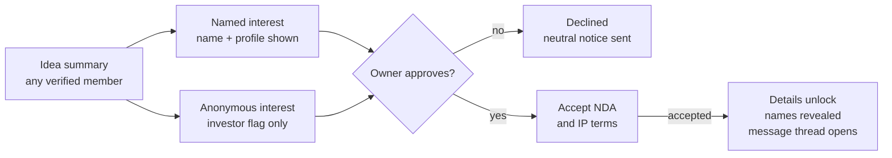

# Kingdom Connect: Product Requirements Document

| Item | Detail |
|---|---|
| Product | Kingdom Connect (People • Opportunities • Growth) |
| PRD version | 0.2 (draft), 15 October 2026 |
| Supersedes | PRD v0.1, 14 October 2026 ([sources/Kingdom-Connect-PRD-v0.1.pdf](../sources/Kingdom-Connect-PRD-v0.1.pdf)) |
| Based on | Project Plan v1.1, 14 October 2026 (FR-01 to FR-49, UC-01 to UC-43), frozen as the approved church document |
| Audience | Champion and the collaborator (product and build), Technical Committee |
| Status | Draft. Being driven to v1.0 by the [wayfinder map](https://github.com/clainkavit/kingdom-connect/issues/1) |

## 1. Document info and purpose

This PRD turns the Kingdom Connect Project Plan v1.1 into buildable requirements: what each screen does, who can use it, and how we know it works.

**How to read it.** Each feature section has user stories ("As a … I want … so that …") and acceptance criteria (AC). Each story cites the Plan's FR or UC numbers so the two documents stay traceable.

**Markers.**
- **Proposed**: a default the PRD sets that the Plan does not. Every Proposed value that existed on 19 Oct was confirmed or changed in [Confirm or change the PRD's Proposed defaults](https://github.com/clainkavit/kingdom-connect/issues/4). The four added on 20 to 22 Oct (ID expiry check, 10 milestones, 10 MB signed document, staff access to the signed document) were confirmed on 22 Oct, so none remain. Section 15 targets are separate and still need the Technical Committee.
- **Changed 15 Oct**: a decision made after v0.1. Where it overrides the Plan, the Plan is not edited; this PRD wins. See Appendix A.
- **Open**: a question with a ticket on the map. The ticket is linked where it applies.

Terms follow the glossary in [GLOSSARY.md](../GLOSSARY.md).

## 2. Product overview and goals

Kingdom Connect is a verified, members-only platform where people in Tanzania find people, opportunities and ideas to grow together, on web and mobile. It is open to anyone in Tanzania with a verified identity. The pilot starts with the Mkuyuni Community.

**Problem.** People have no trusted place to find each other's skills, businesses, ideas or opportunities. Opportunities get missed, and unverified channels expose people to job and investment scams.

**Product goals**
1. Every member can find verified professionals and businesses by skill, sector and location.
2. Members can find and apply for safe, verified opportunities, with scam posts removed fast.
3. Innovators can share ideas and meet investors or partners without losing control of their IP.
4. Investors can find ideas discreetly, without being publicly listed or pitched.
5. Members can grow through training, events, tenders and community news.

**Non-goals (Phase 1)**
- Moving money: no payments, course fees, escrow or investment transactions.
- Mentorship matching.
- Members resident outside Tanzania.
- Public, non-member access to any content beyond the landing and sign-up pages.

## 3. Users, roles and permissions

Roles stack: a member gains rights by passing further verification, and the investor flag is a private permission added on top of a member account.

| Role | How someone gets it | Visible to other members as |
|---|---|---|
| Applicant | Submits registration | Not visible |
| Verified Member (Level 1) | Identity checked by an admin with one accepted ID (section 6, Member verification) | Member, with profession |
| Verified Business (Level 2) | BRELA, TRA TIN, business licence approved | Member + business listing |
| Opportunity Poster (Level 3) | Director/authorisation proof + physical address approved | Member + business listing |
| Investor (private flag) | Invitation by an Administrator or Super Administrator, or approved application from a Level 2 member | Same as their base role; never labelled investor |
| Administrator | Assigned by Super Administrator | Staff badge |
| Super Administrator | Assigned at setup | Staff badge |

**Permission matrix** (✓ allowed, ✗ not allowed)

| Action | Member L1 | Business L2 | Poster L3 | Investor flag | Admin |
|---|---|---|---|---|---|
| Browse directories, profiles, opportunities, ideas | ✓ | ✓ | ✓ | ✓ | ✓ |
| Connect and message | ✓ | ✓ | ✓ | ✓ | ✗ |
| Apply for opportunities, register for training and events | ✓ | ✓ | ✓ | ✓ | ✗ |
| Submit ideas, express named interest | ✓ | ✓ | ✓ | ✓ | ✗ |
| List a business in the directory | ✗ | ✓ | ✓ | ✗ | ✗ |
| Post opportunities, including tenders | ✗ | ✗ | ✓ | ✗ | ✓ (changed 15 Oct) |
| Post training and courses | ✓ (admin approval) | ✓ | ✓ | ✗ | ✓ |
| Apply for investor flag | ✗ | ✓ | ✓ | ✗ | ✗ |
| Anonymous interest, silent browsing, investor filters, saved list | ✗ | ✗ | ✗ | ✓ | ✗ |
| Approve members, businesses, investors; moderate; take down | ✗ | ✗ | ✗ | ✗ | ✓ |
| See investor list and audit logs | ✗ | ✗ | ✗ | ✗ | ✓ |
| Manage admin accounts and settings | ✗ | ✗ | ✗ | ✗ | Super Admin only |

A professional who is also a student is one Level 1 member with study information on their profile (FR-09).

**Changed 15 Oct: Administrators post opportunities and tenders.** This restores use case UC16 from the original use case diagram and overrides Plan FR-15 (Level 3 posters only). Admin posts publish directly with no probation review and do not carry the no-fee declaration.

## 4. Scope and release plan

Phase 1 ships in two releases inside the 12-month plan: Release 1 builds trust and connection, and Release 2 adds everything that depends on that trust. Months count from the start of the plan; no calendar dates are fixed.

| Area | Release 1 (Core, months 5–7) | Release 2 (Extended, months 7–9) |
|---|---|---|
| Accounts | Registration, NIDA verification, MFA login, approval workflow | Annual business re-verification |
| Dashboards | Member and Admin dashboards (core widgets) | Widgets for opportunities, ideas, featured items, news |
| Profiles and directories | Professional and business profiles, study info, search, privacy masking | Business levels 2 and 3 |
| Connections | Requests, accept/decline, secure messaging | ✗ |
| Safety | Report a scam/bad user, admin review, suspension | Fast takedown of opportunities, probation queue |
| Opportunities | ✗ | Posting (including tenders), applications and expressions of interest, featured, Scan for Opportunities |
| Ideas and investors | ✗ | Ideas pool, profile Ideas tab, NDA flow, investor flag and tools |
| Learning and community | ✗ | Training and courses, events, news |
| Milestone plans | ✗ | A step-by-step plan two connected members agree on and track on the platform, ending with an upload of their signed agreement. Replaces agreement forms and e-signing (decided 20 Oct, reworked 22 Oct, [#6](https://github.com/clainkavit/kingdom-connect/issues/6)) |

**Platforms (changed 20 Oct):** the pilot launches as a responsive web portal that can be added to a phone's home screen. Android and iOS apps with the same features follow once the web version is stable, built from the same codebase (section 15).

**Geography:** Tanzania only, enforced by a Tanzanian (+255) phone number and a Tanzanian address on registration. There is no nationality rule, so a foreign resident can join (changed 22 Oct).

**Out of scope:** payments of any kind, investment transaction processing, e-commerce, social media integrations, mentorship, members outside Tanzania.

## 5. Information architecture and navigation

Members and administrators get different menus; a member never sees admin items, and an investor's menu looks the same as any member's.

**Member menu (a bar across the top):** Dashboard · People (the directory, with Professionals and Businesses tabs) · Opportunities (filtered by type on the page) · Ideas · Training · Events · Messages · Connections · Reports & Safety · Settings. Notifications and My profile open from the dashboard.

**Investor additions (inside Ideas only):** investor filters, Saved ideas, anonymous "Express interest" option. No separate menu item.

**Admin sidebar:** Dashboard · Verification queue (members, businesses, investors) · Moderation queue (opportunities, ideas, training, events, tenders) · Ideas (decided 10 Nov, [#186](https://github.com/clainkavit/kingdom-connect/issues/186)) · Reports · Re-verification · Members and investors · News and featured · Milestone plans · Post as admin · Audit log. Platform settings are on the Super Administrator's pages.

**On phones** the menu becomes a bottom tab bar: Home, People, Opportunities, Messages, More for members, shown as icons with their names read out by screen readers; Home, Verify, Moderate, Reports, More for admins. More lists the remaining menu items.

**Visual direction.** The [Kingdom Connect Screens canvas](https://claude.ai/artifact/7pbedM5rqr67UUbxncHx8X) sets the look and the layout of every screen. It replaces the earlier mockup ([context/design/dashboard-mockup.jpg](../context/design/dashboard-mockup.jpg)) and prototype ([context/design/dashboard-prototype.html](../context/design/dashboard-prototype.html)). Where the canvas conflicts with this PRD, the PRD wins. **Colours changed 8 Nov:** both apps use the maroon and cream look of the screens in [context/design/signin-screens/](../context/design/signin-screens/README.md) (maroon `#4A0E1A`, cream `#F7F1EA`); the layout still follows the canvas.

**Key screens**

| # | Screen | Used by |
|---|---|---|
| 1 | Landing, sign-up, login, OTP | Everyone |
| 2 | Registration wizard (personal, category, category details, photos, credentials, review) | Applicant |
| 3 | Registration status | Applicant |
| 4 | Member dashboard | Members |
| 5 | Directory list + filters (Professionals, Businesses) | Members |
| 6 | Member profile (About, Skills, Business, Ideas tab) | Members |
| 7 | Connections and requests | Members |
| 8 | Messages (inbox, thread) | Connected members |
| 9 | Opportunities list, detail, apply, post form | Members, posters, admins |
| 10 | Ideas pool, idea summary, idea detail, submit form, access manager | Members, owners, investors |
| 11 | Training list, detail, post form, learning materials | Members |
| 12 | Events list, detail, registration | Members |
| 13 | Business verification and upgrade (Level 2, Level 3, investor application) | Members |
| 14 | Report form, my reports | Members |
| 15 | Admin dashboard and each queue | Admins |
| 16 | Settings (profile privacy, notifications, password, MFA) | All |

The full screen list with states, which replaces this table for the build, is in [docs/screens.md](screens.md) (ticket [#13](https://github.com/clainkavit/kingdom-connect/issues/13)).

## 6. Registration, login and verification

No one reaches member content until an administrator has verified their identity, and business rights unlock one level at a time.

**Stories**
- **REG-1** As a person in Tanzania, I want to register on web or mobile so that I can join the platform. (FR-01, UC-01–06)
- **REG-2** As an applicant, I want to see my registration status so that I know when I can log in. (FR-04, FR-05)
- **REG-3** As an admin, I want to review pending profiles and approve or reject them so that only real members get in. (FR-03, UC-07–08)
- **REG-4** As a member, I want to log in with password and OTP so that my account is protected. (FR-02, UC-09–10)
- **REG-5** As a business owner, I want to upgrade to Verified Business, then Opportunity Poster, so that I can list my business and post opportunities. (FR-32, UC-28–29)
- **REG-6** As a member, I want to reset a forgotten password so that I can get back into my account without an administrator. (FR-02, UC-09–10; decided 10 Nov, [#182](https://github.com/clainkavit/kingdom-connect/issues/182))

**Acceptance criteria**
1. The wizard collects full name, username, a Tanzanian address chosen from the region and district lists, email, a Tanzanian phone number (+255), one accepted ID (NIDA, passport, driving licence or voter's ID) with its type and number, occupation categories, ticked as many as apply from Professional, Businessperson and Other (decided 10 Nov, [#161](https://github.com/clainkavit/kingdom-connect/issues/161); Entrepreneur and Student are not categories), optional study info, a face photo (required), and a photo of the ID (see Member verification below).
2. Category-specific fields appear based on the category (for example, CPA number for auditors; CISSP, CISM, CEH for cybersecurity).
3. An ID number must be unique for its ID type, and a NIDA number must be 20 digits. A duplicate blocks submission and alerts admins (duplicate-profile detection). Because one person could register twice with two different IDs, admins also compare face photos. In Phase 1 an admin checks the ID manually; a connection to NIDA's verification service for NIDA holders may follow (ticket [#30](https://github.com/clainkavit/kingdom-connect/issues/30)).
4. On submit, status = Pending and the applicant receives an email and SMS confirmation.
5. Admin sees each pending applicant with documents side by side and must give a reason when rejecting; the reason is sent to the applicant.
6. Status values: Pending → Approved or Rejected. A rejected applicant can correct and resubmit once; a second rejection is final unless an admin reopens the application.
7. Login requires username/password, then a 6-digit OTP sent by email during the pilot (SMS OTP considered later, depending on cost), valid 10 minutes, 3 attempts, with a resend allowed after 60 seconds (changed 19 Oct: email can arrive slowly on mobile networks). **Open:** whether the chosen auth service supports this natively, see [Can Supabase Auth do username login plus an email OTP second step?](https://github.com/clainkavit/kingdom-connect/issues/8)
8. Five failed password attempts lock the account for 15 minutes.

**Business verification levels**

| Level | Unlocks | Documents the member uploads | Admin checks |
|---|---|---|---|
| 2. Verified Business | Business directory listing; may apply for investor flag | BRELA certificate, TRA TIN certificate, valid business licence | Documents match the business name; licence not expired |
| 3. Opportunity Poster | Post opportunities, including tenders | Proof of directorship (BRELA records) or authorisation letter; physical address | Person is director or authorised; address confirmed |

9. A member can only request Level 3 after Level 2 is approved.
10. Each level shows its own status (Not started, Pending, Approved, Rejected, Expired) on the member's verification screen.
11. Licence expiry date is captured at Level 2 approval and drives annual re-verification (section 13).

**Member verification (Level 1), decided 19 Oct and changed 22 Oct for the nationwide scope.** An admin approves an applicant only after checking that they are who they say they are. Church membership is no longer checked. Decided in [What does an admin check to approve a member?](https://github.com/clainkavit/kingdom-connect/issues/3)

| Check | Evidence | What the admin confirms |
|---|---|---|
| Identity | Completed profile, a face photo, and a photo of one accepted ID: NIDA, passport, driving licence or voter's ID | Name and ID number on the ID match the form; the face photo matches the ID photo; the ID has not expired |
| Location | A +255 phone number and a Tanzanian address chosen from the region and district lists | Both are present. There is no nationality rule |

12. Each ID number is unique for its ID type. Admins compare face photos to catch one person registering with two different IDs; a suspected duplicate is flagged and the admin decides.
13. The ID photo is stored in the admin-only document store (section 15) and is never shown to members. **Open:** how long the photo is kept after the decision, for the lawyer (see Legal texts in section 13).
14. NIDA's verification service may be connected after the pilot, for NIDA holders, once the company exists and the production hosting is decided (NIDA asks where the server is; ticket [#30](https://github.com/clainkavit/kingdom-connect/issues/30)). Passports, driving licences and voter's IDs stay manual, and Persona is deferred until the company exists.
15. **Sign-up is open from day one (decided 22 Oct, ticket [#30](https://github.com/clainkavit/kingdom-connect/issues/30)),** so review volume is managed in four ways:
    - The sign-up form checks what it can before an admin sees the application: a NIDA number must be 20 digits, the phone must start with +255, the address must come from the region and district lists, a duplicate ID is flagged automatically, and the face photo and ID photo are required.
    - Applications are reviewed oldest first. The admin dashboard shows queue size and the age of the oldest application, with an alert when an application has waited 2 working days. Applicants see "Your application is being reviewed. You will get a notification when the review is done.", with no expected time (decided 10 Nov, [#180](https://github.com/clainkavit/kingdom-connect/issues/180)).
    - A daily cap on new applications is a Super Administrator setting, off by default. When it is on, people over the cap see "We're reviewing a high number of applications, please try again tomorrow".
    - The pilot starts with at least 3 staff accounts, including trusted volunteers, not one admin.

## 7. Dashboards

The member dashboard shows community activity and the member's own to-dos; every approval, rejection and moderation figure lives only on the admin dashboard. (FR-30, FR-31)

| Widget | Member dashboard | Admin dashboard |
|---|---|---|
| Welcome, date, location | ✓ | ✓ |
| Community stats: verified members, registered businesses, open opportunities, ideas in pool (changed 22 Oct: admins only) | ✗ | ✓ |
| People you may know: members who share skills, location, profession, study or connections with you, with a Connect button (changed 15 Oct) | ✓ | ✗ |
| My connection requests (accept/decline inline) | ✓ | ✗ |
| My activity: applications and expressions of interest, idea requests, registrations | ✓ | ✗ |
| Featured opportunities | ✓ | ✓ (with slot count and remove) |
| Latest opportunities & more (tabs: All, Jobs, Training, Tenders, Investments, Ideas) | ✓ | ✗ |
| Member quick actions: Post opportunity (Level 3 only), Share an idea, Scan for opportunities, Post training | ✓ | ✗ |
| Admin quick actions: Post opportunity, Post tender, Post news, Feature an opportunity | ✗ | ✓ |
| Latest news & updates | ✓ | ✓ |
| Pending verifications (members, Level 2, Level 3, investors), with queue size and the age of the oldest application | ✗ | ✓ |
| Rejected/denied members | ✗ | ✓ |
| Open reports and items hidden pending review | ✗ | ✓ |
| Moderation queue counts (opportunities, ideas, training, events, tenders) | ✗ | ✓ |
| Re-verifications due in 30 days | ✗ | ✓ |
| Investor count and activity | ✗ | ✓ |
| New verified members per week, last 8 weeks, as a line chart (decided 10 Nov; design in `context/design/signin-screens/`) | ✗ | ✓ |

**Acceptance criteria**
1. The member dashboard API never returns pending, rejected or investor counts, or any platform-wide count (members, businesses, opportunities, ideas), so they cannot appear even through a client bug.
2. Quick actions a member is not entitled to are hidden, with a short path to upgrade (for example, "Verify your business to post opportunities").
3. Each admin count links straight to its filtered queue.
4. Stats refresh at least every 15 minutes.
5. People you may know excludes members already connected, with a pending request, blocked, or hidden from the directory, and is rule-based like Scan for Opportunities. The rules are in "Matching rules" in section 10 (decided 20 Oct).

## 8. Profiles and directories

Profiles show what people do and offer, never how to reach them; contact happens only through a connection. (FR-06–12, FR-25, UC-11–13)

**Stories**
- **PRO-1** As a member, I want to build a profile with my profession, skills and experience so that others can find me.
- **PRO-2** As a member who is studying, I want to add my institution, course and year so that I can be found as a student without a separate account.
- **PRO-3** As a member, I want to search and filter Professionals and Businesses so that I can find the right person or company.
- **PRO-4** As a member, I want to see someone's ideas on their profile so that I know what they are working on.

**Profile fields**

| Section | Fields | Shown to members |
|---|---|---|
| Basics | Photo, name, headline, city/region, bio | ✓ |
| Professional | Profession, skills (tags), experience, certifications, credentials | ✓ |
| Study (optional) | Institution, course, year | ✓ |
| Business (Level 2+) | Business name, sector, size, description, logo, verified badge | ✓ |
| Ideas tab | Published idea summaries | ✓ (per idea settings) |
| Contact | Phone, email, physical address | ✗ (masked; member may choose to share with connections) |
| Identity | NIDA number, documents | ✗ (admins only) |
| Investor flag | n/a | ✗ (admins only) |

**Acceptance criteria**
1. Directory cards show photo, name, headline, location, top 3 skills, verified badge and a Connect button; no contact details.
2. Filters: profession, skills, sector, region/city, currently studying (yes/no), verification level for businesses.
3. Search matches name, profession, skills and business name, and returns results in under 2 seconds for 10,000 members.
4. Location is chosen from Tanzanian regions and districts only.
5. Contact fields are never sent to another member's device; they are revealed only inside an accepted connection, and only if the owner chooses to share them. Sharing is optional and set by each member in privacy settings.
6. A member can hide their profile from the directory without leaving the platform. Existing connections can still see the profile.

## 9. Connections and messaging

Two members can message only after one accepts the other's connection request. (FR-13–14, UC-14–16)

**Stories**
- **CON-1** As a member, I want to send a connection request with a short note so that the other person knows why I'm reaching out.
- **CON-2** As a member, I want to accept or decline requests so that I control who can message me.
- **CON-3** As a connected member, I want to message securely so that I don't need to share my phone number.

**Acceptance criteria**
1. Request states: Sent → Accepted, Declined or Withdrawn. Declining does not notify the sender: the request simply stays pending for them for 30 days, then expires.
2. The request note is optional, up to 300 characters.
3. A member can send at most 30 requests a day to slow spam.
4. Messages support text and attachments (PDF, images, up to 10 MB). Messages are encrypted in transit and at rest.
5. Either side can remove a connection or block a member; blocking stops messages and hides each from the other's searches.
6. Every message thread has a "Report" action that sends the thread to admins (section 13).
7. Idea-related conversations (section 11) open as message threads too, labelled with the idea title.

## 10. Opportunity marketplace

Level 3 businesses and Administrators post opportunities, including tenders. Every Level 3 post carries a no-fee declaration, and new Level 3 posters go through admin review first. (FR-15, FR-33–39, FR-47, UC-30–31, UC-40, UC-42–43)

**Stories**
- **OPP-1** As an Opportunity Poster, I want to post a job, partnership, collaboration, investment opportunity or tender so that I can reach verified members.
- **OPP-2** As a member, I want to browse, filter and apply through the platform so that my details stay private until I choose to apply.
- **OPP-3** As a poster, I want to see and respond to applications and expressions of interest in one place.
- **OPP-4** As a member, I want to "Scan for Opportunities" so that I see ones that match my skills and location.
- **OPP-5** As an admin, I want to feature selected opportunities on the dashboard.
- **OPP-6** As an admin, I want to post opportunities and tenders on behalf of the community so that members see them without waiting for a business to post (changed 15 Oct).

**Posting form: required fields**

| Field | Rule |
|---|---|
| Type | Job, Partnership, Collaboration, Investment, Tender (Tender added 15 Oct). An internship is a Job with employment type Internship; training goes in Training & Courses (section 12). Training/Internship removed 19 Oct |
| Title and role | Required |
| Employment type | Full-time, Part-time, Contract, Internship (jobs only) |
| Location | Tanzanian region/district, or Remote |
| Description and requirements | Required, minimum 100 characters |
| Contact channel | Always via the platform. Phone numbers and emails in the description are blocked at posting, with a short explanation; a post that contains a link goes to admin review (decided 19 Oct) |
| Skills wanted | 1 to 5 tags. Required for Jobs and Collaboration; optional for other types (changed 20 Oct) |
| Sector | Chosen from a fixed list (changed 20 Oct) |
| Closing date | Required, maximum 90 days ahead |
| No-fee declaration | Required tick for Level 3 posters: "No fee will be charged to applicants at any stage". It covers tenders too, so a tender that charges a document fee or bid security cannot be posted in Phase 1 (decided 19 Oct). Not shown for admin posts (changed 15 Oct), but admin posts never ask members for a fee either |

**Types and responses (decided 19 Oct).** Members apply to Jobs and express interest in every other type. Both are stored as a Response. Decided in [Tenders as an Opportunity type: how do they differ?](https://github.com/clainkavit/kingdom-connect/issues/5)

| Type | Member action | What the member sends | Who can respond |
|---|---|---|---|
| Job (including internships) | Apply | Profile, optional CV (PDF, max 5 MB), cover note | Any member |
| Partnership, Collaboration | Express interest | Profile, short note, optional attachment (PDF, max 5 MB) | Any member |
| Investment | Express interest | Profile, short note, optional attachment (PDF, max 5 MB) | Any member |
| Tender | Express interest | Profile, short note, optional attachment such as a company profile (PDF, max 5 MB) | Verified Business (Level 2) and up |

Partnership and Collaboration keep both names from the Plan but share the same fields and action.

**Tender fields.** On top of the posting form above, a tender has: issuing organisation (the business, or "Kingdom Connect" for admin posts), tender reference number, scope of work, eligibility, required documents (a list), closing date and time, optional estimated value in TZS, and the tender document (PDF attachment). The formal bid follows the instructions in the tender document; the platform handles interest and conversation, not bid submission.

**Acceptance criteria**
1. A new Level 3 poster's first 3 opportunities go to the moderation queue (status Pending review); after 3 approvals with no upheld reports, later posts publish directly. Admin posts always publish directly (changed 15 Oct).
2. Opportunity states: Draft → Pending review → Published → Closed or Expired; also Hidden (reported) and Removed (admin).
3. Apply and Express interest send what the table above lists. The poster sees each Response as New, Shortlisted or Declined, the member sees the same status, and the conversation continues in a message thread.
4. A member can respond to an opportunity once.
5. Featured opportunities: an admin picks up to 5 published posts; they show with a Featured badge until the admin removes them or the post closes.
6. Scan for Opportunities ranks open posts by matching skills, profession, location and study info. Phase 1 uses rules, not AI. The rules are under "Matching rules" below (decided 20 Oct).
7. Filters: type, location, sector, employment type, posted date.
8. A member below Level 2 sees a tender but, instead of Express interest, sees "Verify your business to respond".

**Matching rules** (decided 20 Oct, ticket [#7](https://github.com/clainkavit/kingdom-connect/issues/7)). Both features are rule-based, with no AI. Matching reads only tags and profile fields, never a post's description text.

*Skill tags.* Typing suggests existing tags; tags are lowercased and trimmed on save. Administrators keep a synonym merge list (for example accounts to accounting) that applies everywhere.

*Location.* Same district counts fully, same region partly, and a Remote post counts fully for everyone. A different region earns no location points, but an item can still appear if skills match strongly.

*Scan for Opportunities.*

| Signal | Points |
|---|---|
| Each matching skill tag (max 3 counted) | 20 each |
| Post sector matches the member's profession or business sector | 15 |
| Location: same district 15, same region 8, Remote 15 | up to 15 |
| Study info, only for Jobs with employment type Internship and entry-level Jobs | 10 |

Eligible: published, open posts of every type. Excluded: the member's own posts, posts already applied to, and closed, expired, Hidden or Removed posts. Minimum 20 points to appear; sorted by score, ties to the post closing soonest.

*People you may know.*

| Signal | Points |
|---|---|
| Each mutual connection (max 5 counted) | 15 each |
| Each shared skill (max 3 counted) | 10 each |
| Same district 15, same region 8 | up to 15 |
| Same profession | 10 |
| Same institution or course (only if both filled it in) | 10 |

Excluded: members already connected, with a pending request, blocked, hidden from the directory, suspended or deactivated, and anyone whose connection request the member declined or who declined theirs, for 90 days. Minimum 20 points; sorted by score, ties to the most recently active member.

*Rules for both.*
- The investor flag is never used, so investor status cannot shape what anyone is shown.
- Each result shows its top two reasons, built from the member's own tags and location, for example "Matches your skills: accounting, auditing. In Mwanza." Mutual connections show as a count only ("3 mutual connections"), never names. A reason never includes anything the viewer cannot already see on that profile or post.
- The dashboard widget shows the top 5 of each feature and a "See all" page shows up to 20. Scores are worked out when the page opens and are not stored. If that is too slow at scale, a nightly job replaces it.
- The weekly Scan digest email sends the top 5 matches new since the last digest, only when there is at least one, and members can turn it off.
- A member with an empty profile sees "Complete your profile to see matches", listing the missing fields. People you may know falls back to the newest verified members in the same region until the profile has data.
- Weights and minimum scores live in a settings table. Only a Super Administrator can change them, and each change is written to the audit log with before and after values. Any Administrator can edit the synonym merge list.

## 11. Ideas pool and investor access

Every verified member sees idea summaries; full details unlock only when the owner approves and the requester accepts the NDA, and investors stay anonymous until that moment. (FR-16–24, FR-40–44, UC-17–23, UC-35–36)

Both routes meet at the owner's decision; an anonymous investor's name is revealed only once the NDA is accepted.

**Stories**
- **IDEA-1** As a member, I want to submit an idea with a summary and choose its visibility so that I can find investors or partners.
- **IDEA-2** As a member, I want to browse ideas in the Ideas section and on profiles so that I can find ones to back or join.
- **IDEA-3** As any member, including a business owner, I want to say "I'm interested" as investor, partner or both so that I can invest without needing the investor flag.
- **IDEA-4** As a flagged investor, I want to filter, save and express interest anonymously so that I am not publicly pitched.
- **IDEA-5** As an idea owner, I want to approve, decline and revoke access so that I control who sees my details.
- **IDEA-6** As a Verified Business, I want to apply for the investor flag.

**Idea fields**

| Layer | Fields |
|---|---|
| Summary (all members) | Title, problem being solved, industry, stage (Idea, Prototype, Early revenue, Growing), seeking (Investor, Partner, Both), optional investment range in TZS, owner name and profile link unless hidden, interest count |
| Details (approved only) | Full description, business model, market, financials, team, attachments (PDF, images; max 20 MB total) |

**Acceptance criteria**
1. Idea states: Draft → Pending moderation → Published (named or without name) → Archived; also Hidden (reported) and Removed.
2. A published idea appears in the pool and on the owner's profile Ideas tab. An idea posted without name appears in the pool only, as "A verified member".
3. Named interest shows the requester's name, profile and chosen role (Investor, Partner, Both) to the owner.
4. Anonymous interest (investor flag only) shows the owner: "A verified investor", sector focus and ticket size band: under TZS 10M, TZS 10–50M, or over TZS 50M. Name and profile stay hidden.
5. The owner approves or declines within the request card; declining sends a neutral notice.
6. After approval, the requester must accept the NDA and IP terms before details open. Acceptance timestamp, IP and version of the terms are stored. The terms are one of the legal texts described under "Legal texts" in section 13.
7. On NDA acceptance, both identities are shown to each other and a message thread opens, labelled with the idea title.
8. Detail pages and documents are watermarked with the viewer's name and date. Every view and download is logged.
9. The owner's access manager lists everyone with access and a Revoke button; revoking removes access at once and logs it.
10. Investor silent browsing: the owner sees "Viewed by N investors", never names.
11. Investor filters: sector, stage, investment range, region; a private Saved list.
12. The investor flag is granted only by Administrator or Super Administrator invitation or by approving a Level 2 member's application. There is no investor directory, badge or member-facing count.
13. After an accepted connection, the two members can set up a milestone plan. See "Milestone plans" below. In-platform agreement forms, e-signing and legal support (UC-24 to UC-26) are not in Phase 1.

**Milestone plans** (decided 20 Oct and reworked 22 Oct; replaces UC-24 to UC-27, ticket [#6](https://github.com/clainkavit/kingdom-connect/issues/6)). Two members who have decided to work together agree the stages up front, track them on the platform, and finish by uploading their signed agreement. The idea comes from a similar concept on Upwork. It ships in Release 2.

1. **Who.** Any two verified members connected through an Idea or an Opportunity (Partnership, Collaboration or Investment). There is no minimum level, so a Level 1 member with an idea can use it. Either member can start the plan; the other must accept it before it begins.
2. **Stages.** A plan has 1 to 10 milestones, each with a title, a description and a target date. Stage 1 is always "Agreed in principle". The last stage is the signed document.
3. **Doing a milestone.** The member responsible marks it done, and the other member confirms.
4. **Hand-off disclaimer.** Each side accepts, at the start, that the platform provides a record only, is not a party to the agreement, does not guarantee or mediate anything, and that dealings outside the platform are the members' own. The accepted version and timestamp are stored for each side, as with the NDA. The wording is written in [Who writes the NDA, IP terms and data-consent text?](https://github.com/clainkavit/kingdom-connect/issues/11).
5. **Waiting for the other member.** A proposed plan stays Pending for 14 days, with one reminder on day 7, then lapses. Either member can restart it. A lapsed plan counts as "not started" in analytics. Messaging stays open throughout.
6. **Withdrawing.** While Pending, the member who proposed it may withdraw. Once both have accepted stage 1, either may withdraw within 1 hour and the other is notified. After that hour, stage 1 is final and the plan can only be ended (see 11). Later stages keep an audit trail and cannot be removed.
7. **Signed document.** At the end, if both members agree, each is prompted to upload the signed agreement to the platform (PDF, up to 10 MB). The platform stores it. It does not draft, review or e-sign anything.
8. **Who sees what.** The plan shows on both members' profiles. Administrators see names, the idea or opportunity, stage statuses, dates and notes, never contact details or the investor flag. Administrators do not see the signed document unless a report is filed on the partnership. An Administrator can annotate a plan but not delete it. A withdrawn plan stays visible as Withdrawn.
9. **What protection means in Phase 1.** Evidence only: timestamped stages, the stored signed document and a record both members accepted. The platform does not mediate disputes or guarantee anything. The lawyer confirms the wording before launch (section 13, Legal texts).
10. **Analytics.** The platform counts people linked, plans started and plans completed.
11. **Ending a plan (decided 22 Oct).** After the first hour, either member can end the plan at any time and must give a reason. The other member is told, and the plan stays on record as Ended, showing who ended it, when, why, and every milestone so far. Nothing is deleted. A member who is being ignored can also report the partnership (section 13). **Open:** whether the platform may later charge for completed plans (billing is a Phase 2 ticket; Phase 1 has no payments).
12. **Not in Phase 1:** drafting agreements on the platform, e-signing and a legal-professional directory. A lawyer directory is a possible Phase 2 idea.

## 12. Training, events and news

These modules are free to join in Phase 1, and anything members post passes moderation before it goes live. (FR-45–46, FR-48, UC-37–39, UC-41) Tenders moved to section 10 on 15 Oct.

| Module | Who posts | What members do | Key rules |
|---|---|---|---|
| Training & Courses | Any verified member, and admins; every member post needs admin approval | Browse, register, open learning materials (PDF, video links, slides) | Title, provider, format (in person, online), date or self-paced, seats; free only; materials visible after registration |
| Events | Admins and Level 2+ businesses | Browse, register, add to calendar, get reminders | Title, date, time, venue or link, capacity; reminders 1 day and 1 hour before |
| News & Updates | Admins only | Read on the dashboard and News page | Title, image, body, publish date; optional pin to top |

**Acceptance criteria**
1. Training and events follow the same states as opportunities: Draft → Pending review → Published → Closed; plus Hidden and Removed.
2. Registration stops at capacity and offers a waitlist. When a place frees up, the first person waiting gets it automatically and is notified.
3. A registered member sees their trainings and events under "My activity" on the dashboard.
4. The poster sees a registrant list (names and profiles only, no contact details).
5. Learning materials open inside the platform; downloads are allowed only if the poster enables them.

## 13. Reports, safety and administration

A reported opportunity disappears from members' view the moment it is reported; admins then restore it or act on it, and every admin action is logged. (FR-26–29, FR-35–36, FR-49, UC-32–34)

**Stories**
- **SAFE-1** As a member, I want to report a scam or bad user from any profile, opportunity, idea or message thread.
- **SAFE-2** As an admin, I want one queue of reports, pending posts and re-verifications so that nothing is missed.
- **SAFE-3** As an admin, I want to suspend repeat offenders.
- **SAFE-4** As a Super Admin, I want an audit log of every admin and sensitive action.

**Acceptance criteria**
1. The report form asks for a reason (Asked for money, Fake job or business, Harassment, Impersonation, Spam, Other) and an optional note and screenshot.
2. Reporting an opportunity (any type, including tenders) sets it to Hidden immediately. Profiles and ideas stay visible until an admin reviews them.
3. The reporter gets a reference number and the final outcome (Action taken / No action), not the details.
4. Admin actions: Restore, Edit request to poster, Remove, Warn, Suspend posting rights, Suspend account. Each requires a note.
5. Two upheld reports against a business within 12 months suspend its posting rights; three suspend the account pending review.
6. Re-verification: 30 and 7 days before a business licence expires, the member is reminded. On expiry, Level 2 and 3 rights pause until new documents are approved.
7. Audit log records who, what, when, and before/after values for approvals, rejections, moderation, role changes, investor flag changes, admin-posted opportunities, and every view of idea details. Logs are read-only and kept at least 5 years, including after a member deletes their data, as a legal record.
8. Admins cannot see message contents unless a thread has been reported.

**Legal texts** (decided 20 Oct, ticket [#11](https://github.com/clainkavit/kingdom-connect/issues/11)). The platform needs five legal texts, each with a version number:

| Text | Accepted where |
|---|---|
| Terms of use for members | Registration; again when the text changes |
| Privacy notice and data consent (Personal Data Protection Act 2022) | Registration, as its own tick box separate from the terms of use; again when the text changes |
| NDA | Per idea access request, after the owner approves |
| IP terms | Per idea access request, together with the NDA |
| Hand-off disclaimer | Per milestone plan, at the start (see section 11) |

1. **Who writes and approves.** Champion and the collaborator draft the texts, with Claude's help. The texts are real drafts from the start, not placeholders, and the app shows them as they stand. Reviewers are the testers, the church leadership and a lawyer. A text that is not approved is edited and reviewed again. Where a lawyer's edit changes the legal meaning, the lawyer's wording is used. A text written with AI help is a draft, not legal advice, until a lawyer has approved it.
2. **Who they name.** The platform will be its own legal entity. The name is not final (Kingdom Connect for now), so every text takes the entity name from one setting, and the final name is filled in at the end.
3. **Launch gate.** No real member registers, and no real idea or NIDA data is stored, until all five texts are approved and loaded as version 1.0. Before that, the app runs test data only.
4. **Versions.** Each text is stored with its version number and date, and each acceptance records which version was accepted. When the terms of use or the privacy notice change, members accept again at their next login. An NDA or IP term a member has already accepted stays valid under the version they accepted; a new version applies only to new requests.
5. **Languages.** Every text is shown in English and Kiswahili. If the two differ, the English text governs, and the Kiswahili is a faithful translation, unless a lawyer advises otherwise.
6. **What the lawyer reviews.** Besides the wording of the five texts, the lawyer is asked to confirm:
   - The legal form and name of the entity that runs the platform.
   - Registration of that entity with the Personal Data Protection Commission as a data controller. The Act says no one may collect or process personal data without registering (checked against the Commission's website on 20 Oct; the lawyer confirms the process and timing).
   - Whether holding member data on a host outside Tanzania, such as managed Supabase, needs a cross-border transfer permit or the member's consent. This feeds the production hosting decision (section 15).
   - Whether NIDA numbers, identity documents and any record of church membership count as sensitive personal data that needs written consent.
   - Whether one consent tick box separate from the terms of use is enough, and how a member withdraws consent.
   - Whether the NDA and IP terms hold between members, and what the platform may and may not promise about them.
   - Whether the platform's role in milestone plans (a record and a stored signed document, with no mediation or guarantee) limits its liability, and whether storing members' signed agreements is allowed.
   - Whether sending ID images to a foreign verification service is allowed, and what a connection to NIDA's verification service requires.
   - What the platform must keep and what it must delete when a member asks to delete their data, including audit logs and milestone plans.

## 14. Notifications

Every event below shows in the in-app bell; during the pilot, OTPs and account messages go by email, SMS is added later if the budget allows, and members can turn off email for non-critical ones. (FR-05)

| Event | Who is told | In-app | Email | SMS |
|---|---|---|---|---|
| Registration received, approved, rejected or reopened | Applicant | ✓ | ✓ | Later |
| Login OTP | Member | ✗ | ✓ | Later |
| Business level approved, rejected or expiring | Business member | ✓ | ✓ | Later |
| Connection request received or accepted | Member | ✓ | ✓ | ✗ |
| New message | Member | ✓ | Digest | ✗ |
| Application or interest received / status changed | Poster / member who responded | ✓ | ✓ | ✗ |
| Post approved, rejected, hidden or removed | Poster | ✓ | ✓ | ✗ |
| Interest in my idea (named or anonymous) | Idea owner | ✓ | ✓ | ✗ |
| Access approved, NDA accepted, access revoked | Owner and requester | ✓ | ✓ | ✗ |
| Milestone plan: proposed, reminder, accepted, milestone done or confirmed, signed document uploaded, lapsed, withdrawn or ended | The other member (both, on withdrawal) | ✓ | ✓ | ✗ |
| Matches from Scan for Opportunities | Member | ✓ | Weekly digest | ✗ |
| Training or event reminder | Registrant | ✓ | ✓ | ✗ |
| Waitlist place confirmed | Member who was waiting | ✓ | ✓ | ✗ |
| Report outcome | Reporter | ✓ | ✗ | ✗ |
| Investor flag granted | Investor | ✓ | ✓ | ✗ |
| Login locked after 5 failed attempts | Member | ✗ | ✓ | ✗ |
| Account suspended | Member | ✗ | ✓ | ✗ |
| Posting rights paused | Poster | ✓ | ✓ | ✗ |
| Idea hidden or removed by an admin | Idea owner | ✓ | ✓ | ✗ |

**Push notifications** (decided 20 Oct) are sent to the Android and iOS apps once they ship; the web pilot has the in-app bell and email only.
- Push is sent for: connection request received or accepted, new message, application status change, idea access approved or NDA accepted, a milestone plan request, post approved or rejected, and registration approved or rejected. The weekly Scan digest is email only, and report outcomes are in-app only.
- The app asks for notification permission after the first login, not at install. Once permission is granted, push is on by default, with one master switch and a switch per category in Settings.
- A new-message push says "You have a new message", with no preview.

Notification text never names an anonymous investor and never includes contact details. The wording, in English and Kiswahili, is in [docs/notifications.md](notifications.md) (ticket [#14](https://github.com/clainkavit/kingdom-connect/issues/14)). The Kiswahili is a draft until a native speaker has reviewed it.

## 15. Non-functional requirements

The figures below are proposed starting targets for the Technical Committee to confirm.

| Area | Requirement |
|---|---|
| Security | MFA on every login; passwords hashed (bcrypt/Argon2), minimum 8 characters with a number; TLS 1.2+ in transit; AES-256 at rest for documents and messages; role-based access enforced on the server, not just hidden in the UI |
| Privacy and law | Comply with Tanzania's Personal Data Protection Act 2022: consent captured at registration, members can download or delete their data, hosted with a cloud provider in a region that meets the Act's rules on storing personal data |
| Hosting (changed 15 Oct) | Development runs on managed Supabase with test data only; no real member data goes in until the hosting decision. The production provider and region (managed Supabase outside Africa, or self-hosted in Tanzania) are decided before the pilot, with a legal check against the Act |
| Document storage | Identity and business documents in a separate encrypted store, visible to admins only, never in public URLs |
| Performance | Pages and searches load in under 2 seconds on 3G for 95% of requests; app usable on Android 9+ and iOS 15+. Measured 5 Nov (R17): repeat visits meet it, first visits do not (see section 18) |
| Scale | Built for 2,000 members in year 1 and 20,000 without redesign |
| Availability | 99.5% monthly uptime; daily backups kept 30 days; restore tested quarterly |
| Languages | English and Kiswahili for all member-facing screens |
| Accessibility | WCAG 2.1 AA contrast and text sizes; works with screen readers on mobile |
| Data usage | Images compressed; a low-data mode that hides images on mobile |
| Monitoring | Security logging, alerts on repeated failed logins, unusual message volume, or duplicate NIDA attempts. Supabase logs for the server and Sentry (free plan) for app crashes (changed 20 Oct) |

**Technical stack** (decided 20 Oct, ticket [#10](https://github.com/clainkavit/kingdom-connect/issues/10)). The priorities are a low budget while developing, one codebase for every platform, and privacy rules enforced in the database.

| Layer | Choice |
|---|---|
| Member app | One Expo (React Native) universal app in TypeScript: web first, then Android and iOS from the same code. If the web build misses the 3G target in a prototype test, only the member website moves to Next.js |
| Admin console | Separate Next.js web app, sharing types and Supabase client code with the member app |
| Backend | Supabase: Postgres, Auth, Storage, Realtime. No separate server. Access rules are Row-Level Security; matching scores and agreement records are Postgres functions; Edge Functions handle login and OTP, email sending and signed links to private documents. Auth follows the custom design in [Supabase Auth login flow](../context/memory/supabase-auth-login-flow.md) |
| Interface | NativeWind in the Expo app, shadcn/ui in the admin console, on shared design tokens |
| Code and quality | pnpm workspace (no Turborepo at first), TypeScript with a typecheck script, Vitest, Husky with lint-staged and typecheck on pre-commit |
| Email | Brevo. Free plan (300 a day) for development and the start of the pilot, with an alert at 200 a day and a move to the paid plan when it fires. Test delivery to Gmail and Tanzanian mobile-provider addresses before the pilot |
| Push | Expo push service, for the Android and iOS apps once they ship. The web pilot uses the in-app bell and email only |
| Languages | English and Kiswahili from the start, with every screen string kept in translation files |
| Development hosting | Supabase Free plan and Vercel for development and preview builds, test data only |
| Production hosting | The two apps, the member web app and the admin console, are hosted on Vercel (decided 5 Nov). Where Supabase runs, which holds the member data, is not decided: managed Supabase and its region, or self-hosted (Hostinger is a candidate, which would mean the team runs backups and security updates). Decided before the pilot with the legal check against the Act (see Hosting above) |

## 16. Key data entities and statuses

These are the main records the system stores and the states each can be in. Every table, its access rules and the functions that guard private data are in [docs/schema.md](schema.md) (decided 20 Oct, ticket [#12](https://github.com/clainkavit/kingdom-connect/issues/12)).

**Access rules (decided 17 Oct).** The server decides what each request may read or write; the UI only hides what a user doesn't need to see, and is never relied on for privacy. Restricted data never leaves the server for a user who isn't allowed it:

| Data | Who the server returns it to |
|---|---|
| Investor flag | Admins only. No member-facing query returns it, directly or as a count |
| Contact details (phone, email, address) | The owner; a connected member only if the connection is accepted and the owner shares contact details |
| NIDA number and identity or business documents | The owner and admins. Documents sit in a separate admin-only store, never at public URLs |
| Message contents | The two members in the thread. Admins only once the thread is reported |

On Supabase/Postgres (the stack, decided 20 Oct, see section 15), these rules are enforced in the database with Row-Level Security policies and restricted views, so a faulty API endpoint can't leak them.

| Entity | Key fields | Statuses |
|---|---|---|
| Member | Name, username, NIDA (encrypted), phone, email, region, category, verification level, investor flag (private) | Pending, Approved, Rejected, Suspended, Deactivated |
| Profile | Headline, bio, skills, experience, certifications, study info, privacy settings | n/a |
| Business | Name, sector, BRELA no., TIN, licence no. and expiry, address, level | Pending, Approved, Rejected, Expired |
| Verification request | Member, level requested, documents, reviewer, reason | Pending, Approved, Rejected |
| Connection | Requester, receiver, note | Sent, Accepted, Declined, Withdrawn, Expired |
| Message thread / message | Members, idea link (optional), body, attachments | Active, Reported, Closed |
| Opportunity | Poster (Level 3 member or admin), type (including Tender), title, location, sector, skills wanted (tags), closing date, no-fee flag, featured flag | Draft, Pending review, Published, Closed, Expired, Hidden, Removed |
| Response (replaces Application, 19 Oct) | Opportunity, member, kind (Application for Jobs, Interest for other types), CV or attachment, note | New, Shortlisted, Declined, Withdrawn |
| Idea | Owner, summary fields, details, attachments, visibility | Draft, Pending moderation, Published, Archived, Hidden, Removed |
| Idea access request | Idea, requester, role, anonymous flag, NDA version, accepted at | Pending, Approved, Declined, NDA accepted, Revoked |
| Milestone plan | The two members, idea or opportunity, milestones (title, description, target date, status), disclaimer version, accepted at (each side), signed document, admin annotations | Pending, Active, Completed, Lapsed, Withdrawn, Ended |
| Training / Event | Poster, title, dates, capacity, materials | Draft, Pending review, Published, Closed, Hidden, Removed |
| Registration | Member, training or event | Registered, Waitlisted, Cancelled, Attended |
| News item | Title, body, image, pinned | Draft, Published |
| Report | Reporter, target, reason, note | Open, Under review, Action taken, No action |
| Matching setting | Feature, signal, points, minimum score; skill synonym merge list. Weights changed by Super Administrator, synonyms by Administrator | n/a |
| Audit log entry | Actor, action, target, before/after, time, IP | Append only |

Changed 15 Oct: Tender moved from the Training / Event / Tender record into Opportunity. Decided 19 Oct: applications and expressions of interest share one Response record, and tenders carry their extra fields (section 10) on the Opportunity record.

## 17. Success metrics

Year 1 targets come from the Project Plan v1.1; the product measures below show whether the features are working day to day.

| Metric | Target | Source |
|---|---|---|
| Registered members | 2,000+ | Plan |
| Verified professionals | 1,000+ | Plan |
| Registered businesses | 300+ | Plan |
| Investors (internal only) | 50+ | Plan |
| Jobs published | 200+ | Plan |
| Partnerships formed | 100+ | Plan |
| Platform adoption rate | 70%+ of the pilot community (the church members told about it) registered and approved. The national target is set after the pilot | Plan, reworded 22 Oct |
| Median time from registration to approval | Under 3 working days | Agreed 19 Oct |
| Reported opportunities reviewed | Within 24 hours | Agreed 19 Oct |
| Upheld scam reports per 100 opportunities | Under 1 | Agreed 19 Oct |
| Ideas with at least one approved access request | 30% of published ideas in year 1 | Agreed 19 Oct |
| Monthly active members | 50% of verified members | Agreed 19 Oct |

**Testing and pilot readiness** (decided 20 Oct, ticket [#15](https://github.com/clainkavit/kingdom-connect/issues/15)).

| Layer | What it covers | Where it runs |
|---|---|---|
| Unit tests (Vitest) | Pure logic such as matching scores, status changes and validation | On every commit |
| Format and typecheck | Prettier on staged files, TypeScript typecheck | On every commit |
| Access-rule tests | One test per restricted item in section 16 (investor flag, contact details, identity documents, message contents): signed in as the wrong person, nothing comes back. Run against the real database rules | On every pull request (CI) |
| End-to-end tests (Playwright, web only) | Registration to approval; login with the email code and lockout; connection to message; idea access with NDA; a milestone plan with its 1-hour withdrawal after stage 1; reporting a post and it disappearing; the member dashboard never showing admin-only counts | On pull requests that change app code (CI) |
| Manual use by testers | Testers use the web version as ordinary members and report problems as feedback | Before the pilot |

1. **Never merge on red.** CI runs on every pull request and marks a failing one red. Nobody merges a pull request with a failing check. GitHub does not enforce it, because branch protection needs GitHub Pro on a private repository (decided 1 Nov 2026, F02 #40). Pull requests that change only documents skip the end-to-end tests to save CI minutes on a private repository.
2. **Database tests run locally.** Tests use a local copy of Supabase in Docker on each machine and in CI, reset to a clean state each run. Both developers need Docker Desktop. Login-code emails are read from the local test mail catcher.
3. **Test data.** One seed script creates fake members in every role (applicant, member, Level 2, Level 3, investor-flagged, administrator, super administrator, suspended) with fake ideas, posts and connections. All tests and demos use it. No real person's data enters any test environment.
4. **Tests first for the costly parts.** Access rules and anything that moves through statuses (registration, idea access request, milestone plan, connection requests) get their tests written before the code. Ordinary screens get tests after.
5. **Phone apps.** End-to-end tests for the Android and iOS apps are added when the store apps ship (a tool such as Maestro).
6. **Ready for the pilot** only when all of these hold:
   - All CI checks pass on `main`.
   - Every access-rule test passes.
   - The testers have used the web version as ordinary members, and no serious issue they reported is still unresolved.
   - The five legal texts are approved as version 1.0 (section 13).
   - The email login code is confirmed arriving on Gmail and on Tanzanian mobile-provider addresses.

## 18. Decisions and open questions

**Decided on 14 October 2026**
- NIDA: manual admin review in Phase 1; integrate with NIDA's verification service later if problems arise.
- Training: any verified member can post; every post needs admin approval.
- Contact sharing: optional; each member chooses whether connections can see their phone or email.
- OTP: by email during the pilot; SMS considered later, depending on cost.
- Investor invitations: Administrators and Super Administrators.
- Probation: a new poster's first 3 posts are reviewed; 2 upheld reports in 12 months suspend posting, 3 suspend the account.
- Investor ticket bands: under TZS 10M, TZS 10–50M, over TZS 50M.
- Hosting: cloud hosting.

**Decided on 15 October 2026**
- Administrators can post opportunities and tenders. Admin posts publish directly (no probation) and do not carry the no-fee declaration. Overrides Plan FR-15.
- A tender is a kind of Opportunity, not a separate module.
- The member dashboard gets a "People you may know" widget.
- No "No fee" label on opportunity cards; the no-fee declaration stays at posting time only.
- Development uses managed Supabase with test data only; the production hosting decision, with a legal check, comes before the pilot.
- This markdown file is the living PRD; the Plan v1.1 stays frozen as the approved church document.

**Decided on 17 October 2026**
- Access rules are enforced on the server, not in the UI: the investor flag, contact details, identity documents and message contents never reach a user who isn't allowed them (section 16). On Supabase/Postgres this means Row-Level Security in the database. The schema is in [docs/schema.md](schema.md).

**Decided on 19 October 2026 (changed 22 October)**
- Level 1 verification checks identity only (section 6, Member verification): a completed profile, a face photo and a photo of one accepted ID (NIDA, passport, driving licence or voter's ID). Location is a +255 phone and a Tanzanian address, with no nationality rule. The 19 Oct version also checked church membership through references and a founding-members list; that was dropped on 22 Oct when the platform went nationwide. Resolves [What does an admin check to approve a member?](https://github.com/clainkavit/kingdom-connect/issues/3)
- The Proposed approval target (median under 3 working days, section 17) stays.

**Decided on 20 October 2026 (test strategy, ticket #15)**
- Unit tests and typecheck on commit; database access-rule tests and web end-to-end tests in CI on pull requests, blocking merges (section 17).
- Local Supabase in Docker for database tests; one seed script of fake members; tests first for access rules and status changes.
- Testers give feedback as ordinary members; there is no formal checklist.
- Pilot-readiness list as in section 17.

**Decided on 20 October 2026 (legal texts, ticket #11)**
- Five versioned legal texts: terms of use, privacy notice and consent, NDA, IP terms, hand-off disclaimer (section 13).
- Drafted by Champion and the collaborator as real text; reviewed by testers, church leadership and a lawyer; edited until approved.
- No real member data until all five are approved as version 1.0.
- The platform is its own legal entity; the name is not final.

**Decided on 20 October 2026 (matching, ticket #7)**
- Scan for Opportunities and People you may know are rule-based and point-scored from tags and profile fields; the rules are in section 10.
- Opportunity posts gain skills-wanted tags and a sector.
- The investor flag is never used in matching. Mutual connections show as a count only.

**Decided on 20 October 2026**
- Agreements and e-signing (UC-24 to UC-27) are replaced in Phase 1 by milestone plans: two connected verified members agree stages, track them on the platform and upload their signed agreement at the end (section 11). A first version on 20 Oct was a simple "Agreed to proceed" record; it was reworked on 22 Oct.
- Legal support (UC-26) is out of Phase 1. A lawyer directory is a possible Phase 2 idea.

**Decided on 19 October 2026 (opportunity types and tenders, ticket #5)**
- Opportunity types are Job, Partnership, Collaboration, Investment and Tender (section 10). Training/Internship is removed: internships are Jobs, training goes in Training & Courses. Members apply to Jobs and express interest in the rest, stored as one Response record. Only Level 2 and up can respond to a tender, tenders get 8 extra fields, and tenders that charge any fee cannot be posted. Resolves [Tenders as an Opportunity type: how do they differ?](https://github.com/clainkavit/kingdom-connect/issues/5)

**Decided on 19 October 2026 (Proposed defaults, ticket #4)**
- Every Proposed value is confirmed, with these changes: OTP valid 10 minutes with a resend after 60 seconds; phone numbers and emails blocked in posts and links sent to review; a second rejection is final unless an admin reopens it; waitlists move the first person up automatically; audit logs survive a member's data deletion; idea access target 30% and monthly active members 50%. Resolves [Confirm or change the PRD's Proposed defaults](https://github.com/clainkavit/kingdom-connect/issues/4)

**Decided on 20 October 2026 (database schema, ticket #12)**
- The schema and access rules are in [docs/schema.md](schema.md). Private data (contact details and ID numbers, investor flag, business registration numbers) sits in separate admin-only tables; other members reach contact details only through one checked function, with three share switches (phone, email, address) off by default.
- Admin accounts are separate from member accounts.
- ID numbers (NIDA, passport, driving licence or voter's ID) are encrypted in the database with a fingerprint for duplicate checks; messages and documents rely on the host's disk encryption.
- Milestone plans have their own tables (plans, milestones, signed documents); signed documents are visible to the two members, and to staff only while a report is open on the plan.
- A deleted member becomes a "Deleted member" placeholder; the lawyer review (#11) confirms what must be kept.
- Nothing hard-codes the community name, and church references and the founding list are not in the schema, so it fits the nationwide scope (ticket #30).

**Decided on 20 October 2026 (tech stack, ticket #10)**
- Stack as in section 15: Expo universal member app, Next.js admin console, Supabase, Brevo email, Sentry, pnpm workspace, TypeScript, Vitest, Husky.
- The pilot launches on the web first; Android and iOS follow from the same code. This supersedes the earlier plan to publish all three for the pilot.
- Push notifications are in scope for the mobile apps, with a master switch and per-category switches.
- English and Kiswahili from the start.
- Production hosting stays open until before the pilot.

**Decided on 22 October 2026 (nationwide scope, ticket #30)**
- The platform is open to anyone in Tanzania with a verified identity, with a Christian character kept in the name and tone. The church is the first community, not a requirement.
- Sign-up is open from day one; review volume is managed by form checks, a visible queue with an alert, a daily-cap switch and at least 3 staff accounts (section 6).
- The NIDA verification service is a post-pilot step, after the company exists and hosting is decided.
- The adoption target is reworded for the pilot community; the national target comes after the pilot.
- The name Kingdom Connect stays for now; the final name is decided late, and every text takes it from one setting (section 13).

**Decided on 22 October 2026 (confirmed Proposed items)**
- Confirmed: an admin checks that the ID has not expired; a milestone plan has 1 to 10 milestones; a signed document is a PDF up to 10 MB; staff see a signed document only while a report is open on that plan.

**Decided on 22 October 2026 (ending a milestone plan)**
- After the first hour, either member can end a plan at any time with a reason. The other is told, and the plan stays on record as Ended with all its milestones. Nothing is deleted (section 11).

**Decided on 22 October 2026 (dashboard counts)**
- The community counts (verified members, registered businesses, open opportunities, ideas in the pool) are shown to administrators only. Members see no platform-wide figures (section 7).

**Decided on 2 November 2026 (design canvas)**
- The Kingdom Connect Screens canvas is the visual direction (section 5). The member menu moves from a sidebar to a bar across the top; the "Report a Scam / Bad User" card becomes the Reports & Safety menu item.
- The member menu is Dashboard, People, Opportunities, Ideas, Training, Events, Messages, Connections, Reports & Safety, Settings. Professionals and Businesses become tabs inside People.
- The member phone tab bar shows icons only, each with a screen-reader name.
- The admin sidebar takes the canvas's items: Members and investors, and News and featured, are one item each; Milestone plans and Post as admin are added; Settings moves to the Super Administrator's pages.

**Decided on 2 November 2026 (languages, F07)**
- Both apps, the member app and the admin console, are in English and Kiswahili. The Kiswahili is drafted with the code and reviewed by Champion before merge.
- Signed-out visitors can read one setting, the platform name, so the sign-in screens can show it. Every other setting stays signed-in only.
- Until Settings is built, the language switch is in the sign-in header and the menus. A Member's choice is saved to their account; a choice made before sign-in carries into the account.

**Decided on 2 November 2026 (notifications, F10)**
- Always emailed, with no switch: registration, login code, account locked, account suspended, posting paused, warning (added 3 Nov), email or phone changed (added 4 Nov), idea hidden or removed. Every other category that sends email has an email switch.
- The new-message email is a daily digest of messages still unread, sent only when there is at least one.
- The notification copy in docs/notifications.md is the single source; the apps and the email sender are generated from it.
- Emails are queued and sent within a minute, with retries. The login code is still sent at once.

**Decided on 2 November 2026 (legal texts, R05)**
- Claude drafts all five texts in English and Kiswahili as version 0.1, marked as drafts and not legal advice; Champion and the collaborator rework them under L03. Facts not yet decided are marked "[TO CONFIRM: ...]" in the text.
- The texts live as files in `legal/` in the repo; reviewing a text is reviewing a pull request, and `pnpm legal:load` loads a new version.
- The launch gate is a setting, `real_registrations_open`, off by default. The database refuses to switch it on until all five texts are approved at version 1.0. Development and testing keep working on test data.

**Decided on 2 November 2026 (registration, R01)**
- Sign-up works when real registrations are open, or when the environment is marked test-data-only (local and staging). Production shows "Registration opens soon" until the launch gate opens.
- The face photo is for verification only, kept with the ID photo in the admin-only store. A public profile photo is optional and comes with the profile (R06).
- Category details are a small fixed set for now: a Professional gives a profession and optional certifications and licence numbers; a Businessperson a business name and sector; an Entrepreneur what they are building and a sector; Other a short description. Per-profession fields can follow. Since 10 Nov (#161) the Entrepreneur details are gone; posting an idea stays open to every member, IDEA-1.
- A duplicate ID is refused with "This ID is already registered", written to the audit log and flagged for the admin queue (R03).
- A starter list of 16 sectors in English and Kiswahili is loaded; Champion and the collaborator can rename or add.
- The ID number is never kept in the saved draft: it is encrypted the moment step 4 is saved.

**Decided on 2 November 2026 (verification queue, R03)**
- The R03 queue holds Level 1 member applications. Businesses (Levels 2 and 3) and investor applications join the same queue when their tickets are built.
- A rejection uses a reason from a short preset list, written in English and Kiswahili, plus an optional note. The Applicant receives the reason in their own language and the note as the admin typed it. "Another reason" needs a note. A note cannot carry a phone number or email address.
- Staff mark a suspected duplicate by typing the other member's username. Both face photos then show side by side, and the mark is written to the audit log.
- The overdue alert is a banner on the queue and a mark on each row once an application has waited 2 working days. Working days are Monday to Friday in Tanzania time; public holidays are added later. The admin dashboard (A01) shows it when that screen is built.
- An expired ID is shown as a warning. The admin still decides.
- Staff decide only through the audited decision function, never by editing the application directly. Approving, rejecting, marking a duplicate and revealing an ID number are each written to the audit log with the admin and their IP address.

**Decided on 2 November 2026 (registration status, R02)**
- Under review, the Applicant sees an expected time worked out from the queue: their place in it, divided by the decisions staff made per working day over the last 14 days, rounded up, at least 1 working day. With no decisions in that window it says "We usually decide within 2 working days". The Applicant sees only the days, never their place or the queue size (section 7, criterion 1). Since 10 Nov ([#180](https://github.com/clainkavit/kingdom-connect/issues/180)) the expected time is no longer shown.
- Fix and resubmit reopens the whole wizard on the review step with the earlier answers, so any detail, the ID or either photo can be changed. Starting it uses the one resubmission. Each submitted application keeps its own copy of the photos, so a replaced photo never changes what an earlier decision was based on.
- An Administrator can reopen a final rejection on A03, with a note for the audit log. The Applicant is told by the new notification A6 and can send the application once more; a rejection after that is final again.
- A rejection still ends the Applicant's sessions (decided with F09). They sign in again to read the reason.
- The Administrator's optional rejection note is written for the Applicant and sent with the reason (R03). There are no private reviewer notes on an application; the Applicant never sees the reviewer, the reason code or the queue.

**Decided on 3 November 2026 (application cap and staff accounts, R04)**
- The daily application cap counts sign-ups: new accounts created that day, midnight to midnight Tanzania time. It is checked at sign-up, so nobody completes the wizard and is then turned away. Two sign-ups at the same moment can each pass the check, so the cap can be passed by one or two.
- A Super Administrator invites a staff member by name, email and role. The invite email links to a set-password page that works for 24 hours; after that the staff member logs in with their email and the email code like any staff account. Nobody else ever knows the password.
- A Super Administrator cannot deactivate or demote their own account, and the last active Super Administrator cannot be removed.
- Settings (A16) appears in the admin menu only for Super Administrators. (Superseded on 3 November by R06: Settings is in every Administrator's menu, and only the cap and staff sections are limited to Super Administrators.)

**Decided on 3 November 2026 (profiles and skill tags, R06)**
- The full name stays as verified at approval; only an Administrator changes it. Region and district, headline, bio, profession, experience, certifications and study are the member's to edit.
- A public profile photo is optional, up to 2 MB, and shows without review. It is opened only by members who can see the profile, and is never the verification face photo.
- Skills are tags, lowercased and trimmed. A member can add a new one; typing suggests existing skills and synonyms. Up to 20 skills, 40 characters each. The server applies the synonym list when tags are saved.
- Any Administrator edits the skill synonym list in Settings. Adding a synonym moves profiles that used the variant onto the skill. Settings is now in every Administrator's menu; the cap and staff sections stay Super Administrator only.
- A profile is reached by the member's id, not their username, so usernames stay private.
- A hidden profile reads "Profile not found" to everyone except the owner, staff and existing connections, including through a direct link. Hiding is a safety tool, and a link can be forwarded.
- When a hidden member contacts someone first (a connection request, R09; an application or expression of interest, O03), that person can see the profile while the request or application is open. Contact details stay masked. Built with those tickets.

**Decided on 3 November 2026 (directory, R07)**
- With no search typed, the directory is shuffled once a day (Tanzania time), so everyone takes a turn near the top and the order holds while paging. With a search, the best matches come first: name, then profession, then skill.
- A hidden profile is not listed for anyone, connections included; connections can still open it. Applicants, staff and members who blocked you are not listed, nor are you.
- Cards showed a disabled Connect button until connection requests arrived (R09); since R09 they show Connect, Request sent, Answer their request or Connected.
- Search and filters return in under 2 seconds with 10,000 members; a database test seeds 10,000 members and checks it on every pull request.

**Decided on 3 November 2026 (contact sharing, R08)**
- Each sharing switch (phone, email, address) applies to every accepted connection; there is no per-person choice. All three are off by default.
- A connection sees a shared value only while neither side has blocked the other and the owner is still an approved member. A hidden profile still shares with its connections.
- In Phase 1 a Member cannot change their own phone, email or address; changing them, with a code to the new email, is its own ticket. Only the sharing switches and the language can be changed.
- The hide switch moves from Edit profile to Profile privacy and contact sharing (S45), so each setting has one place.

**Decided on 3 November 2026 (connections, R09)**
- One open request per pair. The sender may ask again once the request ends: it expires after 30 days, is withdrawn, or the connection is removed. A declined request still counts as open for the sender until it expires, so they cannot tell it was declined. If the other member already asked you, you answer their request instead of sending a second one. If you declined someone and later ask them yourself, your request accepts theirs and you are connected, so the decline never shows. Accepting closes any other open request between the two.
- The note is optional and up to 300 characters, with no check for phone numbers or emails.
- Blocking asks to confirm, then removes any connection and closes open requests both ways, without notice. The blocked member's own request leaves their list, so nothing of the blocker (name, headline, photo) reaches them. Unblocking is on S45 and does not restore the connection. Blocking also stops messages; that part is built with messaging (R10).
- Removing a connection sends no notice. Either member can send a new request later.
- The 30-a-day limit counts by the Tanzania calendar day.

**Decided on 3 November 2026 (messaging, R10)**
- "Encrypted in transit and at rest" means TLS for all traffic and the host's disk encryption for the database and file storage. Message text is not encrypted again inside the database, so staff can read a reported thread. Checked again when production hosting is chosen (section 15).
- The inbox shows an unread dot. C3 is sent once per thread until the member opens it, not for every message. There are no read receipts.
- A sender can delete their own message until the thread is reported; both see "This message was deleted". After a report nothing can be deleted.
- R10 builds the reported state and the rule that staff read a thread only once it is reported. The Report button is shown disabled until the report form arrives in R11.
- A thread is one per pair, opened the first time either member taps Message. After a block or a removed connection it stays readable, but no one can send.
- A reported thread stays open: both members can keep sending, nothing can be deleted, and Administrators read all of it. A member who wants it to stop blocks the other.
- In Release 2, each idea or opportunity gets its own labelled thread, separate from the pair's plain thread.

**Decided on 3 November 2026 (reports, R11)**
- R11 reports profiles and message threads. The form and `report()` accept ideas, opportunities and plans, which arrive with Release 2; the test "report a post and it disappears" moves to O06 (#84).
- A reference number reads KC-2026-000123: a prefix, the year and a running number.
- One open report per reporter per item. A repeat shows "You already reported this" with the open reference. After reporting a profile or a thread, the success screen offers to block that member.
- One optional screenshot, JPEG, PNG or WebP up to 5 MB, that only staff can open. The reporter sees only the reference, the date and the outcome.
- The running number does not restart each year; the year in the reference already dates it.
- Only an approved member's profile can be reported. A thread with a suspended member can still be reported.
- A member can send 10 reports a day (Tanzania time). A repeat of an open report does not count.

**Decided on 3 November 2026 (reports queue, R12)**
- R12 builds No action, Warn, Suspend posting and Suspend account for profiles and threads. Restore, Edit request and Remove arrive with posts in Release 2. A04 Moderation queue is an empty shell until then.
- Until businesses arrive, the repeat rule (section 13, criterion 5) counts per member and per decision: 2 upheld decisions in 12 months pause posting, 3 suspend the account. Several reports decided together count once.
- Reports on the same item about the same member form one case. One decision closes them all and each reporter gets R1 or R2.
- Every action needs a staff note. Warn and both suspensions also need a message to the member, which is the {reason} in X3, X2 and X1. The note stays with staff.
- A warning sends X3, in-app and always emailed.
- A posting pause lasts until an Administrator lifts it. Administrators lift a pause or reinstate an account from A07, each with a note.
- Before a decision that the repeat rule turns into a pause or a suspension, A07 tells the Administrator, so the message to the member covers it. The automatic X2 or X1 uses that message.
- Lifting a pause or reinstating an account resets the count: only upheld decisions after the latest lift or reinstatement count toward the rule.
- An account that is already suspended or paused is not told again.

**Decided on 3 November 2026 (audit log, R13)**
- Only Super Admins open the audit log (SAFE-4). Administrators don't see it in the menu and the database refuses them.
- Each entry shows only the fields that changed. "Show full record" opens the whole before and after.
- The actor filter is a list of staff accounts, a member username, or system entries.
- Idea-detail views are logged when ideas arrive in Release 2.

**Decided on 4 November 2026 (member dashboard, R14)**
- R14 builds Welcome, my connection requests, My activity and quick actions. People you may know (O08), featured and latest opportunities and news arrive with their tickets.
- In Release 1, My activity lists the connection requests the member sent that are still waiting. Applications, interests, idea requests and registrations join it in Release 2.
- Quick actions follow the permission matrix: Share an idea, Scan for opportunities and Post training for every member; Post an opportunity at Level 3 only, otherwise "Verify your business to post opportunities". The link to business verification comes with B01.
- While a member's posting is paused, Share an idea, Post training and Post an opportunity are hidden and the widget says so; Scan for opportunities stays (X2: "You cannot post new items").

**Decided on 4 November 2026 (admin dashboard, R15)**
- R15 shows the counts that have data in Release 1: verified members, waiting for verification with the age of the oldest, rejected members, open report cases and the daily-cap status. Registered businesses, open opportunities, ideas in the pool, re-verifications, featured slots and investor activity arrive with their tickets rather than showing 0.
- Counts are worked out when the page loads and reload every 15 minutes while it is open (section 7, criterion 4).
- Verified and rejected members link to A09 with a status filter (`/members?status=...`); A09 is built later and applies the filter.
- The daily-cap switch stays in Settings (A16), its one home. The dashboard shows the cap status and, for Super Admins, a link to change it there.

**Decided on 4 November 2026 (legal acceptance on the server, R05b)**
- `is_member()` now also requires acceptance of the current terms of use and privacy notice, so every base rule refuses a Member who has not accepted. `legal_acceptances` uses the new `is_approved_member()` so they can still accept, and `legal_texts` stays readable to anyone signed in.
- Until they accept, the Member reads nothing else, not even their own member row. Their saved language is the one exception: `my_language()` and `set_my_language()` work before acceptance, so the language chosen on S03 or S07 is kept.
- Locally, `pnpm legal:load` records acceptances for the seed members; e2e members accept through `createMember`. Database tests other than the legal ones treat their members as having accepted.

**Decided on 4 November 2026 (download or delete my data, R16)**
- Deletion happens straight after the full-screen confirmation and the tick; there is no waiting period. The member is signed out.
- The username becomes `deleted_<id>` and the sign-in email is replaced and banned, so neither identifies the person and both can be used again.
- Messages the member sent stay in the other member's thread as text from a Deleted member; the files they sent are removed. Reports, moderation actions, verification decisions and legal acceptances stay as records.
- The download is a JSON file of the member's own data. Other members' messages and the encrypted ID number are not in it.
- **Open:** the lawyer review confirms the keep-and-delete list (#64 stays open for it).

**Decided on 4 November 2026 (change phone and email, R08b)**
- R08b builds the changes a signed-in member makes (points 1 to 3 and 8 of #134). Recovery of a lost email, staff-filed requests and the 48-hour wait (points 4 to 7) move to R08c (#146), to keep pull requests small.
- The address changes freely. The Level 3 address re-check moves to the Level 3 verification ticket, because Level 3 arrives in Release 2.
- An email change uses its own code email (E3), so it never reads like a sign-in code. E1 (email changed) and E2 (phone changed) are always emailed.
- A new email that is already in use gets the same answer as a free one, and no working code, so a member cannot find out who is registered.
- A connection who was shown the member's email sees the new one straight away; the sharing switches stay as they were.
- "An Administrator's change is logged" moves to R08c (#146), with the staff-filed requests.

**Decided on 4 November 2026 (end-to-end tests for Release 1, R18)**
- Each end-to-end test creates its own fake members through the test helpers instead of sharing the seed members, so tests stay independent. Every email in the tests, database tests and seed uses a reserved test domain (`example.test`, `test.invalid`, and `deleted.invalid` for deleted accounts), and a unit test fails on any other address in any test file or the seed (section 17, criterion 3).
- Release 1 flows and their tests: registration to approval (`member.registration`, `member.resubmission`, `admin.verification`); login with the email code and the lockout (`member.login`, `member.security`, `admin.login`); connection to message (`member.connections`, `member.messaging`); reporting (`member.reports`, `admin.reports`); the dashboard never showing admin-only counts (`member.dashboard`); and the whole journey across both apps (`member.journey`). Reporting a post is tested when posts arrive in Release 2.

**Decided on 4 November 2026 (recover a lost email, R08c)**
- A request is filed from S04 "Can't get the code?" or by staff for the member. The answer is the same, and takes the same time, whether or not the account exists, so nobody can find out who is registered. One IP address sends at most 3 requests a day, and a member has at most 5 waiting. A new request never cancels an earlier one, so junk requests cannot push the owner's out; Administrators refuse them.
- The last 4 ID digits are checked against the encrypted ID number and only the result is kept. The Administrator compares the new face photo with the face and ID photos on file.
- The Administrator who filed a request cannot decide it.
- An approved change takes effect after 48 hours. Until then the old email still signs in, and the member can cancel the change on S45; E5 tells both addresses how.
- E4 (request received) goes to both addresses, E5 (approved) to both, E6 (refused, with the reason) to the new address only. When the change applies, the old address is told (E1).
- Recovery never lifts a suspension.
- When the change applies, every session of the account is signed out. A deleted account's open requests are cancelled and never applied.
- **Known limit:** a request filed while signed out records no staff filer, so an Administrator could file one that way and approve it alone. The notices to both addresses, the 48-hour cancel and the audit log (with the requester's IP) are the safeguards.

**Decided on 5 November 2026 (launch plan)**
- The two apps are hosted on Vercel. The production database question (L06, #72) is now only about where Supabase runs.
- Email delivery with Brevo (F08, #46) and the delivery test to Gmail and Tanzanian addresses (L05, #71) happen during the testing phase. **Changed 6 Nov:** Brevo is set up after the testing phase and before the pilot; until then the hosted test project has no mail provider.
- Company registration (L01, #67) and the Data Protection Commission registration (L02, #68) happen after testing and before the pilot.
- The lawyer review (L04, #70) also confirms R16's keep-and-delete list.
- R17 is built for Vercel now; its backup part waits for the Supabase hosting decision.

**Decided on 5 November 2026 (3G measurement, R17)**
- Measured on the member web build (production, gzip), Chrome throttled to 3G (1.6 Mbps down, 750 kbps up, 150 ms) with a 4x slower CPU, 20 loads of the login page each. 95th percentile: first visit 4.4 s, repeat visit 1.8 s. Before two fixes it was 6.5 s and 2.4 s.
- The fixes: icons are imported one by one instead of the whole icon library (the shared bundle fell from 2.9 MB to 0.55 MB), and the web page no longer waits for the fonts before it draws.
- Accepted by Champion: repeat visits meet the 2-second target; a first visit takes about 4.4 s on 3G. The member website stays on Expo rather than moving to Next.js. Pre-rendering the pages is a possible later improvement.

**Decided on 5 November 2026 (monitoring, R17)**
- Sentry, EU region, organization `clain`: the project `kingdom-connect-member` (React Native) for the member app and `kingdom-connect` (Next.js) for the admin console. Error monitoring only: no session replay, tracing or profiling. The DSNs are Vercel settings; without one nothing is sent. The member app loads Sentry after the first screen so it never slows a first visit.
- Reports never carry the member, extra data, request headers, cookies, bodies, query strings or console output, and email addresses, phone numbers and ids are blanked out in error messages, breadcrumbs and URLs. Server errors in the admin console are reported too.
- Failed sign-ins and lockouts are counted from one record per event (`private.login_events`, kept 7 days), over a rolling window; an alert is not raised again for the same thing within its window.

**Decided on 6 November 2026 (Level 2 business verification, B01)**
- A member has one business. A Level 2 request is a `verification_requests` row with `level` 2 and the three documents are `verification_documents` rows, so approval raises the member's level and the directory's verified badge follows.
- The member gives the business name, sector, size and an optional description, the BRELA number, the TRA TIN (9 digits), the business licence number and its expiry date (in the future), and uploads the BRELA certificate, the TRA TIN certificate and the licence as PDF or image files up to 10 MB.
- Administrators review business requests in the verification queue and approve, or reject with a preset business reason (documents unclear, name, BRELA, TIN or licence mismatch, licence expired, other) and a note where needed. The reason reaches the member in B2 in their language.
- After a rejection the member can fix the details and send again, with no limit. One request waits at a time.
- The registration numbers and documents are visible only to the owner and staff. Other members see an approved business's name, sector, size and description.
- Deleting a member's data also deletes their business, its registration numbers and its documents (R16).
- The dashboard's "Verify your business to post opportunities" now links to the business screen.
- A business name and description cannot hold a phone number or email address, because other members read them once the business is approved.
- A business request is decided only with `decide_business_verification()`; the Level 1 functions refuse it, and a rejection reason must fit the kind of request (identity or business).
- A member keeps at most 30 files in their business folder, and cannot upload again to the path of a file that was sent, so a sent document cannot be swapped.
- S40 can show Expired. The licence expiry check that sets it, the reminders and the rights pause come with B04.
- Security alerts at these levels: 20 failed sign-ins across the platform in 10 minutes, 3 lockouts in an hour, more than 100 messages from one member in an hour, and every duplicate ID attempt. Each appears on the admin dashboard and is emailed to every Super Admin (through Brevo once it is set up).

**Decided on 6 November 2026 (Level 3 Opportunity Poster, B02)**
- Level 3 can be requested only once the member's business is approved at Level 2 (rule 9 in section 6). A Level 3 request is a `verification_requests` row with `level` 3 and the same `business_id`.
- The proof of directorship or authorisation is one document, chosen by the member: a BRELA record that lists them as a director, or an authorisation letter signed by a director. Staff check the name against the member's verified ID.
- The physical address is typed (street, area or plot, then region and district) and proven by one document dated in the last 3 months: a utility bill, a lease, or a letter from the Serikali ya Mtaa. The address holds no phone number or email address and is visible only to the owner and staff.
- Staff review Level 3 in the verification queue ("Business, Level 3") and approve, or reject with a Level 3 reason (directorship not shown, authorisation letter not signed by a director, address proof older than 3 months, address does not match the proof, other). Level 2 reasons do not fit Level 3, and the other way round.
- Approval makes the business and the member Level 3 and sends B1 with Level 3. A rejection leaves the business at Level 2 and sends B2 with the reason. The member can fix and send again straight away; one Level 3 request waits at a time.
- The Level 3 address re-check (moved here from R08b) is this business address and its proof; the member's own address on S45 is not re-checked. The audit log keeps the address each Level 3 request was sent with.
- Staff see the BRELA number on a Level 3 request too, to match a directors' record to the company. A file already sent with a request cannot be sent again.
- A Level 3 approval does not lift an expired business; it only raises the level.
- What Level 3 unlocks (posting opportunities) comes with O01; licence expiry pausing Level 3 comes with B04.

**Decided on 6 November 2026 (Businesses tab, B03)**
- People has two tabs, Professionals and Businesses. The Businesses tab lists approved businesses at Level 2 and up only; pending, rejected and expired businesses never appear.
- A business follows its owner's profile: it is not listed when the owner is hidden from the directory, when either member has blocked the other, or when the owner is not an approved member. A member does not see their own business. The rule is on the `businesses` table as well as in the search, so reading the table directly shows no business across a block either.
- A business card shows the name, sector, size, the owner's region and district, the description, a Verified Business or Opportunity Poster badge and the owner's name. Tapping it opens the owner's profile, where Connect works as before. There is no separate business page.
- Search by business name or description, and filters for sector, level and region (the owner's region, since the business address is private).

**Decided on 6 November 2026 (licence expiry and renewal, B04)**
- While a business licence is expired, its owner counts as Level 1 everywhere: no Verified Business badge, not on the Businesses tab, and no posting (posting needs Level 3, O01). Approving the new licence returns them to the level they held, 2 or 3.
- A daily check just after midnight Tanzania time sends B3 once when 30 days or fewer are left and once at 7 days or fewer (not while a renewal is waiting), and on the end date marks the business Expired and sends B4. The licence end date counts as expired, as at Level 2 sign-up.
- To renew, the member sends only the new licence: number, expiry date and the document, within 30 days of the end date or after it. BRELA, TIN and the Level 3 documents stay as approved. Staff approve, or reject with a Level 2 reason; a rejected renewal leaves the business as it was.
- Staff see expired licences and licences ending in the next 30 days on Re-verification (A08), and renewals in the verification queue.

**Decided on 7 November 2026 (post an opportunity, O01)**
- Opportunity Posters (Level 3) and staff post through the same rules: type (job, partnership, collaboration or investment; tenders come with O04), a title of 5 to 120 characters, an employment type for jobs only, a region or "remote", a sector, a description of 100 to 5000 characters, and a closing date after today and within 90 days. Up to 5 skills; at least one for jobs and collaborations.
- Phone numbers and emails anywhere in the post are refused. A post with a link always goes to review. A poster's posts go to review until 3 have been approved; after that they publish at once. A poster must tick the no-fee declaration.
- Staff posts (A15) publish at once, without the tick or review, and are marked as staff posts.
- Staff review a post (A05): Approve (O5), Send back to Draft with a reason the poster sees (O6), or Remove with a reason (O8). Reasons: not clear enough, asks applicants for money, misleading or fake, wrong type, or other with a note. Every decision is audit logged.
- The poster can edit a Draft and close a Published post. A daily job marks Published posts Expired after their closing date.

**Decided on 8 November 2026 (colours, F06b, [#184](https://github.com/clainkavit/kingdom-connect/issues/184))**
- Both apps change from navy and blue to maroon and cream: maroon `#4A0E1A` for the menu, header and main buttons, cream `#F7F1EA` for the page, `#F3E6D0` for the selected menu item and highlights. Dark mode has its own maroon steps.
- Every text colour keeps at least 4.5:1 contrast and input borders at least 3:1, checked by a test.
- The Cormorant Garamond headings of the designs follow in a separate ticket, because the member app needs a font package for them.

**Decided on 9 November 2026 (opportunities, database side, O02 to O08)**
- Reporting a published opportunity hides it at once for every member (O06). A hidden post can still be reported, so reports on it add up. The administrator's decision settles it: no action restores the post, any upheld action (a warning or a suspension) removes it, and restoring it from the moderation item closes its open reports. A poster with a report upheld against one of their posts in the last 12 months has every later post reviewed first; lifting a pause or reinstating the account resets that. Admin posts and a poster's own posts cannot be reported.
- A tender stays open until its closing time on its closing date; every other type stays open through its closing date (O04).
- Responding to a post opens a message thread that is open to send while the response is New or Shortlisted. The poster reads the responder's profile for that time even when it is hidden from the directory; the responder gains no sight of a hidden poster profile (O03).
- Scan counts a sector match when the post's sector is the member's approved business sector or equals their profession, and gives study points only to internships, because entry-level jobs are not a field yet (O07).
- The tender document is optional: a tender can be sent and published without it (decided 10 Nov).
- "Viewed by N investors" shows a number only from 3 investors up and 0 below that, so an owner with one anonymous request cannot tell who looked (I03).
- People you may know gives study points only when the institution and the course both match (O08).

**Decided on 10 November 2026 (Champion's answers)**
- Registration categories (#161): a member ticks every category that applies from Professional, Businessperson and Other. The identity check stays the only gate to get in; each category unlocks its own badge only after its proof is checked (Businessperson through Level 2, Professional through certificates). Entrepreneur and Student are not categories. The investor flag is never a category.
- Registration status (#180): Under review says "Your application is being reviewed. You will get a notification when the review is done." with no expected time. Staff keep the queue age and the 2-working-day alert.
- Forgot password (#182, REG-6): "Forgot password?" on S03 and on its locked state. The member types the username and always gets the same answer, then a 6-digit email code with the login code's rules, then a new password typed twice with the sign-up rules, then a normal log in with the email code. Saving signs the member out on every other device, ends a running lockout and always sends a "Your password was changed" email, with no switch. Forgot password never changes the email; without access to it the member uses the lost-email recovery (R08c).
- Admin Ideas overview (#186): an Ideas page after the Moderation queue, with counts, ideas by stage and industry, interest to NDA, the ideas waiting for moderation and a list of all ideas with search and filters. Staff see summaries and who posted them, never the confidential details (those stay in moderation or after a report) and never investor names. No export for now.
- Weekly members chart: the admin dashboard shows new verified members per week for the last 8 weeks. Staff only.
- Confirmed as built on 9 Nov: the response thread and profile rule (O03), an upheld report removes the post and no action restores it (O06), and study points for internships only (O07).
- Store accounts (M04): the Google Play and App Store developer accounts are registered as organisation accounts of the company once it exists (L01), so nothing has to be transferred later.
- The tender document is optional (O04), replacing the 9 Nov rule.

**Open.** Every open question is a ticket on the [wayfinder map](https://github.com/clainkavit/kingdom-connect/issues/1) and is linked where it applies above.

**Outside this spec**
- Cloud provider and region: before the pilot (see Hosting in section 15).
- Admin team size: decided from pilot volumes. The pilot starts with at least 3 staff accounts (section 6).

## Appendix A: Changes since v0.1

| Date | Change | Sections |
|---|---|---|
| 15 Oct 2026 | Administrators post opportunities and tenders; no probation and no no-fee tick for admin posts | 3, 7, 10, 13, 16, 18 |
| 15 Oct 2026 | Tender becomes an Opportunity type; removed from section 12 and from the Training / Event / Tender record | 10, 12, 16 |
| 15 Oct 2026 | People you may know widget added to the member dashboard; admin quick actions and featured slot count proposed | 7 |
| 15 Oct 2026 | Development hosting path recorded | 15, 18 |
| 15 Oct 2026 | Phone bottom tab bar proposed; mockup and prototype linked as visual direction | 5 |
| 15 Oct 2026 | Open items linked to wayfinder tickets; Proposed values flagged for review | Throughout |
| 17 Oct 2026 | Server-side access rules for the investor flag, contact details, identity documents and messages | 16, 18 |
| 22 Oct 2026 | Nationwide scope: overview and problem reworded, open sign-up with review-volume measures, NIDA service after the pilot, adoption target reworded | 2, 6, 7, 17, 18 |
| 19 Oct 2026 | Level 1 verification: identity check with one of four accepted IDs, +255 phone and Tanzanian address, no nationality rule; church references and founding members dropped on 22 Oct | 3, 5, 6, 7, 13, 14, 16, 18 |
| 20 Oct 2026 | Test strategy and pilot-readiness list | 17, 18 |
| 20 Oct 2026 | Legal texts: who drafts and approves, versioning, languages, launch gate | 11, 13, 18 |
| 20 Oct 2026 | Matching rules for Scan for Opportunities and People you may know; skills-wanted and sector added to the posting form | 7, 10, 16, 18 |
| 20 Oct 2026 | UC-24 to UC-27 replaced by milestone plans (reworked 22 Oct); overrides the Plan's "both routes end with an agreement" (section 13 of the Plan) | 4, 11, 14, 16, 18 |
| 19 Oct 2026 | Opportunity types and responses: Training/Internship removed, Apply vs Express interest, tender fields and no-fee rule, Response record | 4, 7, 10, 14, 16, 18 |
| 19 Oct 2026 | All Proposed values confirmed or changed; success-metric targets set | 1, 5, 6, 7, 8, 9, 10, 12, 13, 14, 17, 18 |
| 22 Oct 2026 | The four Proposed items added on 20 to 22 Oct confirmed; no Proposed markers remain | 6, 11, 18 |
| 22 Oct 2026 | Four notifications added: login lockout, account suspended, posting paused, idea hidden or removed | 14 |
| 22 Oct 2026 | A milestone plan can be ended by either member after the first hour; status Ended | 11, 14, 16, 18 |
| 22 Oct 2026 | Community stats on the dashboard are admin-only | 7, 18 |
| 20 Oct 2026 | Database schema and access rules written in docs/schema.md | 16, 18 |
| 20 Oct 2026 | Tech stack decided; pilot launches web first, mobile apps follow; push notifications scoped | 4, 14, 15, 16, 18 |
| 1 Nov 2026 | CI on every pull request; nobody merges a pull request with a failing check (an agreed rule, without branch protection) | 17 |
| 2 Nov 2026 | The design canvas becomes the visual direction; member menu across the top, new member and admin menu items, icon-only member phone tabs | 5, 18 |
| 2 Nov 2026 | Both apps bilingual; visitors read the platform name; language switch placement until Settings | 18 |
| 2 Nov 2026 | Critical notifications always emailed; daily message digest; copy generated from docs/notifications.md; queued email | 14, 18 |
| 2 Nov 2026 | Legal texts as files in the repo, drafts at 0.1, launch gate as a database-guarded setting | 13, 18 |
| 2 Nov 2026 | Registration: test-data switch, admin-only face photo, category details, duplicate ID handling, starter sectors | 6, 18 |
| 2 Nov 2026 | Verification queue: members first, preset bilingual rejection reasons, duplicate marked by username, overdue banner on Monday-to-Friday days | 6, 18 |
| 2 Nov 2026 | Registration status: expected time from the queue, resubmission reopens the whole wizard, Administrators reopen a final rejection (new notification A6) | 6, 14, 18 |
| 3 Nov 2026 | Daily cap counts sign-ups; staff invited by email with a set-password link; Super Administrator safeguards | 6, 18 |
| 3 Nov 2026 | Profiles: verified name locked, photo without review, free skill tags with suggestions, synonyms edited by any Administrator | 8, 18 |
| 3 Nov 2026 | Directory: daily shuffle with no search, hidden profiles never listed, disabled Connect until R09, 2-second target tested at 10,000 members | 8, 18 |
| 3 Nov 2026 | Contact sharing: one switch per field for all connections, contact values locked in Phase 1, hide switch moved to privacy settings | 8, 18 |
| 3 Nov 2026 | Connections: one open request per pair, free-text note, block ends everything silently with unblock on S45, removal sends no notice | 9, 18 |
| 3 Nov 2026 | Messaging: TLS plus host disk encryption, one C3 per thread until it is opened, no read receipts, delete until reported, Report wired in R11 | 9, 18 |
| 3 Nov 2026 | Reports: profiles and threads now, KC-year-number references that run on across years, one open report per item with a Block offer, one staff-only screenshot, 10 reports a day | 13, 18 |
| 3 Nov 2026 | Reports queue: Release 1 actions, cases decided together, repeat rule per member and decision, a message to the member separate from the staff note, X3 warning, pauses until lifted | 13, 14, 18 |
| 3 Nov 2026 | Audit log: Super Admins only, changed fields with the full record on demand, staff, username or system actor filter | 13, 18 |
| 4 Nov 2026 | Member dashboard: Release 1 widgets, My activity as requests sent, quick actions by level | 7, 18 |
| 4 Nov 2026 | Admin dashboard: Release 1 counts only, live counts reloaded every 15 minutes | 7, 18 |
| 4 Nov 2026 | Legal acceptance enforced on the server: no member data until the current terms and privacy notice are accepted | 13, 18 |
| 4 Nov 2026 | Download or delete my data: immediate deletion after confirmation, placeholder username, scrubbed sign-in, JSON export of own data | 13, 15, 18 |
| 4 Nov 2026 | Change phone, address and email (R08b); recovery split to R08c | 6, 8, 14, 18 |
| 4 Nov 2026 | Release 1 end-to-end coverage, a journey test across both apps, a check that tests use only reserved email domains | 17, 18 |
| 4 Nov 2026 | Recover a lost email: request without signing in or by staff, photo and ID digit check, another Administrator decides, 48-hour wait with cancel | 6, 14, 18 |
| 5 Nov 2026 | Launch plan: apps on Vercel, Brevo and email tests in the testing phase, registrations before the pilot | 15, 18 |
| 5 Nov 2026 | 3G measured: repeat visits 1.8 s, first visits 4.4 s, accepted; the member website stays on Expo | 15, 18 |
| 5 Nov 2026 | Monitoring: Sentry for both apps, security alerts on the dashboard and by email to Super Admins | 15, 18 |
| 6 Nov 2026 | Level 2 business verification: documents, review in the verification queue, B1 and B2 | 6, 18 |
| 6 Nov 2026 | Brevo moved to after the testing phase, before the pilot | 18 |
| 6 Nov 2026 | Licence expiry pauses Level 2 and 3 until a new licence is approved; B3 reminders, B4, renewal and Re-verification | 13, 18 |
| 6 Nov 2026 | Businesses tab on People: approved Level 2 and up, following the owner's profile rules | 8, 18 |
| 6 Nov 2026 | Level 3 Opportunity Poster verification: directorship or authorisation proof, address with proof, review in the verification queue | 6, 18 |
| 7 Nov 2026 | Posting opportunities: shared posting rules, review of a poster's posts until 3 are approved and of any post with a link, staff posts publish at once, staff review with Approve, Send back or Remove | 10, 18 |
| 8 Nov 2026 | Colours: maroon and cream in both apps, replacing navy and blue (F06b) | 5, 18 |
| 8 Nov 2026 | Admin dashboard line chart of new verified members per week (decided 10 Nov) | 7 |
| 8 Nov 2026 | S06 Under review drops the expected time and says a notification follows the review (#180, decided 10 Nov) | 6, 18 |
| 8 Nov 2026 | Registration categories become tick all that apply from Professional, Businessperson and Other (#161, decided 10 Nov) | 6, 18 |
| 9 Nov 2026 | Reporting an opportunity hides it at once; the decision restores or removes it; an upheld report puts a poster back on review | 13, 18 |
| 10 Nov 2026 | Forgot password (REG-6), admin Ideas page, store accounts under the company, tender document optional; the 9 Nov opportunity rules confirmed | 5, 6, 10, 18 |

## Appendix B: Source documents

| File | Status |
|---|---|
| [Project Plan v1.1](../sources/Kingdom_Connect_Project_Plan_v1.1.docx) ([markdown extract](../context/project-plan-v1.1.md)) | Frozen, approved church document. Where it and this PRD disagree, this PRD wins, and the difference is listed in Appendix A |
| [PRD v0.1](../sources/Kingdom-Connect-PRD-v0.1.pdf) ([text extract](../context/prd-v0.1.txt)) | Superseded by this file |
| [Use case diagram](../sources/Church-Connect-Platform-Use-Case-Diagram.pdf) | Outdated, pre-v1.1 (UC01 to UC21, titled "Church Connect") |

**How the diagram's 21 use cases map to the Plan's 43.** Fourteen match a Plan use case directly. The separate Professional and Business dashboards (UC11, UC12) became one Member dashboard; members and admins still have separate dashboards. Admin posting opportunities (UC16) was dropped in the Plan and restored on 15 Oct. Checking registration status (UC02), notifications (UC04), and viewing news and opportunities (UC13, UC14) exist in the Plan as functional requirements (FR-04, FR-05, FR-31, FR-15), not as use cases.
