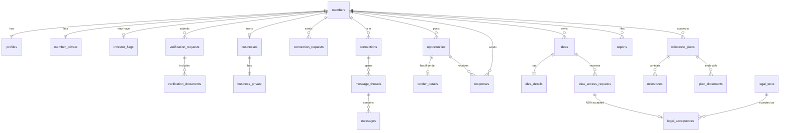

# Kingdom Connect: database schema and access rules

| Item | Detail |
|---|---|
| Version | 0.2 (design), updated 22 October 2026 for the nationwide scope, milestone plans and the four accepted IDs |
| Ticket | [Database schema and access rules](https://github.com/clainkavit/kingdom-connect/issues/12) |
| Built on | [docs/prd.md](prd.md) section 16 and the decisions merged up to 22 October 2026 (tickets #3 to #7, #10, #11, #15) |
| Stack | Supabase: Postgres with Row-Level Security (RLS), Storage, Auth (PRD section 15) |
| Status | Being built. Sections 1 to 3, 5 and 10 are migrated (F04, #42) in `supabase/migrations/`, tested as in PRD section 17. The rest is still design |

This document lists every table, who can read and write it, and the database functions that hide private data. The rule behind all of it: **the server decides what each person may see; the app only hides what they don't need** (PRD section 16, Access rules).

## 1. Conventions

- Every table has `id uuid` (random) as its primary key, plus `created_at` and `updated_at` timestamps, except `private.audit_log` and `legal_acceptances`, which are never updated and so have only `created_at`. Member and staff IDs equal the Supabase Auth user ID, and one sign-in account is a member or staff, never both.
- Statuses are `text` with a `CHECK` list of allowed values, not Postgres enums, so values can be added or removed later.
- Money is `numeric` in Tanzanian shillings (TZS). Times are `timestamptz`.
- No table or value hard-codes the community or platform name. Names come from `platform_settings` so the schema survives the national pivot (map ticket #1).
- Tables live in two schemas:
  - `public`: app tables, every one with RLS turned on.
  - `private`: login internals and the audit log. No app user (`anon` or `authenticated`) can read or write it. Only database functions and Edge Functions reach it.

## 2. The base rule on every table

Every `public` table carries a **restrictive** RLS base rule that must pass before any other policy counts:

> The request comes from a session whose email code is verified (`otp_verified` claim), and the account is an approved member or an active staff account.

This follows the login design in [context/memory/supabase-auth-login-flow.md](../context/memory/supabase-auth-login-flow.md). A session with only a password, an applicant, or a suspended account reads nothing from the member tables.

Decided 1 Nov (F04, #42):

- **Status is read from the tables**, not from a token claim, so a suspension or rejection takes effect on the next request. The email-code step comes from the `otp_verified` claim that the access token hook adds (F09).
- **The shared lists are the exception.** `regions`, `districts`, `sectors`, `platform_settings` and `legal_texts` are readable by any signed-in session, applicants included, so the address step works. Writing them still needs the strict rule. Signed-out visitors can read one row only, `platform_settings` key `platform_name`, so the sign-in screens can show the name (F07, decided 2 Nov 2026).
- **Signed-out visitors get no table privilege** on `public` tables, with explicit exceptions: the `platform_name` row of `platform_settings` (above), and later the terms and privacy in `legal_texts`, granted when it lands.

**Applicants** (pending or rejected) reach only their own application, and only through these functions (section 9): view status, upload documents, edit and resubmit.

**Helper functions** used inside policies (each `security definer`, read-only). They live in the `access` schema, which the API does not expose, so policies can call them but no app user can call them directly:

| Function | Returns true when |
|---|---|
| `is_member()` | The caller is an approved member with a verified session who has accepted the current terms of use and privacy notice (R05b). Until they accept, every member table refuses them |
| `is_approved_member()` | An approved member with a verified session, accepted or not. Only `legal_acceptances` uses it, so a member can accept |
| `set_my_phone(phone)`, `set_my_address(address)` | The member changes their own phone (+255 and 9 digits, spaces allowed) or address (up to 300 characters); each change is audit logged with before and after, and a phone change sends E2 (R08b) |
| `change-email` Edge Function | The password (counted toward the login lockout), then a 6-digit code sent to the new address (`private.email_changes`, 10 minutes, 3 tries, 10 codes an hour). An address already in use gets the same answer and no working code, so the member cannot find out who is registered. On the code it changes the sign-in email; the `sync_member_email` trigger on `auth.users` then changes the contact email in the same transaction, logs it and sends E1, whichever way the sign-in email changed. A notice also goes to the old address |
| `my_language()`, `set_my_language(chosen)` | The caller's saved language, read and changed by an approved member even before accepting, so a choice on S03 or S07 is kept |
| `accepted_terms_and_privacy()` | The caller has accepted the current version of the terms and the privacy notice (true while none is in effect) |
| `is_staff()` | The caller is an active Administrator or Super Administrator |
| `is_super_admin()` | The caller is an active Super Administrator |
| `is_connected(a, b)` | Members `a` and `b` have an accepted connection |
| `is_blocked(a, b)` | Either member has blocked the other |
| `member_level(id)` | The member's highest approved level (1, 2 or 3); 0 for anyone who is not an approved member |

## 3. Accounts and identity

Private data sits in its own tables, so each rule is "this whole table is admin-only" rather than hiding single fields.

| Table | Key columns | Who can read | Who can write |
|---|---|---|---|
| `members` | `id` (= auth user), `username` (citext, unique), `status` (pending, approved, rejected, suspended, deactivated, deleted), `category`, `resubmissions_used`, `posting_suspended_until`, `approved_at` | The member; staff | Staff change `status`; the member changes nothing here directly |
| `staff` | `id` (= auth user), `full_name`, `role` (admin, super_admin), `active` | Staff | Super Admin only. New staff are invited through the `create-staff` Edge Function, which sends a set-password email. The database refuses a change that deactivates or demotes the caller's own account, or removes the last active Super Admin |
| `profiles` | `member_id`, `full_name` (locked once verified; staff change it), `headline`, `bio`, `photo_path` (optional public photo, never the verification face photo), `region_id`, `district_id`, `profession`, `experience`, `certifications`, `category_details` (business name and sector, what an entrepreneur is building, or a description), `study_institution`, `study_course`, `study_year`, `hidden_from_directory`, `last_active_at` | Approved members, unless hidden or blocked; a hidden profile stays visible to the owner and existing connections; staff | The owner |
| `profile_skills` | `member_id`, `skill_id` | Same as `profiles` | The owner |
| `member_private` | `member_id`, `email`, `phone` (must start with +255), `address`, `id_type` (nida, passport, driving_licence, voters_id), `id_encrypted` (bytea), `id_fingerprint` (unique), `id_expires_on` (date, optional), `share_phone`, `share_email`, `share_address` (all false by default), `language` (en, sw) | The owner; staff. **Never** other members: they use `get_contact_details()` | The owner, only `share_phone`, `share_email`, `share_address` and `language`. `email`, `phone` and `address` are written at sign-up and registration only; `id_*` only by the registration function |
| `investor_flags` | `member_id`, `granted_by` (staff), `route` (invitation, application), `sector_focus`, `ticket_band` (under_10m, 10m_to_50m, over_50m), `granted_at`, `revoked_at` | The investor themselves (so the app shows investor tools); staff. **No other member, ever** | Staff |

**Admin accounts are separate.** A staff account has no member profile and cannot connect, message, apply or post ideas. A staff person who also wants to network uses a separate member account.

**ID number.** Whichever accepted ID the member registers with (NIDA, passport, driving licence or voter's ID) is encrypted in the database with `pgcrypto`, using a key held in Supabase Vault. `id_fingerprint` is a keyed one-way hash (HMAC) of the ID type plus the number, so the same ID cannot register twice, without decrypting anything. A NIDA number must be 20 digits (checked by the registration function). The number is never stored in the wizard draft: step 4 sends it to the `save-identity` Edge Function, which calls `private.set_identity()` to encrypt it (Vault key `id_encryption_key`) and fingerprint it (Vault key `id_fingerprint_key`) at once. A duplicate is refused and written to the audit log as `registration.duplicate_id` for admins. Staff compare face photos to catch one person using two different IDs, and mark the suspected duplicate on the verification request. Only staff can decrypt a number, through `reveal_id_number(member_id)`, which writes an audit log entry.

## 4. Verification

| Table | Key columns | Who can read | Who can write |
|---|---|---|---|
| `verification_requests` | `member_id`, `level` (1, 2, 3), `status` (pending, approved, rejected, expired), `reviewer_id` (staff), `reason_code` (from `rejection_reasons`), `reason_note` (up to 500 characters, no contact details), `reason` (the text sent to the applicant, in their language), `duplicate_suspected_of` (member, optional), `submitted_at`, `decided_at` | The member (own, without reviewer notes, via the `application-status` Edge Function); staff | The applicant functions create it. Staff decide it only through the `decide-application` Edge Function (`private.decide_application()`) and mark a duplicate through `mark-duplicate` (`private.mark_duplicate()`); both write the audit log. No one updates the table directly |
| `rejection_reasons` | `code`, `label_en`, `label_sw`, `sort`, `needs_note` | Staff | Migrations only |
| `verification_documents` | `request_id`, `kind` (face_photo, id_photo, brela, tin, licence, directorship, authorisation_letter), `storage_path`, `delete_after` (set once the request is decided; the retention period is open for the lawyer) | Staff | Written by `private.submit_registration()` from the files in Storage; staff |
| `registration_drafts` | `member_id`, `step` (1 to 6), `data` (the wizard answers, never the ID number), `submitted_at` | The Applicant (own). **Never staff**: a draft is not an application | The Applicant, until they submit |
| `businesses` | `member_id`, `name`, `sector_id`, `size`, `description`, `logo_path`, `level` (2, 3), `status` (pending, approved, rejected, expired) | Approved members see approved businesses; the owner; staff | The owner edits while not approved; staff approve |
| `business_private` | `business_id`, `brela_no`, `tin`, `licence_no`, `licence_expires_on`, `address` | The owner; staff | The owner while pending; staff |

## 5. Shared lists and matching

| Table | Key columns | Who can read | Who can write |
|---|---|---|---|
| `regions`, `districts` | Tanzanian regions and districts, `name_en`, `name_sw` | Everyone signed in, including applicants | Staff |
| `sectors` | Fixed list, `name_en`, `name_sw` | Everyone signed in | Staff |
| `skills` | `name` (citext, lowercased and trimmed, unique) | Approved members | Members create new tags only through the `set-skills` Edge Function (`private.set_skills()`, up to 20 skills of 40 characters, synonyms applied); staff create and merge |
| `skill_synonyms` | `from_name`, `skill_id` | Approved members | Staff (PRD section 10, Matching rules). Adding one moves profiles that used the variant onto the skill and removes the variant; audit logged |
| `matching_settings` | `feature` (scan, people), `signal`, `points`, `min_score` | Staff | Super Admin, audit logged (PRD section 10, Matching rules) |
| `platform_settings` | `key`, `value` (`platform_name`, `legal_entity_name`, `real_registrations_open` (off until all five legal texts are approved at 1.0; the database refuses to switch it on before that), `test_data_only` (on in local and test environments, off in production; sign-up works when either this or `real_registrations_open` is on), featured slot limit, `daily_application_cap`: `null` when off, the default, or a whole number of sign-ups a day from 1 to 999999, counted midnight to midnight Tanzania time; the database refuses any other value) | Everyone signed in; signed-out visitors read the `platform_name` and `legal_entity_name` rows only. The registration function reads the cap for signed-out visitors | Super Admin, audit logged |

Matching scores are worked out when a page opens and are not stored (PRD section 10). The investor flag is never an input to matching.

## 6. Connections and messages

| Table | Key columns | Who can read | Who can write |
|---|---|---|---|
| `connection_requests` | `requester_id`, `receiver_id`, `note` (max 300), `status` (sent, accepted, declined, withdrawn), `responded_at`, `expires_at` (30 days after sending; a request past it counts as expired) | The two members, but never `status`, `responded_at` or `updated_at`, so the sender cannot tell a decline. Lists come from `my_received_requests()` and `my_sent_requests()` | The requester sends (max 30 a Tanzania day, in the insert policy and the insert trigger; one open request per pair; not to a connection, a block either way, a non-member or when the other already asked) and withdraws; the receiver accepts or declines an open request. Accepting creates the connection, closes any other open request between the two, and sends C2; sending sends C1. Asking someone you declined accepts their request instead of creating a new one |
| `connections` | `member_a`, `member_b` (stored with a < b), `connected_at` | The two members | Created when a request is accepted; either member removes it |
| `blocks` | `blocker_id`, `blocked_id` | The blocker only, with names through `my_blocks()` | The blocker. A block removes the connection and closes open requests both ways; neither side's list then shows the other |
| `message_threads` | `member_a`, `member_b` (stored with a < b), `idea_id`, `opportunity_id`, `status` (active, reported, closed), `reported_at`, `last_message_at` | The two members; staff only when `status` is reported | One per pair without a label, opened by either member of a connection (R10); each idea or opportunity gets its own labelled thread (Release 2), opened by an approved idea request or a response. Members can keep sending after a report. `status` is set to reported by `report()` (R11) |
| `messages` | `thread_id`, `sender_id`, `body` (up to 4000 characters), `deleted_at` | Same as the thread | The sender, only while connected and not blocked. The sender deletes their own message until the thread is reported; deleting clears `body` and removes its attachments. A new message sends C3 to the other member unless one was already sent since they last opened the thread. In the Realtime publication, so open threads update live |
| `message_attachments` | `message_id`, `storage_path` (`<thread>/<message>/<file>`), `file_name`, `mime` (PDF, JPEG, PNG, WebP), `size` (max 10 MB) | Same as the thread | The sender, while they can send |
| `thread_reads` | `thread_id`, `member_id`, `last_read_at` (set by the server) | The member (own) | The member, for a thread they can read. Drives the unread dot; never shown to the other member |

## 7. Opportunities

| Table | Key columns | Who can read | Who can write |
|---|---|---|---|
| `opportunities` | `poster_member_id` or `poster_staff_id` (exactly one), `type` (job, partnership, collaboration, investment, tender), `title`, `role`, `employment_type`, `region_id`, `district_id`, `remote`, `sector_id`, `description`, `closing_at`, `no_fee_declared`, `featured_at`, `status` (draft, pending_review, published, closed, expired, hidden, removed) | Approved members see published ones; the poster sees their own; staff see all | Level 3 members and staff create; the poster edits drafts; staff moderate |
| `opportunity_skills` | `opportunity_id`, `skill_id` (1 to 5) | Same as the opportunity | The poster |
| `tender_details` | `opportunity_id`, `issuing_org`, `reference_no`, `scope`, `eligibility`, `required_documents`, `estimated_value_tzs`, `document_path` | Same as the opportunity | The poster |
| `responses` | `opportunity_id`, `member_id`, `kind` (application, interest), `note`, `attachment_path`, `status` (new, shortlisted, declined, withdrawn); unique per member and opportunity | The member who responded; the poster of that opportunity; staff | Members create (a tender requires `member_level() >= 2`); the poster changes status; the member withdraws |

Reporting an opportunity sets it to `hidden` at once, through `report()` (section 9).

## 8. Ideas and milestone plans

| Table | Key columns | Who can read | Who can write |
|---|---|---|---|
| `ideas` | `owner_id`, `title`, `problem`, `sector_id`, `stage`, `seeking` (investor, partner, both), `investment_min_tzs`, `investment_max_tzs`, `show_owner`, `status` (draft, pending_moderation, published, archived, hidden, removed) | The owner; staff. Members read summaries only through the view `idea_summaries`, which blanks the owner when `show_owner` is false | The owner; staff moderate |
| `idea_details` | `idea_id`, `description`, `business_model`, `market`, `financials`, `team` | The owner; members whose request is `nda_accepted` and not revoked; staff | The owner |
| `idea_files` | `idea_id`, `storage_path`, `size` (20 MB total per idea) | Same as `idea_details`, through watermarked links only | The owner |
| `idea_access_requests` | `idea_id`, `requester_id`, `role`, `anonymous`, `status` (pending, approved, declined, nda_accepted, revoked), `nda_acceptance_id`, `decided_at`, `revoked_at` | The requester (own); staff. The owner only through `requests_for_my_idea()` | The requester creates (`anonymous` only with an investor flag); the owner decides or revokes |
| `idea_views` | `idea_id`, `viewer_id`, `kind` (summary, detail, download), `viewed_at` | Staff only. The owner gets a count through `investor_view_count()` | Written by the read functions |
| `saved_ideas` | `investor_id`, `idea_id` | The investor | The investor (requires an investor flag) |
| `milestone_plans` | `member_a`, `member_b`, `idea_id` or `opportunity_id` (exactly one), `started_by`, `status` (pending, active, completed, lapsed, withdrawn, ended), `a_acceptance_id`, `b_acceptance_id` (hand-off disclaimer acceptances), `stage1_agreed_at`, `expires_at` (14 days while pending), `withdrawn_by`, `withdrawn_at`, `ended_by`, `ended_reason`, `ended_at`, `completed_at` | The two members; staff (names, item, stage statuses, dates and notes only) | The two members, through the plan functions below. Both must be approved members with an accepted connection that came from that idea or opportunity. No minimum level |
| `milestones` | `plan_id`, `position` (1 to 10; 1 is always "Agreed in principle"), `title`, `description`, `target_date`, `responsible_member_id`, `status` (open, done, confirmed), `done_at`, `confirmed_at` | The two members; staff | The responsible member marks done, the other confirms. A confirmed milestone is never edited or removed |
| `plan_documents` | `plan_id`, `uploaded_by`, `storage_path`, `size` (max 10 MB), `uploaded_at`; one per member per plan | The two members. Staff only while a report is open on that plan | The two members upload once the milestones before it are confirmed |
| `plan_annotations` | `plan_id`, `staff_id`, `note` | Staff | Staff add; nobody edits or deletes |

**Anonymous investors.** `requests_for_my_idea()` returns "A verified investor", the sector focus and the ticket band for an anonymous request, with the requester's identity blank, until the requester accepts the NDA. Only then does it return their name and profile. Investor silent browsing is logged in `idea_views`, and the owner only ever sees the count.

## 9. Legal texts, learning, safety and notifications

| Table | Key columns | Who can read | Who can write |
|---|---|---|---|
| `legal_texts` | `kind` (terms, privacy, nda, ip, handoff), `version` (major.minor, loaded once per kind), `body_en`, `body_sw` (with `{entity_name}` and `{platform_name}`), `approved_at`, `effective_at` | Everyone, including applicants and signed-out visitors for terms and privacy | Super Admin, or `pnpm legal:load` from the files in `legal/` (PRD section 13, Legal texts) |
| `legal_acceptances` | `member_id` (defaults to the caller), `legal_text_id`, `accepted_at`, `ip_address` (from the request), `context_type` (registration, reaccept, idea_access, plan), `context_id` | The member (own); staff | A Member inserts their own re-acceptance (S07); registration (R01), NDA and IP (I04) and hand-off (P01) acceptances are written by those tickets' functions. A trigger allows only the current version, and each acceptance is recorded once. **Never updated or deleted**, so it has `created_at` only; a member's row is never hard-deleted (section 14) |
| `trainings` | `poster_member_id` or `poster_staff_id`, `title`, `provider`, `format`, `starts_at` (empty if self-paced), `seats`, `downloads_allowed`, `status` | Approved members see published ones; the poster; staff | Members create (pending review); staff create and moderate |
| `training_materials` | `training_id`, `kind` (file, link), `storage_path`, `url` | Members registered for that training; the poster; staff | The poster |
| `events` | `poster_member_id` or `poster_staff_id`, `title`, `starts_at`, `venue`, `link`, `capacity`, `image_path`, `status` | Approved members see published ones; the poster; staff | Level 2 and up, and staff |
| `registrations` | `member_id`, `training_id` or `event_id`, `status` (registered, waitlisted, cancelled, attended), `waitlist_position` | The member (own); the poster sees names and profiles only through `registrants()`; staff | The member registers or cancels; a function moves the first waitlisted member up |
| `news_items` | `staff_id`, `title`, `body`, `image_path`, `pinned`, `status` (draft, published) | Approved members see published ones; staff | Staff |
| `reports` | `reference_no` (KC-year-000123: the Tanzania year and one running number that does not restart each year; it grows past six digits), `reporter_id`, `target_type` (profile, opportunity, idea, thread, plan), `subject_id` (the reported member: the profile's owner or the other member of the thread; reports on one item about one member form a case), `target_id`, `reason` (asked_for_money, fake_job_or_business, harassment, impersonation, spam, other), `note` (up to 1000), `screenshot_path` (in the reporter's own `report-files` folder, used by one report only), `status` (open, under_review, action_taken, no_action), `decided_by`, `decided_at` | The reporter sees reference number and outcome only, through `my_reports()`; staff | Members create through `report()`; staff decide (R12) |
| `moderation_actions` | `staff_id`, `subject_id` (the member acted on), `target_type`, `target_id`, `action` (no_action, restore, edit_request, remove, warn, suspend_posting, suspend_account, lift_posting_pause, reinstate_account), `note` (required, staff only), `member_message` (the reason the member is told; required for warn and both suspensions), `report_ids` (the reports the decision closed), `automatic` (set by the repeat-offender rule) | Staff | Only through `decide_report()`, `lift_posting_pause()` and `reinstate_account()`; never changed afterwards. Audit logged |
| `notifications` | `member_id`, `kind` (the docs/notifications.md code, A1 to H2), `payload`, `read_at` | The member (own) | `private.notify()` only, which refuses contact details in `payload` and never names the investor in an anonymous interest (I2). Members can only set `read_at` |
| `notification_preferences` | `member_id`, `category`, `email`, `push` (one row per category; no row means on). The push master switch comes with the mobile apps (M03) | The member (own) | The member |
| `push_tokens` | `member_id`, `token`, `platform` (android, ios) | The member (own) | The member's app (PRD section 14, Push notifications) |

## 10. Private schema

| Table | Purpose | Access |
|---|---|---|
| `private.login_attempts` | Failed password count and `locked_until` (5 failures lock for 15 minutes) | The login Edge Function |
| `private.login_otps` | Email code **hashes** (never the plain code), `expires_at` (10 minutes), `attempts` (max 3), `consumed_at` | The login and verify Edge Functions |
| `private.mfa_sessions` | Sessions that passed the email code; feeds the `otp_verified` claim | The verify Edge Function and the access token hook. Rows are deleted on logout and expiry |
| `private.email_outbox` | One queued email per notification, plus the daily message digest: `kind`, `payload`, `status` (pending, sending, sent, skipped, failed), `attempts`, `last_error` | Written by `private.notify()` and `private.queue_message_digests()`. The `send-notification-emails` Edge Function sends it every minute (pg_cron), skipping categories a member switched off unless they are critical |
| `private.audit_log` | `actor_member_id` or `actor_staff_id`, `action`, `target_type`, `target_id`, `before`, `after`, `ip_address`, `created_at` | **Append only.** Written by database triggers and functions whenever a logged action happens (PRD section 13, criterion 7). Super Admins read it through `audit_log()` (SAFE-4; decided 3 Nov). Triggers refuse every update, delete and truncate, for app users, `service_role` and the database owner alike; only someone with owner rights who first switches the trigger off could change a row. It has no foreign keys, so deleting a member's data leaves their entries in place. Kept at least 5 years |

## 11. Functions that guard private data

These run as `security definer`: they check who is calling, then return only what that person may see. They are the only way to reach the data marked "through" above.

| Function | What it returns |
|---|---|
| `get_contact_details(member_id)` | Phone, email and address, each only if the caller is an approved member and an accepted connection, neither side has blocked the other, the owner is approved, and the owner's matching share switch is on; otherwise no row. Runs as the caller; the checks are in `access.contact_details(member_id)`, which the API does not expose. Not for your own details, which you read from your own row |
| `application_status()` | The applicant's own state (drafting, under review with the expected working days, rejected, rejected final, approved) and the reason sent. No reviewer, reason code, queue place or queue size. Through the `application-status` Edge Function (`private.application_status()`) |
| `start_resubmission()` | After a first rejection: uses the one resubmission and reopens the draft on step 6. Through the `start-resubmission` Edge Function (`private.start_resubmission()`); logged |
| `reopen_application(request_id, note)` | Staff only, for the latest final rejection: reopens the draft without giving back the resubmission, sends A6. Through the `reopen-application` Edge Function (`private.reopen_application()`); logged with the note |
| `my_threads()` | The caller's threads that have messages, newest first: the other member's name and photo path, the last message (or that it was deleted), and whether it is unread. The name and photo follow the profile rules, so they are empty for a member who blocked you, whom you blocked, or who is hidden and no longer connected. Runs as the caller over `access.my_threads()` |
| `my_sent_requests()` | The caller's sent connection requests, with declined ones shown as "sent" until they expire. Runs as the caller over `access.my_sent_requests()` |
| `my_received_requests()` | The caller's open received requests with the sender's name, headline, photo path and note. Runs as the caller over `access.my_received_requests()` |
| `connection_state(member_id)` | none, sent, received or connected, between the caller and that member. Runs as the caller over `access.relation()` |
| `my_blocks()` | The members the caller blocked, with names, for S45. Runs as the caller over `access.my_blocks()` |
| `requests_for_my_idea(idea_id)` | Access requests for the owner's idea, with anonymous requesters masked until the NDA is accepted |
| `investor_view_count(idea_id)` | "Viewed by N investors" as a number only |
| `get_idea_file_link(file_id)` | A short-lived, watermarked file link, through an Edge Function. Logs the view |
| `registrants(training_or_event_id)` | Names and profiles of registrants, for the poster. No contact details |
| `report(target_type, target_id, reason, note, screenshot_path)` | Creates the report and returns its reference. One open report per reporter per item: a repeat returns the open one's reference. A member sends at most 10 reports a day (Tanzania time); more raises `daily_limit`. A profile must be an approved member other than you; a thread must be yours, and becomes reported (from active or closed) so staff can read it. Ideas, opportunities and plans are refused until Release 2, when reporting an opportunity also hides it at once. Runs as the caller over `access.report()` |
| `audit_log(actor_staff, actor_username, system_only, action_name, from_date, to_date, before_at, before_id, page_size)` | A13 for Super Admins only: entries newest first with the actor's kind (staff, member, system), id and name (the id stays when the account is deleted), the action, target, before, after and IP. Dates are Tanzania days, both ends included. Pages of 50 continue after the last entry's time and id |
| `audit_actions()` | Super Admins: the actions in the log, for the A13 filter |
| `report_queue()` | A06 for staff: one row per case (item and reported member) with open or under-review reports, oldest first: the first report's id and reference, target, member name, reasons, report count, status |
| `start_review(report)` | Staff open a case: its open reports become under_review |
| `decide_report(report, action, note, member_message)` | Staff decide a whole case: no_action, warn, suspend_posting or suspend_account (Release 1; restore, edit_request and remove arrive with posts). Every open report in the case closes as no_action or action_taken and each reporter gets R2 or R1. Warn sends X3, suspend_posting sets `posting_suspended_until` to infinity (until lifted) and sends X2, suspend_account sets the status to suspended, which signs the member out, and sends X1, each with `member_message` as {reason}. Repeat rule (PRD section 13, criterion 5, counted per member until businesses arrive): a second upheld decision in 12 months pauses posting, a third suspends the account, as automatic actions |
| `lift_posting_pause(member, note)`, `reinstate_account(member, note)` | Staff end a posting pause or a suspension, with a note. No notification yet |
| `upheld_decisions(member)` | Staff: the member's upheld decisions (warn or a suspension, not automatic) in the last 12 months and after the latest lift or reinstatement; the count the repeat rule uses |
| `my_reports()` | The caller's reports: reference, outcome (open, action_taken, no_action) and date only. Runs as the caller over `access.my_reports()` |
| `reveal_id_number(member_id)` | The decrypted ID number, for staff only; logged as `id.revealed`. Called through the `reveal-id-number` Edge Function, as `private.reveal_id_number()` |
| `propose_plan()`, `accept_plan()`, `mark_milestone_done()`, `confirm_milestone()`, `withdraw_plan()`, `end_plan(plan_id, reason)`, `upload_plan_document()` | The milestone plan steps. They check the caller is one of the two members, enforce the 14-day lapse, the 1-hour withdrawal window after both accept stage 1, that ending a plan after the first hour needs a reason, and that a confirmed milestone is never changed. A scheduled job sends the day-7 reminder and lapses expired plans |
| `search_directory(q, profession, skill, sector, region, district, studying, page)` | S10 cards: name, headline, region and district names, top 3 skills, level and photo path, 20 a page. Runs as the caller (not security definer), so the profile rules decide who is listed; hidden profiles are never listed. No contact field is in the result. Matching uses trigram indexes through `access.directory_matches(q)`, which returns member ids and match ranks only, ignores the profile rules, and is never exposed by the API; the outer search applies the rules. Search words are matched as plain text (`access.like_pattern()`), so `%` and `_` are not wildcards |
| `member_dashboard()` | S08 for an approved member: their own name, region and district (English and Kiswahili), level and whether their posting is paused. It holds no count of any kind, so no platform-wide or admin-only figure can reach a member (PRD section 7, criterion 1) |
| `admin_dashboard_stats()` | The community counts (verified members, registered businesses, open opportunities, ideas in the pool), for staff only. Built in R15 with the Release 1 counts only (the other counts are added by their tickets): verified members, pending Level 1 verifications as their submission times, rejected members, open report cases, sign-ups today and the daily cap; non-staff get `not_allowed`. A member's dashboard has no platform-wide counts (PRD section 7, criterion 1) |

## 12. File storage

All buckets are private. No file is ever at a public web address. Files are opened through Storage policies or short-lived signed links.

| Bucket | Who can open a file |
|---|---|
| `avatars` | Approved members, and the owner |
| `identity-documents` (face photo and ID photo, at `<member_id>/face` and `<member_id>/id`; JPEG, PNG or WebP up to 5 MB) | The owner, who can add or replace them only until the application is submitted; staff |
| `business-documents` | The owner and staff |
| `response-files` (CVs and attachments) | The member who sent it, the opportunity's poster, staff |
| `idea-files` | Through `get_idea_file_link()` only: the owner and NDA-accepted members, watermarked |
| `report-files` | Staff only. A member uploads one screenshot (JPEG, PNG, WebP, up to 5 MB) into their own folder and cannot open it again; they can remove it only while no report uses it, so a repeat or failed report leaves nothing behind |
| `message-files` | The two members in the thread; staff only if it is reported. Private, 10 MB, PDF and images only. A file is readable only while its attachment row exists, so a deleted message's file cannot be opened; the sender's app also removes the file when deleting, until the thread is reported |
| `learning-materials` | Members registered for that training, the poster, staff |
| `public-media` (tender documents, event and news images) | Approved members |
| `plan-documents` (signed agreements) | The two members in the plan; staff only while a report is open on that plan |
| `report-screenshots` | The reporter and staff |

## 13. Encryption

- **ID numbers (NIDA, passport, driving licence, voter's ID):** encrypted column with the key in Supabase Vault, plus a keyed fingerprint for duplicate checks (section 3).
- **Everything else, including messages and documents:** the hosting's disk encryption. Managed Supabase encrypts at rest with AES-256. If production is self-hosted (the Hostinger option in PRD section 15), disk encryption must be on the hosting checklist.
- Messages are not encrypted one by one: that would stop admins reading a reported thread and make searching impossible.

## 14. When a member deletes their data

Under the Personal Data Protection Act a member can ask for their data to be deleted.

1. Their `profiles`, `member_private`, `investor_flags`, verification documents, uploaded files and notification data are deleted for good.
2. Their `members` row stays as a placeholder with `status` deleted, and the app shows them as "Deleted member". Other people's message threads, responses and milestone plans stay readable. The other member keeps their copy of any signed document; the lawyer review confirms this.
3. `private.audit_log` entries are kept for 5 years (PRD section 13).
4. The lawyer review (PRD section 13) confirms exactly what must be kept. This list is adjusted to match.

Built in R16 (pending the lawyer review): the `delete-my-data` Edge Function (approved, pending or rejected accounts only) lists the member's files with `private.member_file_paths()` (avatar, ID documents including unsubmitted ones, report screenshots, attachments they sent, and anything else in their own folders), then `private.delete_member_data()` deletes in one transaction their profile and skills, `member_private`, investor flag, verification documents, registration draft, connections, requests both ways, their blocks, thread read marks, notifications, preferences, push tokens, queued emails and login records. The `members` row becomes `deleted` with the username `deleted_<id>`. Their messages stay in the other member's thread (text only), and their reports, moderation actions, verification decisions and legal acceptances stay. After the transaction it removes the files through Storage, then the sign-in account's email becomes `deleted-<id>@deleted.invalid`, its phone is cleared and it is banned, so the email can register again. A file or sign-in step that fails is written to the audit log as `member.deletion_unfinished` for staff to finish. The apps show the member as "Deleted member" (`deleted_members(ids)` tells the member app which names are missing because of deletion). `my_data_export()` gives an approved member their own data as JSON; the ID number stays encrypted and is not exported.

## 15. Diagram of the main records

## 16. Follow-ups

- **Nationwide scope (map ticket #30).** The schema holds no church or community data. Church references and the founding list were removed on 22 Oct. If the platform name changes, only `platform_settings` changes.
- **ID verification services.** If a NIDA verification connection or Persona is added later (ticket #30), a new table for the check results is added then.
- **Production hosting.** Disk encryption and Vault must work on whatever host is chosen (PRD section 15).
- **Deletion list and retention.** The lawyer review (PRD section 13) confirms what must be kept, how long ID photos are kept, and what happens to signed documents when one member deletes their data.
- **Access-rule tests.** Every "Who can read" cell above is a test case for the access-rule tests in PRD section 17.
