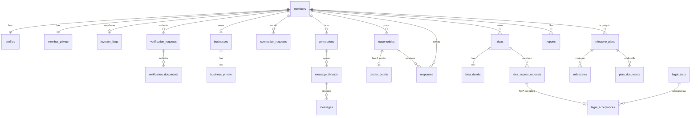

# Kingdom Connect: database schema and access rules

| Item | Detail |
|---|---|
| Version | 0.2 (design), updated 22 October 2026 for the nationwide scope, milestone plans and the four accepted IDs |
| Ticket | [Database schema and access rules](https://github.com/clainkavit/kingdom-connect/issues/12) |
| Built on | [docs/prd.md](prd.md) section 16 and the decisions merged up to 22 October 2026 (tickets #3 to #7, #10, #11, #15) |
| Stack | Supabase: Postgres with Row-Level Security (RLS), Storage, Auth (PRD section 15) |
| Status | Design. The SQL migrations are written when the build starts (ticket #16) and tested as in PRD section 17 |

This document lists every table, who can read and write it, and the database functions that hide private data. The rule behind all of it: **the server decides what each person may see; the app only hides what they don't need** (PRD section 16, Access rules).

## 1. Conventions

- Every table has `id uuid` (random) as its primary key, plus `created_at` and `updated_at` timestamps. Member and staff IDs equal the Supabase Auth user ID.
- Statuses are `text` with a `CHECK` list of allowed values, not Postgres enums, so values can be added or removed later.
- Money is `numeric` in Tanzanian shillings (TZS). Times are `timestamptz`.
- No table or value hard-codes the community or platform name. Names come from `platform_settings` so the schema survives the national pivot (map ticket #1).
- Tables live in two schemas:
  - `public`: app tables, every one with RLS turned on.
  - `private`: login internals and the audit log. No app user (`anon` or `authenticated`) can read or write it. Only database functions and Edge Functions reach it.

## 2. The base rule on every table

Every `public` table carries one **restrictive** RLS policy that must pass before any other policy counts:

> The request comes from a session whose email code is verified (`otp_verified` claim), and the account is an approved member or an active staff account.

This follows the login design in [context/memory/supabase-auth-login-flow.md](../context/memory/supabase-auth-login-flow.md). A session with only a password, an applicant, or a suspended account reads nothing from the member tables.

**Applicants** (pending or rejected) reach only their own application, and only through these functions (section 9): view status, upload documents, edit and resubmit.

**Helper functions** used inside policies (each `security definer`, read-only):

| Function | Returns true when |
|---|---|
| `is_member()` | The caller is an approved member with a verified session |
| `is_staff()` | The caller is an active Administrator or Super Administrator |
| `is_super_admin()` | The caller is an active Super Administrator |
| `is_connected(a, b)` | Members `a` and `b` have an accepted connection |
| `is_blocked(a, b)` | Either member has blocked the other |
| `member_level(id)` | The member's highest approved level (1, 2 or 3) |

## 3. Accounts and identity

Private data sits in its own tables, so each rule is "this whole table is admin-only" rather than hiding single fields.

| Table | Key columns | Who can read | Who can write |
|---|---|---|---|
| `members` | `id` (= auth user), `username` (citext, unique), `status` (pending, approved, rejected, suspended, deactivated, deleted), `category`, `resubmissions_used`, `posting_suspended_until`, `approved_at` | The member; staff | Staff change `status`; the member changes nothing here directly |
| `staff` | `id` (= auth user), `full_name`, `role` (admin, super_admin), `active` | Staff | Super Admin only |
| `profiles` | `member_id`, `full_name`, `headline`, `bio`, `photo_path`, `region_id`, `district_id`, `profession`, `experience`, `certifications`, `study_institution`, `study_course`, `study_year`, `hidden_from_directory`, `last_active_at` | Approved members, unless hidden or blocked; a hidden profile stays visible to the owner and existing connections; staff | The owner |
| `profile_skills` | `member_id`, `skill_id` | Same as `profiles` | The owner |
| `member_private` | `member_id`, `email`, `phone` (must start with +255), `address`, `id_type` (nida, passport, driving_licence, voters_id), `id_encrypted` (bytea), `id_fingerprint` (unique), `id_expires_on` (date, optional), `share_phone`, `share_email`, `share_address` (all false by default), `language` (en, sw) | The owner; staff. **Never** other members: they use `get_contact_details()` | The owner, except `id_*`, which only the registration function writes |
| `investor_flags` | `member_id`, `granted_by` (staff), `route` (invitation, application), `sector_focus`, `ticket_band` (under_10m, 10m_to_50m, over_50m), `granted_at`, `revoked_at` | The investor themselves (so the app shows investor tools); staff. **No other member, ever** | Staff |

**Admin accounts are separate.** A staff account has no member profile and cannot connect, message, apply or post ideas. A staff person who also wants to network uses a separate member account.

**ID number.** Whichever accepted ID the member registers with (NIDA, passport, driving licence or voter's ID) is encrypted in the database with `pgcrypto`, using a key held in Supabase Vault. `id_fingerprint` is a keyed one-way hash (HMAC) of the ID type plus the number, so the same ID cannot register twice, without decrypting anything. A NIDA number must be 20 digits (checked by the registration function). Staff compare face photos to catch one person using two different IDs, and mark the suspected duplicate on the verification request. Only staff can decrypt a number, through `reveal_id_number(member_id)`, which writes an audit log entry.

## 4. Verification

| Table | Key columns | Who can read | Who can write |
|---|---|---|---|
| `verification_requests` | `member_id`, `level` (1, 2, 3), `status` (pending, approved, rejected, expired), `reviewer_id` (staff), `reason`, `duplicate_suspected_of` (member, optional), `submitted_at`, `decided_at` | The member (own, without reviewer notes, via `my_application_status()`); staff | The applicant functions create it; staff decide it |
| `verification_documents` | `request_id`, `kind` (id_photo, brela, tin, licence, directorship, authorisation_letter), `storage_path`, `delete_after` (set once the request is decided; the retention period is open for the lawyer) | The owner; staff | The owner uploads while the request is pending; staff |
| `businesses` | `member_id`, `name`, `sector_id`, `size`, `description`, `logo_path`, `level` (2, 3), `status` (pending, approved, rejected, expired) | Approved members see approved businesses; the owner; staff | The owner edits while not approved; staff approve |
| `business_private` | `business_id`, `brela_no`, `tin`, `licence_no`, `licence_expires_on`, `address` | The owner; staff | The owner while pending; staff |

## 5. Shared lists and matching

| Table | Key columns | Who can read | Who can write |
|---|---|---|---|
| `regions`, `districts` | Tanzanian regions and districts, `name_en`, `name_sw` | Everyone signed in, including applicants | Staff |
| `sectors` | Fixed list, `name_en`, `name_sw` | Everyone signed in | Staff |
| `skills` | `name` (citext, lowercased and trimmed, unique) | Approved members | Members create through tag entry; staff merge |
| `skill_synonyms` | `from_name`, `skill_id` | Approved members | Staff (PRD section 10, Matching rules) |
| `matching_settings` | `feature` (scan, people), `signal`, `points`, `min_score` | Staff | Super Admin, audit logged (PRD section 10, Matching rules) |
| `platform_settings` | `key`, `value` (community name, legal entity name, featured slot limit, `daily_application_cap`: off by default) | Everyone signed in. The registration function reads the cap for signed-out visitors | Super Admin, audit logged |

Matching scores are worked out when a page opens and are not stored (PRD section 10). The investor flag is never an input to matching.

## 6. Connections and messages

| Table | Key columns | Who can read | Who can write |
|---|---|---|---|
| `connection_requests` | `requester_id`, `receiver_id`, `note` (max 300), `status` (sent, accepted, declined, withdrawn, expired), `responded_at`, `expires_at` | The receiver; the requester through `my_sent_requests()`, which shows a declined request as "sent" until it expires | The requester sends or withdraws (max 30 a day, enforced in the insert policy); the receiver answers |
| `connections` | `member_a`, `member_b` (stored with a < b), `connected_at` | The two members | Created when a request is accepted; either member removes it |
| `blocks` | `blocker_id`, `blocked_id` | The blocker only | The blocker |
| `message_threads` | `member_a`, `member_b`, `idea_id`, `opportunity_id`, `status` (active, reported, closed), `reported_at` | The two members; staff only when `status` is reported | Created by a connection, an approved idea request or a response |
| `messages` | `thread_id`, `sender_id`, `body`, `deleted_at` | Same as the thread | The sender, only while connected and not blocked |
| `message_attachments` | `message_id`, `storage_path`, `mime`, `size` (max 10 MB) | Same as the thread | The sender |

## 7. Opportunities

| Table | Key columns | Who can read | Who can write |
|---|---|---|---|
| `opportunities` | `poster_member_id` or `poster_staff_id` (exactly one), `type` (job, partnership, collaboration, investment, tender), `title`, `role`, `employment_type`, `region_id`, `district_id`, `remote`, `sector_id`, `description`, `closing_at`, `no_fee_declared`, `featured_at`, `status` (draft, pending_review, published, closed, expired, hidden, removed) | Approved members see published ones; the poster sees their own; staff see all | Level 3 members and staff create; the poster edits drafts; staff moderate |
| `opportunity_skills` | `opportunity_id`, `skill_id` (1 to 5) | Same as the opportunity | The poster |
| `tender_details` | `opportunity_id`, `issuing_org`, `reference_no`, `scope`, `eligibility`, `required_documents`, `estimated_value_tzs`, `document_path` | Same as the opportunity | The poster |
| `responses` | `opportunity_id`, `member_id`, `kind` (application, interest), `note`, `attachment_path`, `status` (new, shortlisted, declined, withdrawn); unique per member and opportunity | The member who responded; the poster of that opportunity; staff | Members create (a tender requires `member_level() >= 2`); the poster changes status; the member withdraws |

Reporting an opportunity sets it to `hidden` at once, through `report()` (section 9).

## 8. Ideas and milestone plans

| Table | Key columns | Who can read | Who can write |
|---|---|---|---|
| `ideas` | `owner_id`, `title`, `problem`, `sector_id`, `stage`, `seeking` (investor, partner, both), `investment_min_tzs`, `investment_max_tzs`, `show_owner`, `status` (draft, pending_moderation, published, archived, hidden, removed) | The owner; staff. Members read summaries only through the view `idea_summaries`, which blanks the owner when `show_owner` is false | The owner; staff moderate |
| `idea_details` | `idea_id`, `description`, `business_model`, `market`, `financials`, `team` | The owner; members whose request is `nda_accepted` and not revoked; staff | The owner |
| `idea_files` | `idea_id`, `storage_path`, `size` (20 MB total per idea) | Same as `idea_details`, through watermarked links only | The owner |
| `idea_access_requests` | `idea_id`, `requester_id`, `role`, `anonymous`, `status` (pending, approved, declined, nda_accepted, revoked), `nda_acceptance_id`, `decided_at`, `revoked_at` | The requester (own); staff. The owner only through `requests_for_my_idea()` | The requester creates (`anonymous` only with an investor flag); the owner decides or revokes |
| `idea_views` | `idea_id`, `viewer_id`, `kind` (summary, detail, download), `viewed_at` | Staff only. The owner gets a count through `investor_view_count()` | Written by the read functions |
| `saved_ideas` | `investor_id`, `idea_id` | The investor | The investor (requires an investor flag) |
| `milestone_plans` | `member_a`, `member_b`, `idea_id` or `opportunity_id` (exactly one), `started_by`, `status` (pending, active, completed, lapsed, withdrawn, ended), `a_acceptance_id`, `b_acceptance_id` (hand-off disclaimer acceptances), `stage1_agreed_at`, `expires_at` (14 days while pending), `withdrawn_by`, `withdrawn_at`, `ended_by`, `ended_reason`, `ended_at`, `completed_at` | The two members; staff (names, item, stage statuses, dates and notes only) | The two members, through the plan functions below. Both must be approved members with an accepted connection that came from that idea or opportunity. No minimum level |
| `milestones` | `plan_id`, `position` (1 to 10; 1 is always "Agreed in principle"), `title`, `description`, `target_date`, `responsible_member_id`, `status` (open, done, confirmed), `done_at`, `confirmed_at` | The two members; staff | The responsible member marks done, the other confirms. A confirmed milestone is never edited or removed |
| `plan_documents` | `plan_id`, `uploaded_by`, `storage_path`, `size` (max 10 MB), `uploaded_at`; one per member per plan | The two members. Staff only while a report is open on that plan | The two members upload once the milestones before it are confirmed |
| `plan_annotations` | `plan_id`, `staff_id`, `note` | Staff | Staff add; nobody edits or deletes |

**Anonymous investors.** `requests_for_my_idea()` returns "A verified investor", the sector focus and the ticket band for an anonymous request, with the requester's identity blank, until the requester accepts the NDA. Only then does it return their name and profile. Investor silent browsing is logged in `idea_views`, and the owner only ever sees the count.

## 9. Legal texts, learning, safety and notifications

| Table | Key columns | Who can read | Who can write |
|---|---|---|---|
| `legal_texts` | `kind` (terms, privacy, nda, ip, handoff), `version`, `body_en`, `body_sw`, `approved_at`, `effective_at` | Everyone, including applicants and signed-out visitors for terms and privacy | Super Admin (PRD section 13, Legal texts) |
| `legal_acceptances` | `member_id`, `legal_text_id`, `accepted_at`, `ip_address`, `context_type`, `context_id` | The member (own); staff | Written by the acceptance functions only; never edited |
| `trainings` | `poster_member_id` or `poster_staff_id`, `title`, `provider`, `format`, `starts_at` (empty if self-paced), `seats`, `downloads_allowed`, `status` | Approved members see published ones; the poster; staff | Members create (pending review); staff create and moderate |
| `training_materials` | `training_id`, `kind` (file, link), `storage_path`, `url` | Members registered for that training; the poster; staff | The poster |
| `events` | `poster_member_id` or `poster_staff_id`, `title`, `starts_at`, `venue`, `link`, `capacity`, `image_path`, `status` | Approved members see published ones; the poster; staff | Level 2 and up, and staff |
| `registrations` | `member_id`, `training_id` or `event_id`, `status` (registered, waitlisted, cancelled, attended), `waitlist_position` | The member (own); the poster sees names and profiles only through `registrants()`; staff | The member registers or cancels; a function moves the first waitlisted member up |
| `news_items` | `staff_id`, `title`, `body`, `image_path`, `pinned`, `status` (draft, published) | Approved members see published ones; staff | Staff |
| `reports` | `reference_no`, `reporter_id`, `target_type` (profile, opportunity, idea, thread, plan), `target_id`, `reason`, `note`, `screenshot_path`, `status` (open, under_review, action_taken, no_action), `decided_by`, `decided_at` | The reporter sees reference number and outcome only, through `my_reports()`; staff | Members create through `report()`; staff decide |
| `moderation_actions` | `staff_id`, `target_type`, `target_id`, `action` (restore, edit_request, remove, warn, suspend_posting, suspend_account), `note` (required) | Staff | Staff |
| `notifications` | `member_id`, `kind`, `payload`, `read_at` | The member (own) | Database functions only, which never put an anonymous investor's identity or contact details in `payload` |
| `notification_preferences` | `member_id`, `category`, `email`, `push`, `master_push` | The member (own) | The member |
| `push_tokens` | `member_id`, `token`, `platform` (android, ios) | The member (own) | The member's app (PRD section 14, Push notifications) |

## 10. Private schema

| Table | Purpose | Access |
|---|---|---|
| `private.login_attempts` | Failed password count and `locked_until` (5 failures lock for 15 minutes) | The login Edge Function |
| `private.login_otps` | Email code **hashes** (never the plain code), `expires_at` (10 minutes), `attempts` (max 3), `consumed_at` | The login and verify Edge Functions |
| `private.mfa_sessions` | Sessions that passed the email code; feeds the `otp_verified` claim | The verify Edge Function and the access token hook. Rows are deleted on logout and expiry |
| `private.audit_log` | `actor_member_id` or `actor_staff_id`, `action`, `target_type`, `target_id`, `before`, `after`, `ip_address`, `created_at` | **Append only.** Written by database triggers and functions whenever a logged action happens (PRD section 13, criterion 7). All staff read it through `audit_log_view`. Nobody can update or delete a row, not even a Super Admin. Kept at least 5 years |

## 11. Functions that guard private data

These run as `security definer`: they check who is calling, then return only what that person may see. They are the only way to reach the data marked "through" above.

| Function | What it returns |
|---|---|
| `get_contact_details(member_id)` | Phone, email and address, each only if the caller is an accepted connection, not blocked, and the owner's matching share switch is on |
| `my_application_status()` | The applicant's own status ("Your application is being reviewed" while pending) and the rejection reason |
| `my_sent_requests()` | The caller's sent connection requests, with declined ones shown as "sent" until they expire |
| `requests_for_my_idea(idea_id)` | Access requests for the owner's idea, with anonymous requesters masked until the NDA is accepted |
| `investor_view_count(idea_id)` | "Viewed by N investors" as a number only |
| `get_idea_file_link(file_id)` | A short-lived, watermarked file link, through an Edge Function. Logs the view |
| `registrants(training_or_event_id)` | Names and profiles of registrants, for the poster. No contact details |
| `report(target_type, target_id, ...)` | Creates the report; hides an opportunity at once |
| `reveal_id_number(member_id)` | The decrypted ID number, for staff only; logged |
| `propose_plan()`, `accept_plan()`, `mark_milestone_done()`, `confirm_milestone()`, `withdraw_plan()`, `end_plan(plan_id, reason)`, `upload_plan_document()` | The milestone plan steps. They check the caller is one of the two members, enforce the 14-day lapse, the 1-hour withdrawal window after both accept stage 1, that ending a plan after the first hour needs a reason, and that a confirmed milestone is never changed. A scheduled job sends the day-7 reminder and lapses expired plans |
| `member_dashboard_stats()` | Community counts only. Never pending, rejected or investor counts (PRD section 7, criterion 1) |

## 12. File storage

All buckets are private. No file is ever at a public web address. Files are opened through Storage policies or short-lived signed links.

| Bucket | Who can open a file |
|---|---|
| `avatars` | Approved members, and the owner |
| `identity-documents` (ID photos) | The owner and staff |
| `business-documents` | The owner and staff |
| `response-files` (CVs and attachments) | The member who sent it, the opportunity's poster, staff |
| `idea-files` | Through `get_idea_file_link()` only: the owner and NDA-accepted members, watermarked |
| `message-files` | The two members in the thread; staff only if it is reported |
| `learning-materials` | Members registered for that training, the poster, staff |
| `public-media` (tender documents, event and news images) | Approved members |
| `plan-documents` (signed agreements) | The two members in the plan; staff only while a report is open on that plan |
| `report-screenshots` | The reporter and staff |

## 13. Encryption

- **ID numbers (NIDA, passport, driving licence, voter's ID):** encrypted column with the key in Supabase Vault, plus a keyed fingerprint for duplicate checks (section 3).
- **Everything else, including messages and documents:** the hosting's disk encryption. Managed Supabase encrypts at rest with AES-256. If production is self-hosted (the Hostinger option in PRD section 15), disk encryption must be on the hosting checklist.
- Messages are not encrypted one by one: that would stop admins reading a reported thread and make searching impossible.

## 14. When a member deletes their data

Under the Personal Data Protection Act a member can ask for their data to be deleted.

1. Their `profiles`, `member_private`, `investor_flags`, verification documents, uploaded files and notification data are deleted for good.
2. Their `members` row stays as a placeholder with `status` deleted, and the app shows them as "Deleted member". Other people's message threads, responses and milestone plans stay readable. The other member keeps their copy of any signed document; the lawyer review confirms this.
3. `private.audit_log` entries are kept for 5 years (PRD section 13).
4. The lawyer review (PRD section 13) confirms exactly what must be kept. This list is adjusted to match.

## 15. Diagram of the main records

## 16. Follow-ups

- **Nationwide scope (map ticket #30).** The schema holds no church or community data. Church references and the founding list were removed on 22 Oct. If the platform name changes, only `platform_settings` changes.
- **ID verification services.** If a NIDA verification connection or Persona is added later (ticket #30), a new table for the check results is added then.
- **Production hosting.** Disk encryption and Vault must work on whatever host is chosen (PRD section 15).
- **Deletion list and retention.** The lawyer review (PRD section 13) confirms what must be kept, how long ID photos are kept, and what happens to signed documents when one member deletes their data.
- **Access-rule tests.** Every "Who can read" cell above is a test case for the access-rule tests in PRD section 17.
